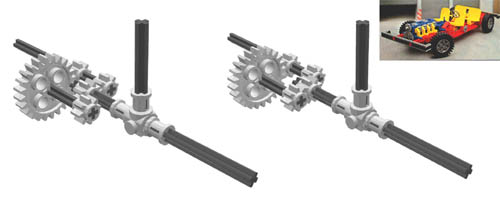
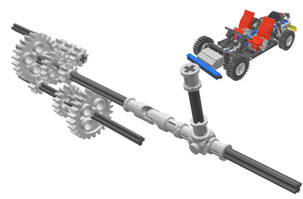
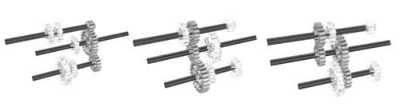
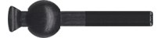
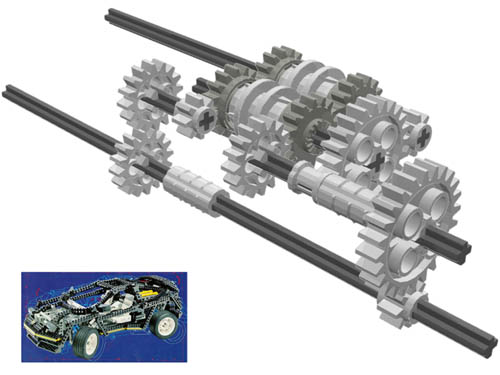
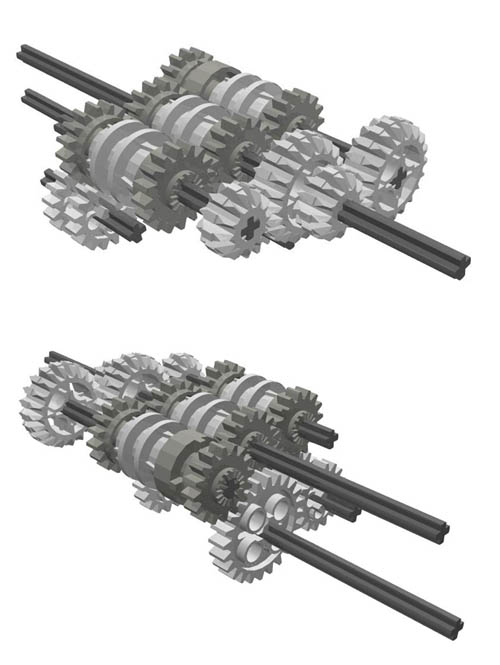

Découvrez une version largement augmentée de cet article en pdf

**Les boites de vitesse**

**Introduction**

La boite de vitesse est un mécanisme modifiant le rapport entre la vitesse de rotation du moteur et celle des roues motrices d’un véhicule. Elle modifie ainsi le couple fournit par le moteur afin de l’adapter aux besoins du véhicule (vitesse, pentes, vent, frottements divers, etc).  
La boite utilise des trains d’engrenages qui augmentent le couple en diminuant la vitesse (réduction) ou inversement. Elle permet en outre de choisir entre les différents rapports de réduction .

**Première génération**

En pièces LEGO® les trains d’engrenages sont aisément réalisés à l’aide des axes Technic™ et du large éventail de roues dentées ou pignons. Nous ne nous attarderons pas sur ce sujet.

La première boite de vitesse LEGO® est apparue dans le modèle _Auto chassis n°956_ en 1977. Il s’agissait d’une boite rudimentaire n’ayant que deux rapports de vitesse (de 1 et 1:3) grâce à l’utilisation du pignon à 8 dents (n°3647) et de la roue dentée à 24 dents (n°3648).

3647

3648

Fig.1 Boite schématisée de la maquette Auto chassis n°956 - Configuration 1ère et marche arrière

Puis est apparue dans le modèle Auto chassis n°8860 de 1980 une boite 3. C’est simplement l’apparition en 1979 de la roue dentée à 16 dents (n°4019) qui a permis cette amélioration.

4019

Fig.2 Boite schématisée de la maquette Auto chassis n°8860

Comme vous pouvez le constater, la boite est constituée d’un ensemble astucieux de trains d’engrenages composé de trois axes dont l’un, mobile en translation, permet de sélectionner l’un des trois rapports. On obtient les valeurs de réduction suivantes :

**–** 1ère 1:9 (0.11)  
**–** 2nde 1:3 (0.33)  
**–** 3ème 1:1 (1)

Ces valeurs s’entendent bien entendu du moteur (axe supérieur) vers l’arbre de transmission (axe inférieur). La valeur du 1er rapport est irréaliste.  
Quand la maquette, non motorisée, est poussée on retrouve des valeurs inverses : le premier rapport devient alors un rapport de surmultiplication de 9 ce qui est trop important et risque de causer des ruptures de pièces. La notice de montage de ce modèle réduit condamne ce rapport au niveau du levier de commande de la boite pour que les enfants ne l’utilisent pas.  
Toutefois, la notice de montage propose une version motorisée (moteur électrique placé en lieu et place du moteur factice). C’est alors le 3ème rapport, non démultiplié, qui est condamné.  
En conclusion, à l’usage, cette boite reste une boite 2 comme celle qu’utilisait la maquette précédente.

Le modèle suivant à disposer d’une boite fut la Test car n°8865 de 1988.

C’est toujours le même type de boite qui est utilisé mais les rapports sont différents :

**–** 1 ère : 1:2 (0.5)  
**–** 2nde : 2:3 (0.67)  
**–** 3ème : 3:2 (1.5)

Fig.3 Boite schématisée de la maquette Test car n°8865

On note des valeurs de rapports plus serrées, plus conformes aux modèles réels. La boite est enfin une vraie boite 3.

Toutefois reste que ces modèles réduits de boites sont limités :

**–** Il n’y a pas de point mort  
**–** La boite est une boite 3 au mieux.  
**–** Le modèle réduit ne disposant pas d’embrayage, le changement de rapport ne se fait pas sans difficultés.

**Seconde génération**

Etant donné les limitations de ce système de boite, la société LEGO® créa de nouvelles pièces qui permirent de développer des boites plus performantes. Ils s’appuyèrent sans doute sur les boites de vitesse réelles. En effet, alors que les premières boites étaient des boites à train baladeur (en simplifiant, un axe qui bouge en translation) les boites modernes sont des boites à pignons toujours en prise.

C’est en 1994 dans la Super car n°8880 qu’apparaissent ainsi les premiers éléments « modernes » de boites :

**–** Le manchon de sélection (6539)

  
**–** La roue dentée folle (6542)

Contrairement aux roues dentées habituelles, la roue dentée folle n’est pas solidaire de l’axe sur lequel elle se trouve. Elle n’est donc ni entraînée par cet axe, ni entraînante. Le manchon de sélection, lui, vient se placer sur le connecteur d’axes Technic™ n°6538.

Ainsi il est solidaire en rotation des axes ou il est placée et il peut librement se déplacer en translation suivant cinq positions.

Si, par l’action de la fourchette de sélection n°6549,

le manchon et la roue sont mis en contact, le manchon entraîne alors la roue : tout se passe alors comme si on avait placé une roue 16 dents classique solidaire de son axe.  
On peut grâce à ces pièces concevoir une boite de vitesse complexe dans laquelle le manchon de sélection sert à embrayer tel ou tel autre train d’engrenage. La boite conçue sur la base de ces pièces permettent :

**–** d’avoir des changements de rapport doux,  
**–** d’avoir un point mort,  
**–** de composer des boites 4 dans un espace sensiblement identique.

Ainsi, dans la Super car n°8880, la boite de vitesse est une boite 4 avec les rapports suivants :

**–** 1ère : 2:3 (0.67)  
**–** 2nde : 1:1 (1)  
**–** 3ème : 2:1 (2)  
**–** 4ème : 3:1 (3)

Fig.4 Boite schématisée de la maquette Super car n°8880

C’est en 1999 qu’apparaît alors une troisième pièce : une extension de manchon de sélection (pièce 32187).

ainsi qu’un ensemble de deux nouvelles roues dentées de 20 (n°32269) et 12 (n°32270) dents :

Elles apparaissent avec le set Super Street Sensation n°8448, accompagnée de la fourchette de sélection n°6641.

Cette maquette dispose d’une boite 6 (5 + marche arrière), d’une complexité telle qu’on ne comprend pas son fonctionnement immédiatement au montage. Son placement au cœur du modèle réduit ne facilite pas non plus la compréhension intime du mécanisme.

Fig.5 Boite schématisée du set n°8448 en configuration de point mort - Vues du même montage suivant deux directions diamétralement opposées.

Tout réside dans la combinaison de rapports d’engrenages ayant des valeurs diverses grâce à une plus grande variété de roues dentées.  
Le 4x4 off roader n°8466 de 2001 présente aussi une boite 6. Malheureusement, il ne s’agit pas d’un nouveau modèle de boite : c’est tout simplement une copie de celle qui équipe la n°8448.

**Les notices de montage**  
[853](http://library.brickshelf.com/cgi-bin/gallery.cgi?f=414)  
[8448](http://library.brickshelf.com/cgi-bin/search.cgi?q=8448&stype=f)  
[8860](http://library.brickshelf.com/cgi-bin/gallery.cgi?f=1258)  
[8865](http://library.brickshelf.com/cgi-bin/gallery.cgi?f=1259)  
[8880](http://library.brickshelf.com/cgi-bin/gallery.cgi?f=25)

**Remerciements**

Merci à Julien, Alain, Erik, Pierre et Philippe pour leur aide.
