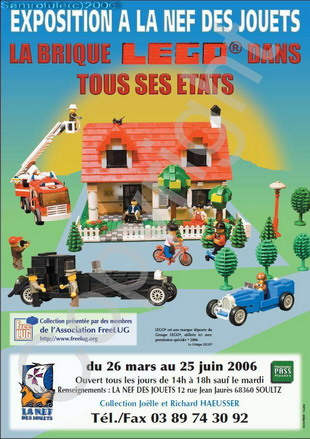
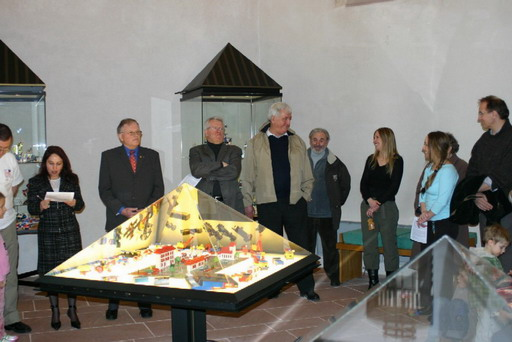
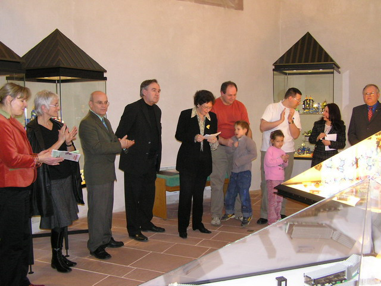
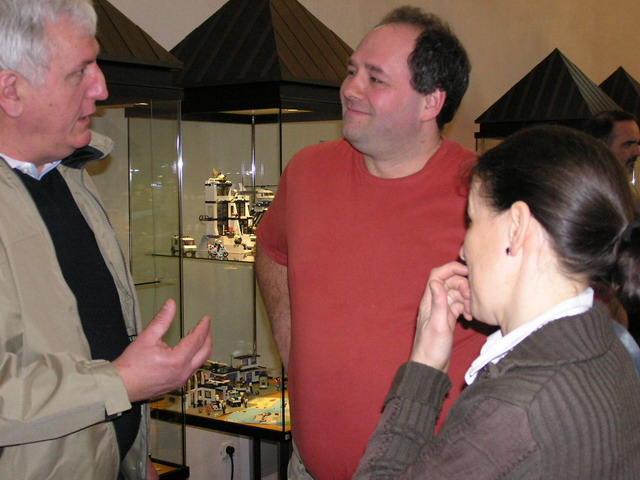
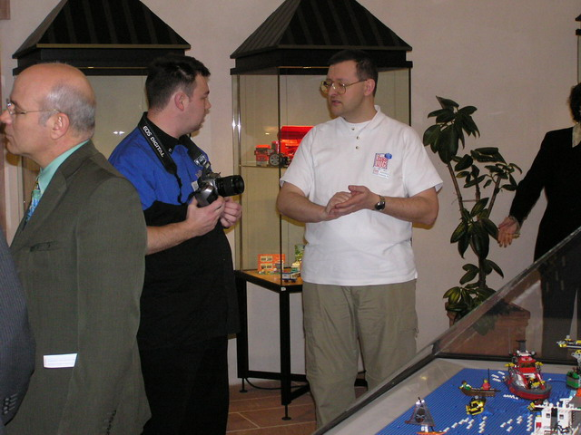

D’abord, je vous présente l’affiche de cette exposition, en un mot...Superbe !

Le 8 avril dernier, nous avons inauguré l’exposition en présence de nombreuses personnalités locales. Etaient présents entre autre : le maire, le conseiller général du Haut-Rhin, Mr et Mme Haeusser, et j’en oublie certainement. La soirée a débuté par la traditionnelle allocution... de Mme Dos Santos pour l’ouverture de cette soirée, suivie par Mme Haeusser qui nous à retracer l’histoire de la marque LEGO(r)avec la passion du détail. Après les longs discours, nous faisons plus amples connaissances avec les invités autour d’un apéritif.

Présentation de l’exposition par la responsable du musée, Mme Dos Santos (à gauche de la photo)

.

Applaudissements après l’allocution retraçant l’historique de la société LEGO présentée par Mme Haeusser (au centre).

Thierry et moi-même, nous étions très sollicités par les invités qui nous submergeaient de questions et d’éloges.

"C’est magnifique votre expo, ça me rend nostalgique..."

.

En conversation avec Philippe, notre photographe de la soirée.

Je voudrais également remercier toute l’équipe de la Nef des Jouets pour l’organisation de cette événement, ces personnes font un travail fabuleux.

L’exposition ne fait que commencer !

Vous pouvez retrouvez d’[autres informations sur cette exposition](/regions/alsace/) sur notre site, et bien sûr plein de photos dans la [galerie](http://photos.freelug.org/main.php/v/samrotule/).

A suivre...
