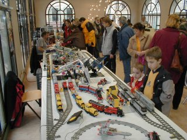

Pour notre première participation à une exposition de jouets, nous avons réussi notre coup ! Je tiens encore à remercier Jibouille, Cdhd et Bobsup pour leur participation avec leurs modèles, sans oublier Olivier Meritto qui nous a prété ses supercars...

Je voudrais aussi remercier les organisateurs de l’expo, le club Omnibus, un club de train de Bourgoin, qui a fait tout ce qu’il fallait pour nous aider en repondant à nos souhaits.

**Mais commençons par le début...**  
Je suis donc arrivé le premier avec trois panières, mon stock lego et les modèles de Bobsup. Après l’agencement des tables pour avoir un peu plus de largeur, c’est Jibouille qui est arrivé...  
"Bonjours, moi c’est Jibouille..."  
"Salut, moi c’est Chimere... euh Loys si tu préfères !"  
Et oui, il faut dire qu’aucun d’entre nous ne se connaissent "en visuel" jusqu’à cet évènement ludique.  
Et voila le jibouille qui arrive donc avec un énorme coffre sur un chariot à roulettes, plein de space classic... Puis arrive Cdhd. Re-présentation et...  
"Tu veux un coup de mains pour tout ammener ?"  
"Euh... Ah oui, volontier !..."  
J’arrive à sa voiture ; du train plein la banquette arrière et plein le coffre ! Là je me suis dit :" Whaou !.. Avec tout ça, on va se la donner un maximum..." J’étais super enthousiaste.  
Et allez ! On est parti pour tout installer :  
**–** une base lunaire de 15 plaques 32\*32 avec des sets de 1978 entre autre.  
**–** un reseau train 9v de 5m de long sur 2m de large, avec 5 locos et 25 wagons.  
**–** un petit réseau train 12v en cercle avec le TGV (??).  
**–** quelques rails et deux locos 4,5 v.  
**–** un monorail MOC  
**–** des modèles Star Wars dont deux collectors.  
**–** deux supercars technic.

**L’ouverture**  
Le dimanche, je suis arrivé avec Bobsup, qui nous a donc rejoint, pour l’ouverture de l’expo à 8h. Alors certe, nous étions un peu décalés avec nos modèles spaciaux par rapport au thème de l’expo qui était le jouet ancien, mais rapellons nous que la brique Lego existe depuis la fin des années 50, et que pour beaucoup de papas de maintenant, ça devient un jouet de leur enfance, et ça reveille la nostalgie...

Il y a eu a peu pret 500 visiteurs, et ça n’a pas arreté, sauf a la pause du déjeuner qui a été un peu plus calme. On peut dire que chaque personne qui se sont arretés devant notre stand sont resté 10 à 15 mn. D’une maniere générale, nous avons eu l’impression que c’était la premiere fois que les gens voyait une expo de Lego, et l’organisateur était du même avis. C’est vrai que la plupart du temps, on voit des Lego montés et exposés uniquement dans les grands magazins et à noël. Vous auriez vu les yeux des enfants quand le train passait juste devant eux...

Alors de ce point de vu, nous pouvons dire fièrement qu’on a bien travaillé... et qu’on s’est bien amusé aussi.  
D’autant plus que nous avons maintenant des contacts pouvant être qualifier de serieux avec quatres autres organisateurs d’expositions de jouets. Quand on leur annoçait que c’était "notre lancement", eh bien on a eu que des félicitations... Voilà ! Et ils rajoutent :"Si vous venez pour un week-end complet, c’est tous frais payés !!". C’est pas beau ça ??  
Enfin, nous avons eu le droit a une interview et une photo du Dauphiné Libéré, la presse régionale...

**Pour conclure**  
Je pense que Jibouille, Cdhd et Bobsup seront d’accord avec moi, nous avons passé un superbe week-end, et nous nous sommes amusés comme des gamins... Franchement, si vous voulez vous lancer dans ce genre de manif, allez y a fond !!

_A voir, les photos sur [http://photos.freelug.org/](http://photos.freelug.org/diapo.php?cat=9&expand=8)_
