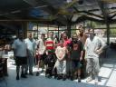
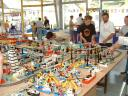
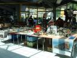

C’était donc ce week-end de Pentecôte, et neuf Freeluguiens allaient assurer le spectacle...

Ce qui est particulierement appréciable dans ce genre d’évènement, c’est de pouvoir se rencontrer, et de mettre un visage sur un pseudo que l’on cotoit presque tous les jours.

Alors, il y avait(de gauche à droite) Denis (Cdhd), David(Rivaldo369), Gilles(un cousin de David), Jibouille (et son enseigne), Gael(Khan, en bas), Didier Malon et ses garçons, Pablo(Paboss38), votre serviteur et l’autre Didier(Dicky-didier)

Les deux tables de 15m² trônaient au milieu de la salle, juste en face de l’entrée. La première fut investie par les cousins et leur ville, plus Cdhd et son train. Sur la seconde, il y avait les Space Classic de Jibouille, quelques véhicules technic de Dicky-didier, et le Star wars.

Didier Malon était descendu de Paris avec le coffre plein de belles choses que LEGO© nous prétait pour l’occasion, à savoir le nouveau train de marchandises, le nouveau train voyageurs et la nouvelle gare. J’en profite pour remercier la société LEGO&copy au nom de FreeLUG pour cette exclusivité, qui notons le,  
a occasionner une agréable réaction du public.

Ce sont les Moc (création perso) qui ont remporté le plus de succès. Il y avait :  
**–** [La tour Smart](http://photos.freelug.org/galleries/expos/tdp_08062003/GF-smart04.jpg) initiés par une idée de Obi, et développés à 5 freeluguiens.  
**–** [Le chateau/tunnel](http://photos.freelug.org/galleries/expos/tdp_08062003/DSCF0060.JPG) créé par Denis.  
**–** [La caserne de pompier](http://photos.freelug.org/galleries/expos/tdp_08062003/DSCF0061.JPG) conçue par Gael.  
**–** [Le space-monorail](http://photos.freelug.org/galleries/expos/tdp_08062003/P1060044.JPG) de Jibouille.  
**–** [Le bunker de Endor](http://photos.freelug.org/galleries/expos/tdp_08062003/P1060042.JPG) monté par Didier Malon.  
**–** [La plage](http://photos.freelug.org/galleries/expos/tdp_08062003/DSCF0110.JPG) de David et Pablo

D’autre freeluguiens nous ont rendu visite, tel que [Steinmeg et Olivier Meritto](http://photos.freelug.org/galleries/expos/tdp_08062003/DSCF0112.JPG)

Voilà, je pense que cet évènement fut une réussite, surtout le fait de nous rencontrer... Une expo est fédératrice de ces réunions, et dans cette idée qui me tient particulierement à coeur, je vous incite encore une fois à vous investir dans les prochaines.

Merci encore à tous, ceux qui m’ont aidé, ceux qui se sont déplacé de loin, ceux qui nous ont rendu visite, et a tous ceux qui aiment les LEGO&copy...
