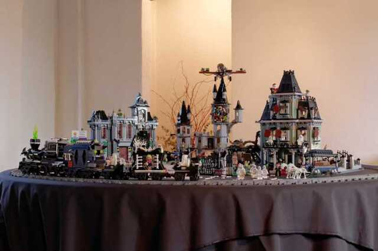
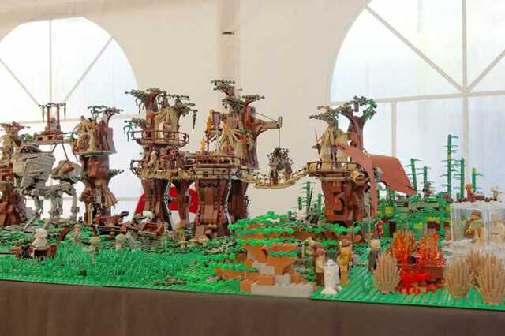
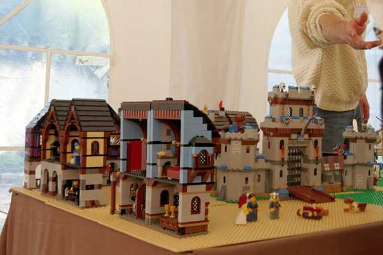
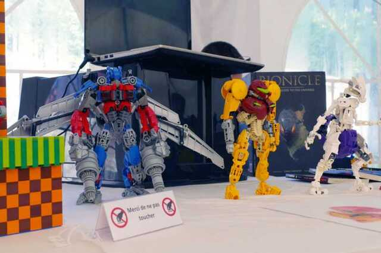
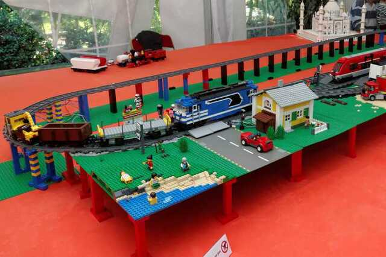
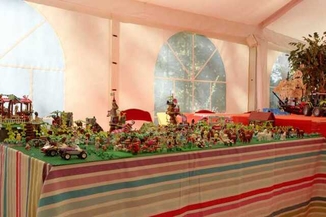
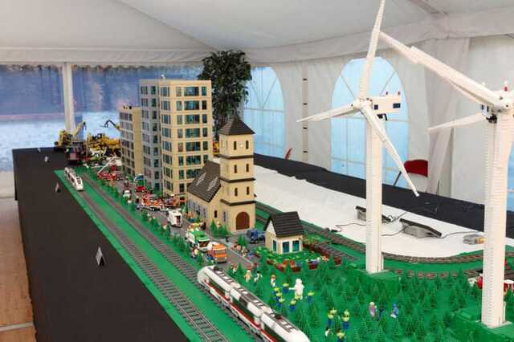
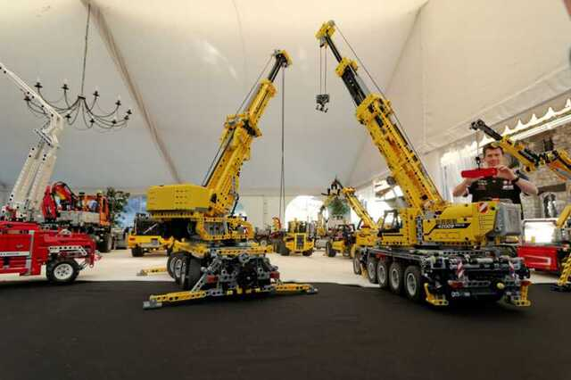
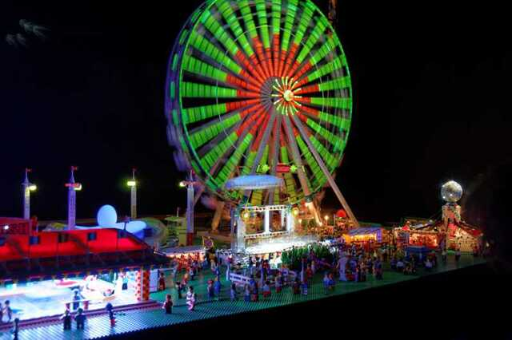
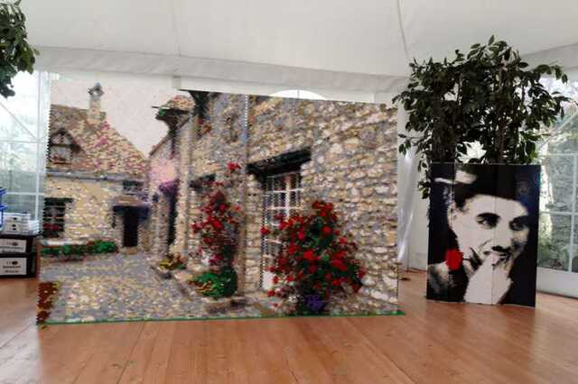

Après des mois de préparation et une grosse journée d’installation, nous sommes enfin prêts pour l’exposition de Gambais qui s’est tenue les 18 et 19 octobre.

**Samedi 7h,**

Les derniers exposants arrivent et mettent en place leurs dioramas.  
Tous sont issus de grandes associations françaises avec par ordre alphabétique : Bionifigs, Brique Mulsanne, FreeLUG et French Briques

**Samedi 10h,**

Ouverture des portes de l’exposition, les premiers visiteurs sont là, impatients de découvrir ce qu’on leur a réservé.

**Samedi 12h,**

Une soixantaine de personnes sont déjà entrées, c’est le moment de les suivre et de découvrir cette fameuse exposition.

La visite commence par l’entrée où 2 bénévoles nous accueillent, nous présentent rapidement l’exposition et la façon dont elle est organisée. Juste à côté, un premier diorama, celui de Fabien sur le thème Monster Fighters où les chasseurs tentent d’empêcher les monstres (vampires, momies…) de s’emparer du royaume.

La visite se poursuit dans la salle principale où Sylvie nous accueille avec un diorama sur le thème Star Wars. Ici nous sommes sur Endor, au royaume des Ewoks

Puis remontons le temps avec Lise pour se plonger en pleine époque médiévale. Un château fort sert de cadre à plusieurs scénettes ; une bataille, un mariage ...

Changeons d’univers pour la science-fiction avec "El Patron" Exo-6 (Eddy), Shaddow (Thomas) et leurs Bionicles, série mélangeant l’univers des LEGO avec celui des personnages ou des créatures bioniques. Chaque personnage à sa propre histoire.

Nouvel univers encore une fois, avec Sébastien D qui nous présente un GBB (Grand Bidule à Balles). Le principe est d’automatiser au moyen de différents mécanismes un circuit de billes. Ici le chargement / déchargement d’un train dans tout un circuit interne autonome.

Laissons les artistes de la brique, et place à nous les visiteurs avec nos talents de constructeurs. Trois ateliers nous sont offerts :

-   le montage libre : des briques 2x4 en quantité pour réaliser toutes nos envies et laisser courir notre imagination.
-   les briques Duplo : montage libre également et quelques heures de jeux pour les plus jeunes !
-   la mosaïque : pas de panique, une notice nous guide pour l’assemblage de ce puzzle géant (20000 briques) au moyen de losanges de 100 briques.

**Samedi 19h,**

Plus de 400 visiteurs nous ont rendu une visite durant la journée. Nous continuerons la visite demain !

**Dimanche 9h30,**

On frappe à la porte ! Ouverture dans 30 min mais quelques personnes sont déjà là !

**Dimanche 12h :**

Déjà 120 personnes accueillies ce matin ! Profitons de l’accalmie "déjeunatoire" pour visiter la suite de l’exposition.  
Repartons de la mosaïque découverte hier pour nous diriger vers la partie City. Le premier diorama, celui de Paul qui nous présente plusieurs modèles de motrices et de trains, ainsi qu’une gare de ville avec rue passant en contre bas.

Sa table accueille également quelques autres réalisations, tel que le Taj Mahal et une scène de banquise.

Retrouvons de nouveau Sylvie pour un diorama très "girly" avec le thème Friends, très apprécié par les demoiselles, mais pas seulement ! Les copines ont quitté la ville pour une promenade dans la jungle.

Allons vers un second diorama city, où Jean-Claude nous accueille avec trois éoliennes impressionnantes et deux trains qui nous emmènent vers une grande ville moderne.

Terminons la visite de la salle principale avec Sébastien H qui nous présente un magnifique panel de la gamme LEGO® Technic®, composé d’engins et de véhicules de toutes sortes. Sébastien avait également sortit "de grange", trois vieilles Citroën : une 2cv, une DS et un Tub.

La fin de la visite approche, voici le dernier diorama, caché dans le noir, la magie opère. Voici la fête foraine selon Denis, qui émerveille petits et grands, tant par les détails que par le décor. Ce diorama est interactif et permet au choix d’actionner le rodéo ou le manège à avion.

Dimanche 17h30,  
Fermeture des portes de la grande aventure !  
Première expo, premier ressenti : on est tous fatigués !  
Merci pour votre visite

Merci à Simon pour la conception et le prêt des mosaïques.

Un merci particulier au Moulin de Gambais et à Grain de Cel pour avoir permis à Brizy de faire sa première exposition et accueillir exposants et visiteurs dans un cadre magnifique

Retrouvez nous sur[le site internet de Brizy](http://brisy.free.fr/index.html), la [galerie photo](http://brisy.free.fr/wa_13.html) sera prochainement active.
