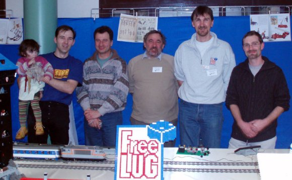
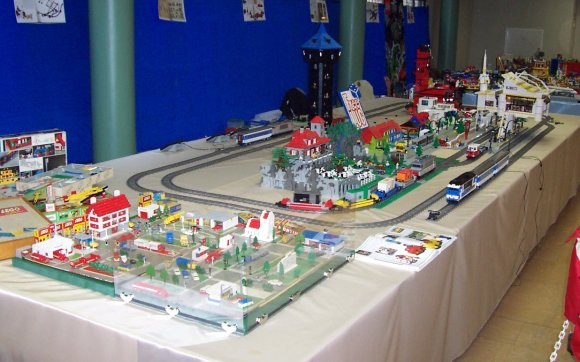
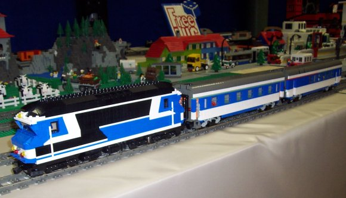

Le 28 janvier dernier, le club OMNIBUS de Bourgoin-Jallieu (38) nous accueillait au sein de leur exposition "Les Jouets Anciens"

Et une fois n’est pas coutume, je vais commencer cet article par remercier toute l’équipe d’Omnibus qui nous accueillait pour la troisième fois. Notons pour mémoire que ce sont eux qui nous ont permis de nous lancer dans le bain des expositions en 2003.

Je voudrais aussi remercier toutes les personnes qui sont venues nous voir, Didier, Jérôme, Emmanuel et d’autres venant d’assez loin pour nous voir, et avec qui nous avons largement eu le temps de discuter briques...

**La fine équipe**

Notre table était donc installée en deux parties : **les anciens modèles et un réseau moc.**

**La table**

Pour être bien dans le thème de l’exposition, Denis Huot nous a sorti une série de vieux modèles LEGO des années 55-60, c’est-à-dire la période où LEGO a commencé à produire des maisons en briques plastiques pour agrémenter l’environnement des petites voitures LEGO qui existaient déjà. C’est assez étonnant de voir qu’à cette époque, ce n’était pas que des briques et des plaques carrées ; on trouvait déjà des [plaques 8x4 avec un angle arrondi](http://www.brickshelf.com/cgi-bin/gallery.cgi?i=2290794).

Le réseau était constitué de quelques modules déjà vus pour la plupart. Il y avait le [Meuhdule](http://www.brickshelf.com/cgi-bin/gallery.cgi?i=2290798) et la tour Harry Potter de Denis, une tour qui présente toutes les minifigs de la série HP ; on retrouvait aussi la gare et la caserne de pompier de votre serviteur.

Le matériel roulant était constitué des trois motrices BB7200, BB15000 et pour sa première sortie la CC72000, tirant soit des wagons porte-containers, soit les voitures Corail d’Alban Nanty. Une remarque à ce sujet, les transformateurs 9v LEGO sont vraiment trop faibles pour tirer des trains en 8 tenons de large. Avis aux futurs exposant !! :)

**CC72000 & wagons Corail**

Notons aussi la présence d’Olivier Delepaux, à droite sur la photo de groupe, qui présentait [un joli réseau ville-train](http://www.brickshelf.com/cgi-bin/gallery.cgi?i=2290807) en fixe avec tout un tas d’animation et de lumière, comme un vrai petit ascenseur qui monte et qui descend !! :)

En conclusion, j’aime beaucoup ces "petites expos". Il n’y a pas le stress des grandes manifestations (même si on oublie de mettre le réveil le matin !!), et surtout on peut prendre tout le temps qu’il faut pour discuter avec le public, ainsi que prendre contact avec d’autres organisateurs d’exposition.

**–** [Photo de Loys "Chimere" Bailly](http://www.brickshelf.com/cgi-bin/gallery.cgi?f=231011)

**–** [Photo de Didier "6StudS" Enjary](http://photos.freelug.org/main.php/v/6studs/Expos/Bourgoin2007/)
