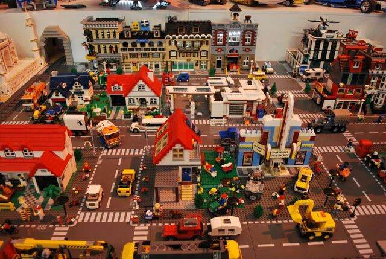
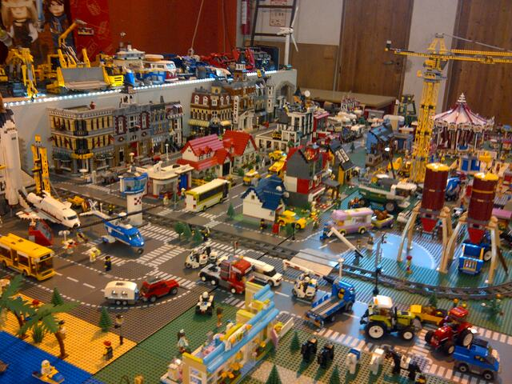
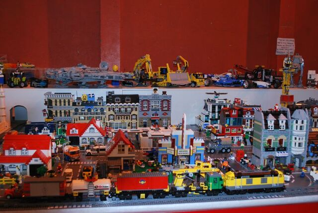
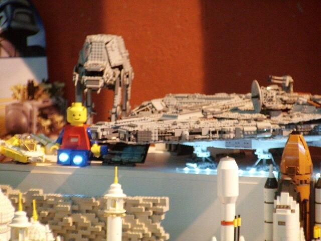
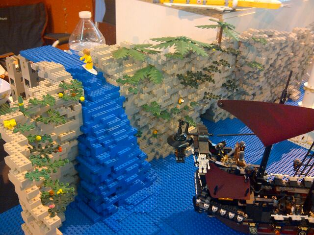

Le syndicat d’initiative de la ville de Cadours m’ayant remarqué lors d’une autre exposition m’a demandé de présenter une ville LEGO pour la fête annuelle de l’Ail violet de Cadours.

Accès à la salle le vendredi 14h00, il nous a fallu pas moins de 5 heures pour mettre la ville en place, le plateau formant 9 m².

L’accueil a été fabuleux, et l’infrastructure se prêtant au mieux à mes prévisions, nous n’avons eu aucun problème pour être prêts pour le samedi et le dimanche.

Il y avait donc une ville assez fournie, contenant un petit réseau train, le tout surplombé par des TECHNIC.

J’ai réussi à intégrer quelques éclairages LED dans les bâtiments, ce qui rendait la ville encore plus vivante.

Le meuble créé en fond de plateau, d’où sortaient les trains me permettait de changer de locomotive sans que cela se voit, cela donnait un côté magique au diorama.

Week-end magnifique avec beaucoup de regards qui brillent devant ma création.

À l’avenir, je rechercherai plus à présenter mes MOC, mais le temps m’a manqué pour cette exposition, on verra à la prochaine.

Je tiens à remercier particulièrement le syndicat d’initiative de Cadours qui a su s’adapter à ma demande. Je reviendrai sûrement l’année prochaine, car manifestement, cela a plu à tout le monde.

Gwen
