Nous exposons du 3 mai au 26 juin 2019, à la médiathèque de Bruguières, avec une animation mosaïque le samedi 25 mai 2019.

Exposer dans une médiathèque me change vraiment des expositions habituelles. Généralement on expose pour un weekend, on arrive le vendredi, on installe et c’est parti pour deux jours non-stop.

Mais là c’est complètement différent, on a le temps qu’on veut pour installer et c’est parti pour... deux mois. On peut même revenir un peu pour modifier, améliorer ou changer. Ceci est très pratique si on oublie des parties d’un bâtiment.

L’exposition est composée de deux vitrines avec des décors de ville, les skylines avec une carte 160\*96 pour les localiser et des tableaux.

Voici donc la première vitrine qui est dans l’entrée de la médiathèque. D’un côté nous avons le corner café et le green grocer reproduit d’une couleur différente (et oui je n’ai pas eu la chance de pouvoir les acheter à un prix raisonnable !), ensuite le restaurant parisien rehaussé et un MOC s’en inspirant. De l’autre côté nous avons le palace cinéma rehaussé lui aussi avec son toit adapté pour rentrer dans la vitrine, le détective, un MOC inspiré de l’animalerie et la banque.

[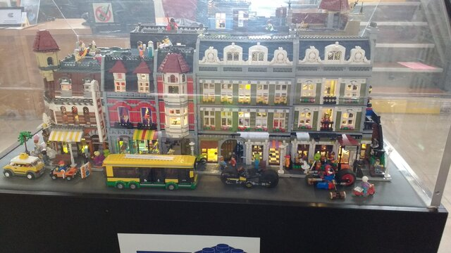](https://www.freelug.org/IMG/jpg/vitrine1-3.jpg)

[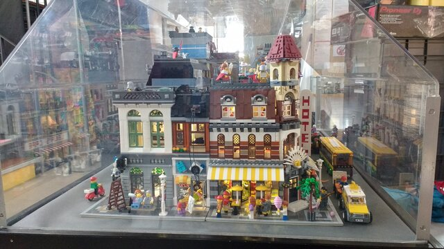](https://www.freelug.org/IMG/jpg/vitrine1-4.jpg)

[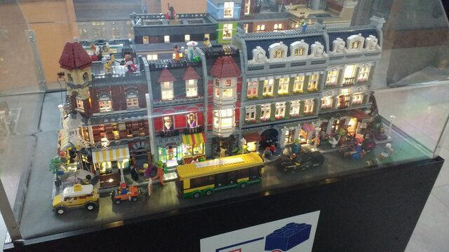](https://www.freelug.org/IMG/jpg/vitrine1-5.jpg)

[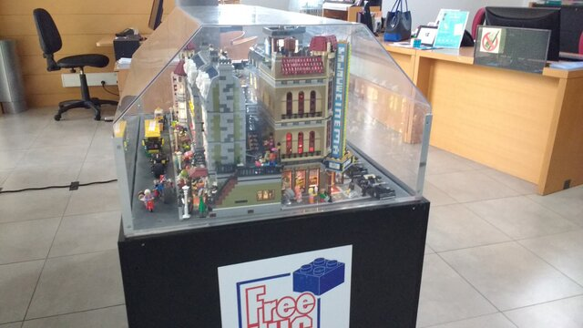](https://www.freelug.org/IMG/jpg/vitrine1-7.jpg)

[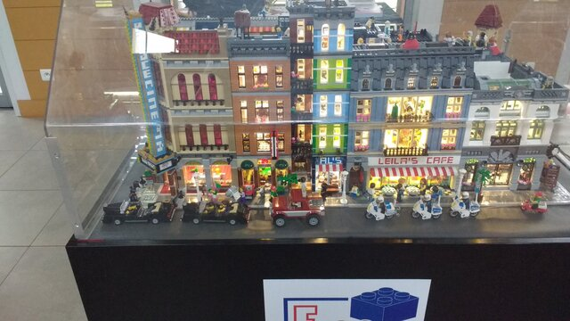](https://www.freelug.org/IMG/jpg/vitrine1-8.jpg)

Ma fille a aussi caché trois oeufs de pâques, leur recherche a vraiment beaucoup de succès auprès du jeune public.

[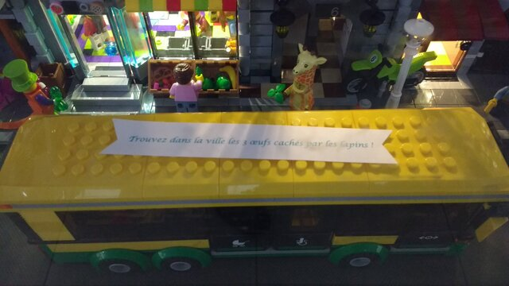](https://www.freelug.org/IMG/jpg/vitrine1-6.jpg)

Dans la deuxième vitrine, nous avons un LEGO Store qui fût la base d’une tour lors de la première Briqu’Expo Rhône-Alpes à Parilly, le square, la mairie et le shop doublé. Tous les bâtiments sont éclairés pour mieux voir l’intérieur, même le cinéma possède deux salles avec des animations de couleurs. J’y ai passé beaucoup de soirées pour finir l’éclairage, mais le résultat en valait la peine, sinon on n’aurait pas pu voir l’intérieur. Déjà sans la vitrine c’est dur de voir l’intérieur, alors avec le plexi c’est impossible.

[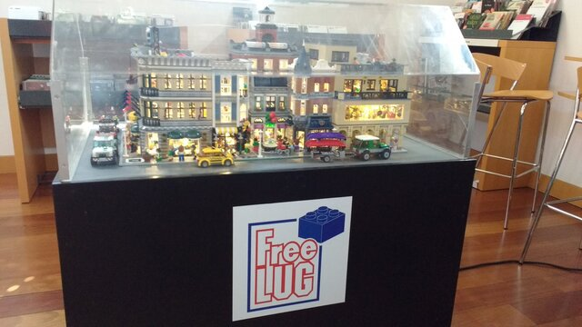](https://www.freelug.org/IMG/jpg/vitrine2-1.jpg)

[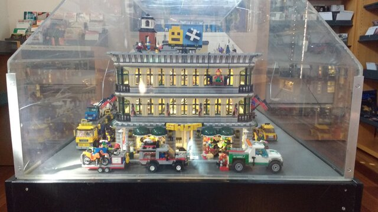](https://www.freelug.org/IMG/jpg/vitrine2-2.jpg)

[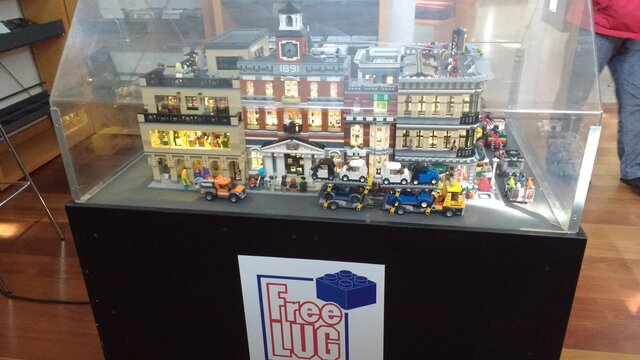](https://www.freelug.org/IMG/jpg/vitrine2-3.jpg)

[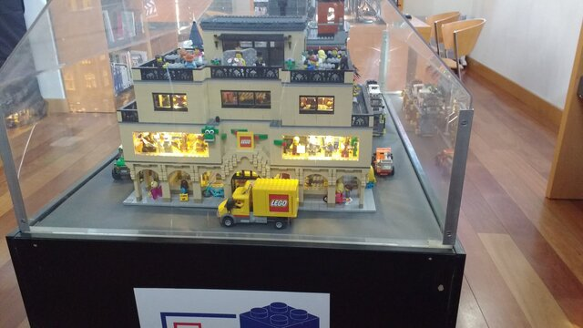](https://www.freelug.org/IMG/jpg/vitrine2-4.jpg)

A l’entrée nous avons disposé des flash codes ainsi que d’autres petits sets, dont les livres _Once upon a brick_ et _Andersen_, et sur une table à côté des livres sur les LEGO avec des livres que la Médiathèque avait acheté pour l’occasion et les miens.

[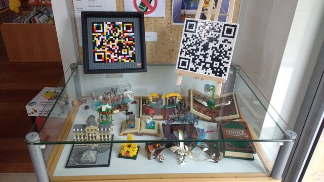](https://www.freelug.org/IMG/jpg/entree-1.jpg)

Derrière le comptoir nous avons placé une mini fête foraine avec la grande roue qui tourne à la demande, elle fait un peu trop de bruit sinon…

[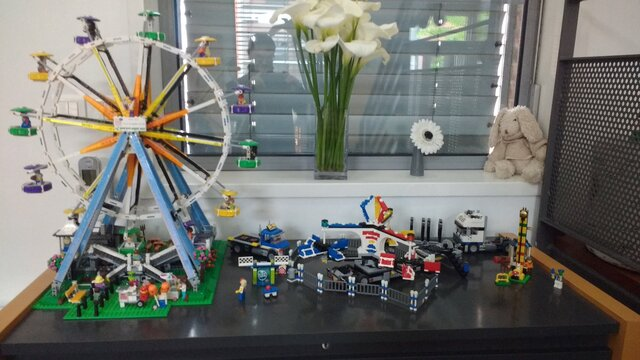](https://www.freelug.org/IMG/jpg/parc.jpg)

Cette exposition a été l’occasion de faire mes premiers tableaux en briques LEGO. C’est là qu’on se rend compte qu’il faut beaucoup de pièces pour les réaliser (plusieurs commandes ont été nécessaires car à chaque fois il m’en manquait). J’ai donc fait Nemo et le blason de la ville de Bruguières :

[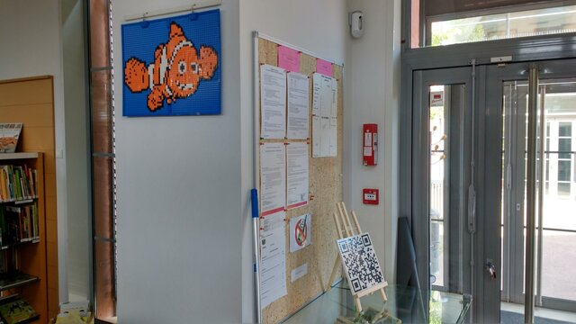](https://www.freelug.org/IMG/jpg/taleaux-5.jpg)

[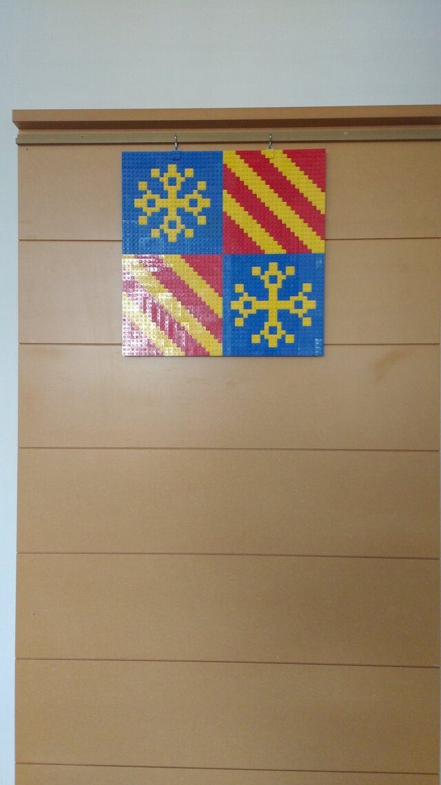](https://www.freelug.org/IMG/jpg/bruguieres.jpg)

Et je me suis fait prêter d’autres tableaux, merci Gilles (Dans une médiathèque c’est mieux de pouvoir habiller les murs).

[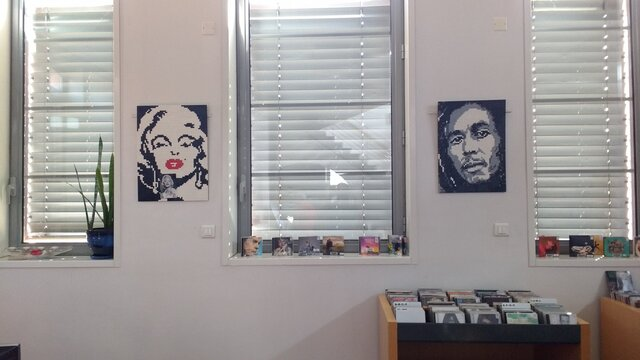](https://www.freelug.org/IMG/jpg/taleaux-1.jpg)

[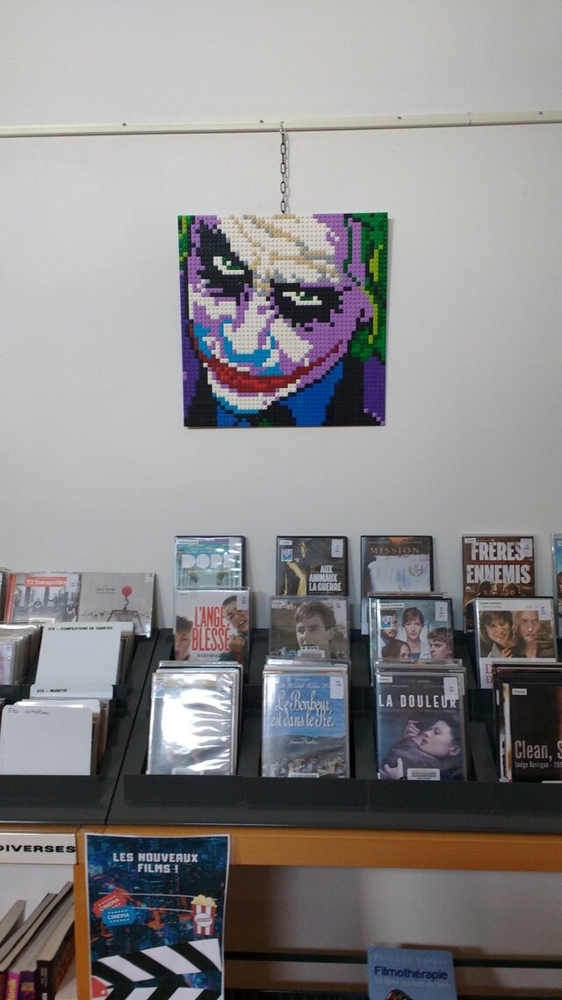](https://www.freelug.org/IMG/jpg/taleaux-2.jpg)

[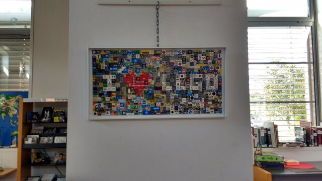](https://www.freelug.org/IMG/jpg/taleaux-3.jpg)

[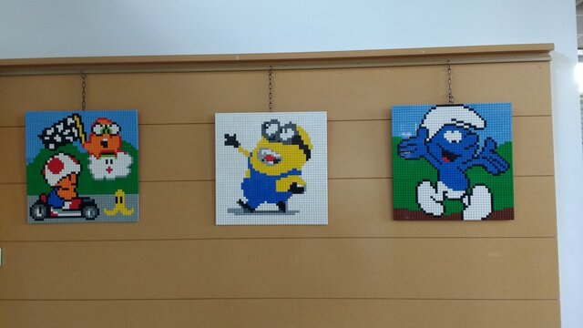](https://www.freelug.org/IMG/jpg/taleaux-4.jpg)

[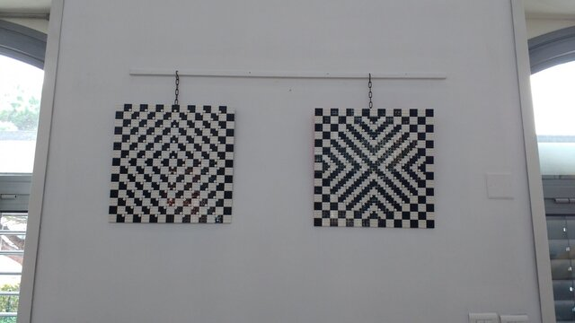](https://www.freelug.org/IMG/jpg/taleaux-6.jpg)

[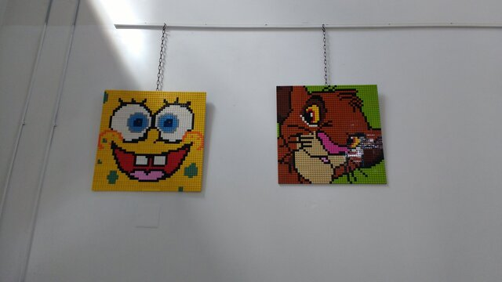](https://www.freelug.org/IMG/jpg/taleaux-7.jpg)

Avec une préférence sans appel pour le Batman-Superman

[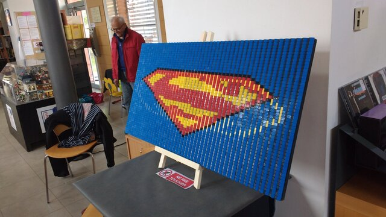](https://www.freelug.org/IMG/jpg/superman.jpg)

[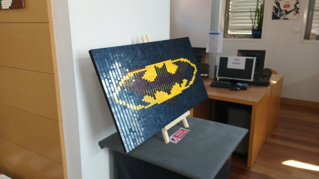](https://www.freelug.org/IMG/jpg/batman.jpg)

Après la réalisation de mes deux premiers tableaux, je me suis lancé dans la réalisation d’une carte 160\*96 pour présenter les Skylines. Le premier défi a été de faire pixéliser une carte (merci au logiciel libre PicToBrick), puis de la faire tenir debout. Là il a fallu que je m’aide d’une planche, et je n’ai pas eu d’autre choix que de coller les plaques de bases dessus.

[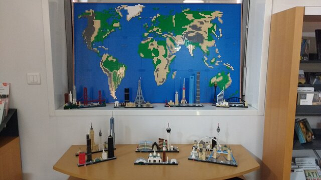](https://www.freelug.org/IMG/jpg/carte-1.jpg)

[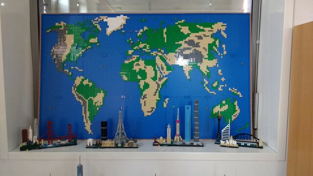](https://www.freelug.org/IMG/jpg/carte-2.jpg)

[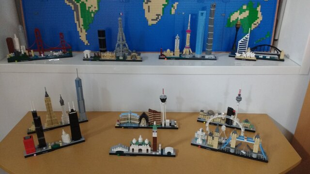](https://www.freelug.org/IMG/jpg/carte-3.jpg)

Le samedi 26 mai a été l’occasion de faire une animation mosaïque. Au dire des employées, c’était la première fois qu’elles voyaient certains papas. L’animation a duré de 10h à 13h pour monter cette mosaïque de 11000 briques représentant le capitole.

J’avais monté une première fois la mosaïque chez moi pour éviter d’emmener toutes les briques et pour avoir de l’avance au cas où l’affluence ne permettrait pas de finir à la fin de la matinée.

La première demi-heure a été doucement

[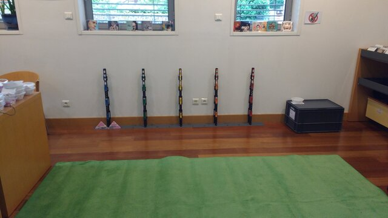](https://www.freelug.org/IMG/jpg/mosaique-2-2.jpg)

[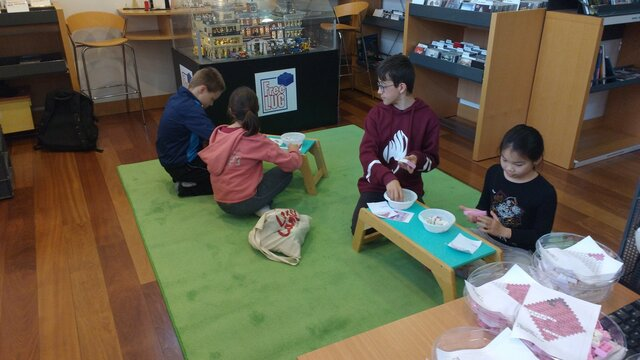](https://www.freelug.org/IMG/jpg/mosaique-3.jpg)

Puis l’affluence a été très forte de 10h30 à 12h15.

[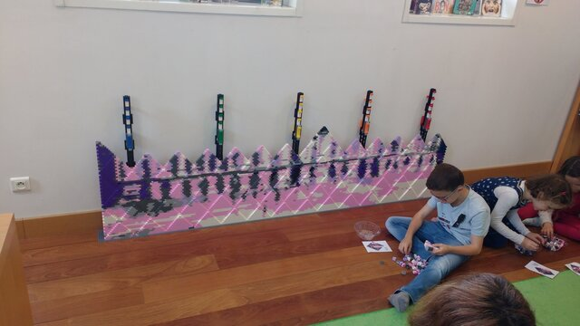](https://www.freelug.org/IMG/jpg/mosaique-5.jpg)

Ce fût une matinée intense avec un très beau résultat à la fin. Tout le monde était ravi et les personnes qui ne sont pas restées jusqu’à la fin vont avoir jusqu’à fin juin pour admirer le résultat.

[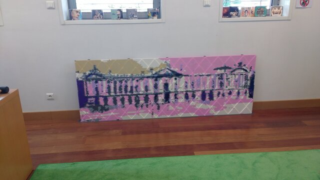](https://www.freelug.org/IMG/jpg/mosaique-6.jpg)
