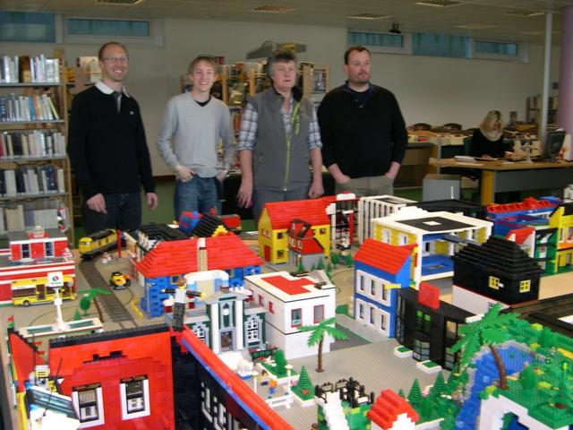
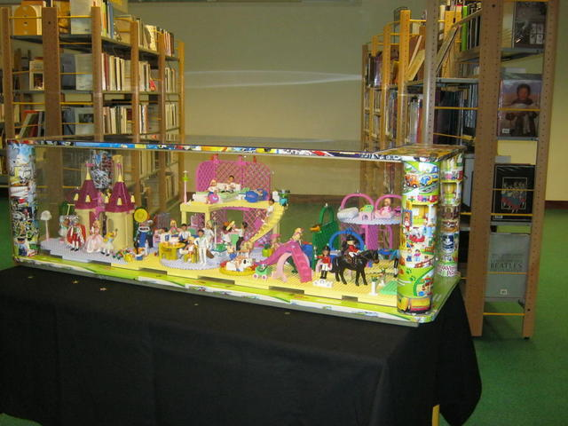
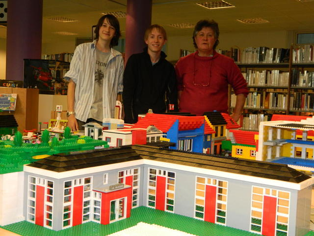

Résumé de l’exposition à la médiathéque de La Glacerie, Manche, en décembre 2011.

Cette expérience en médiathèque est notre première exposition, initiée en Septembre par la responsable animations de la médiathèque de La Glacerie.

Tout novembre et décembre 2011, Jérome adhérent Manchois a exposé sa ville et ses trains (ainsi que l’Emerald Night d’Alain Eury). Pour l’occasion, la médiathèque était décorée d’affiches gracieusement données par LEGO et de vitrines prêtées par Brigitte parmi les étagères de la médiathèque.

Durant les deux mois de l’exposition, la ville fut en perpétuelle évolution, nous avons même eu l’aide d’un stagiaire qui est fan de la petite brique mais qui ne connaissait pas FreeLUG. Dans cette ville nous avons reproduit pour l’occasion la médiathèque, nous avons aussi créé des bâtiments pour l’occasion.

Tout les week-ends, Jérôme animait les trains et laissait les enfants les commander, durant la semaine, le stagiaire s’en chargeait.

Des ateliers pour les enfants ont été organisés le mercredi par Brigitte et la responsable des animations, Mme Daure.

**–** [Galerie de brigitte](http://photos.freelug.org/main.php/v/EURY/la+glacerie/)  
[Galerie de Jerome](http://photos.freelug.org/main.php/v/Jerominus/LaGlacerie2011/)
