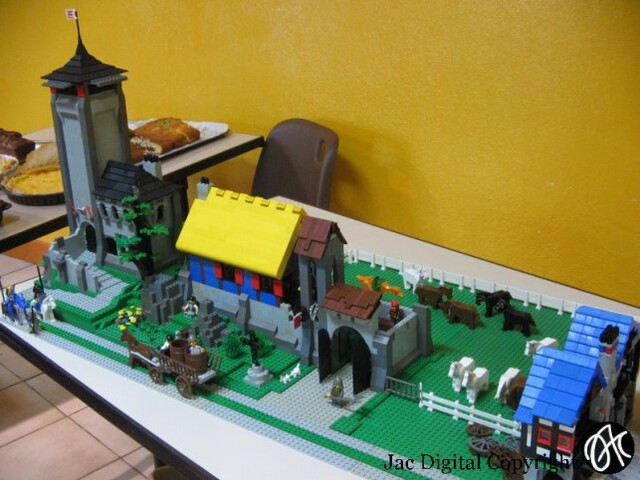

Ce 8 juin 2008 avait lieu à Busséol (63) un grand vide-grenier, ainsi qu’une exposition artisanale. Un de mes collègues de travail habite ce petit village médiéval, et j’ai été invité à participer avec mes briques LEGO à cette journée d’animation. Ma mère était invitée aussi, et présentait une démonstration de broderie avec ruban de soie.

C’est la deuxième fois que l’on me demande de prendre part à une animation dans un village. Mais pour cette journée, les choses auraient pu se passer un peu mieux. Il est 6h du matin, lorsque nous arrivons à Busséol avec ma voiture pleine de constructions. La pluie était elle aussi au rendez-vous. Du coup, sur les 97 stands prévus pour le vide-grenier, 11 brocanteurs courageux seulement sont venus. Nous nous sommes installés comme prévu dans une salle de la mairie qui est située au bout d’une rue normalement fréquentée, mais là, déserte en cette circonstance. Vers 10h, nous avions vu seulement cinq personnes des plus courageuses ayant fait le trajet à pied sous la pluie. Ne voulant pas finir la journée seuls, nous avons décidé de déménager les stands dans un endroit plus vivant. Il restait de la place à la salle des fêtes, située plus au centre, car chez les artisans aussi, il y a eu des désistements... Le reste de la journée s’est bien déroulée, par contre j’ai pris très peu de photos. Impossible aussi de placer la banderole FreeLUG.

C’est une première, de déménager son exposition en cours de journée. Ce n’est pas facile de prendre la décision, mais la suite m’a fait oublier ce désagrément. Et puis, je n’avais pas un grand réseau de trains !! D’ailleurs, ce village est très ancien et surplombé par un château du XIIe siècle. J’ai essayé de faire des constructions médiévales. Mais ce n’est pas facile pour un fan de trains, camions et vaisseaux spatiaux.

**La partie médiévale**

Il y avait aussi de très bonnes choses à manger, comme on peut voir !!!!

L’impact est aussi fort qu’au milieu des modélistes finalement. A part le fait que l’on rencontre plus d’acheteurs déçus car rien n’est à vendre. Et surtout pas la belle vitrine Star Wars, que l’on a pu me prêter...

Ce temps automnal a gâché la belle journée prévue depuis longtemps dans ce beau village. Mais, ce n’est que partie remise, car l’année prochaine, le comité des fêtes réorganisera sûrement un nouveau vide-grenier. Les constructions en LEGO ont du plaire puisque je serais réinvité. L’ambiance était donc un peu à la déception, au début, mais avec une bonne buvette, ça passe !!

[Galerie photos](http://photos.freelug.org/main.php/v/JAC/Exposition/Expositions2008/Busseol-2008/)
