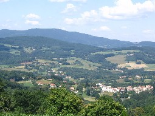

Le Comité des fêtes de Palladuc (63) organise une exposition artisanale pour la fête de la Saint-Georges. Cette année, elle aura lieu le 26 Avril 2009. L’association FreeLUG est invitée à participer à cette petite fête pour présenter son savoir faire en construction LEGO.

De part la situation géographique : le Nord du parc du Livradois Forez, nous allons présenter un diorama bien vert...

Les exposants seront accueillis sur un espace réservé gratuit, et nourris lors du repas de midi.

Horaire d’ouverture suivant le temps de la journée, et entrée libre sur la place. Nous vous attendons nombreux, pour échanger et discuter.

[Palladuc](http://www.carte-france.info/ville-63550-palladuc/)
