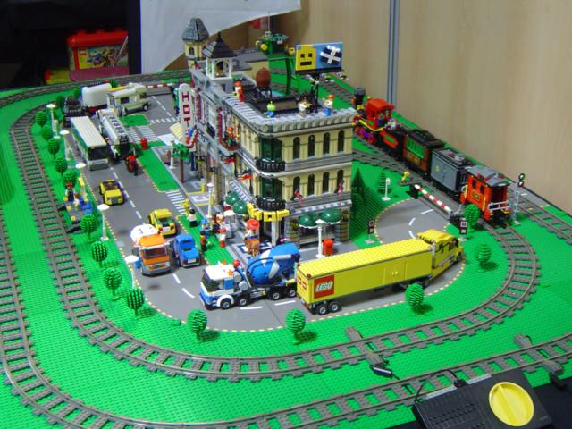
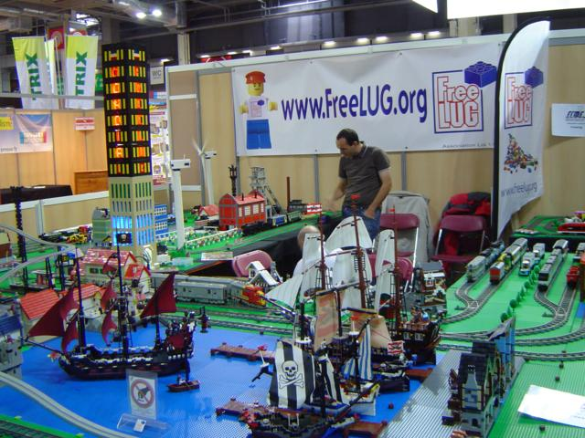
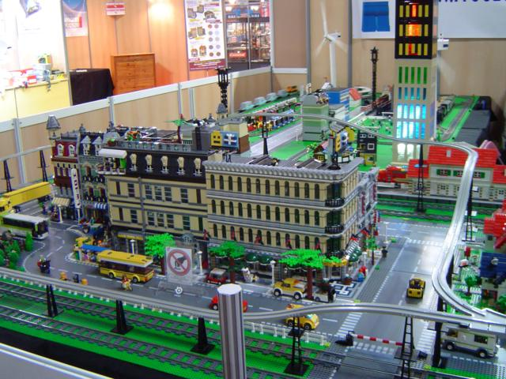
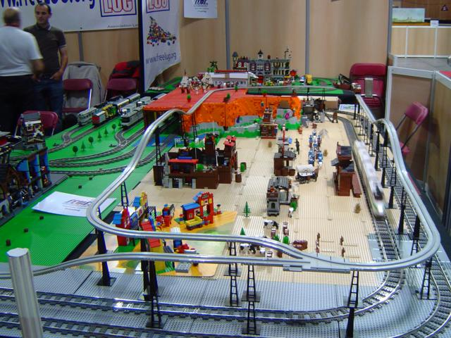
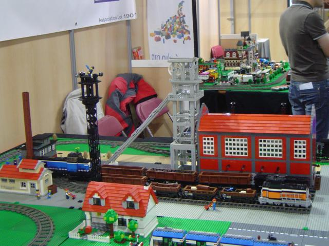

Nous étions de nouveau invités par la FFMF (Fédération Française de Modélisme Ferroviaire), qui nous a proposé cette année une surface d’une vingtaine de mètres carrés. FreeLUG a répondu bien sûr présent pour cette participation !

Cela devient à présent une tradition, la FFMF compte sur nous dans son espace ferroviaire lors du Mondial, pour montrer toutes les facettes du modélisme ferroviaire et ce qu’il est possible de faire avec nos chères petites briques.

Un plan de stand a été réalisé en 2 parties, un diorama commun et un espace démonstration pour faire découvrir les trains LEGO aux enfants du public.

C’est Didier Malon qui a assuré cette partie avec ce diorama, 2 circuits en boucle, un train à commande 9v par régulateur, un autre par télécommande à l’aide du système appelé Power Fonction System (PFS), dernière évolution en date des trains LEGO.

**Circuit animation trains**

Le second diorama beaucoup plus grand pour les passionnés adultes que nous sommes a été réalisé par Jérémy Roblin, Gilles Micheletti, Eric Létang, Brice Daminet, Richard Lemeiter et Didier Gallois.

**Le grand circuit**

Un décor Far-West, une zone portuaire, la ville et une grande gare de triage avec des installations industrielles, une mine de charbon :

**La ville**

**Le FarWest**

**La mine**

Beaucoup d’affluence pour ce salon surtout le week-end. Une très bonne organisation de la FFMF que nous remercions chaleureusement pour la confiance qu’ils nous accordent.

Nous avons même fait les honneurs de la presse spécialisée, avec cette année une page complète dans la revue "Le Train" à l’issue du Mondial.

Cette édition 2011 a été un succès. La FFMF a remercié tous les participants de l’espace ferroviaire pour la réussite du salon et compte déjà sur nous pour l’année prochaine.

Donc pour que nous soyons un peu plus nombreux pour la réalisation du diorama lors de la prochaine édition et si cela vous tente de participer à cette belle aventure, inscrivez dès à présent dans votre agenda les 14, 15, 16 et 17 juin 2012.

## Galerie photos

**–** [Galerie d’Eric](http://photos.freelug.org/main.php/v/f1tvf/expositions/mondial2011/)
