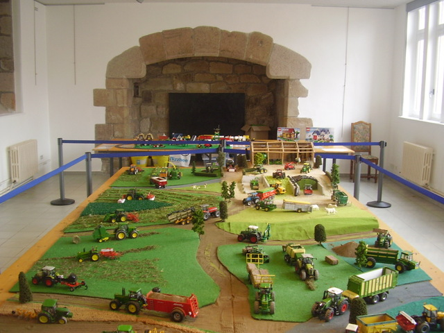
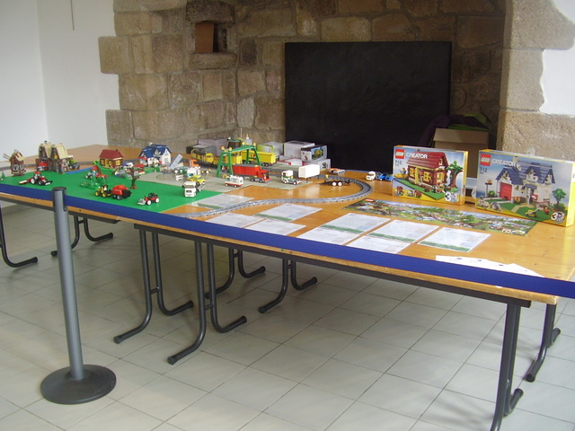
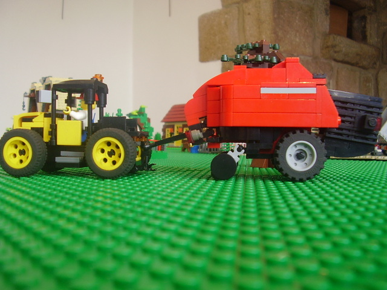
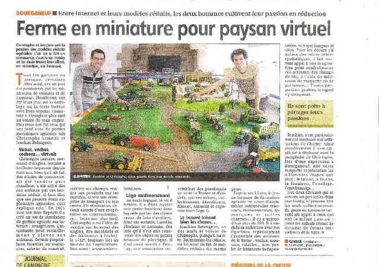

Du 8 au 13 Mai 2012, une exposition sur le thème « l’agriculture et l’herbe » était organisée dans les locaux de la mairie de Bourganeuf (23400, Creuse).

Pour cette première exposition, aussi bien en tant qu’exposant et qu’organisateur, le thème retenu était donc l’agriculture, d’une part parce que notre département est très rural et agricole, et d’autre part, cela est aussi en relation avec mon activité professionnelle. Deux dioramas étaient donc exposés, le premier réalisé en miniatures agricoles à l’échelle 1/32ème (par Joachim), et le second réalisé en brique LEGO, par moi-même.

**Apercu des dioramas**

Au premier plan le diorama miniatures agricoles 1/32ème, au second, le diorama Lego

Sur une surface de quelques mètres carrés, j’ai donc exposé pour la première fois nos briques adorées. Au premier plan, la partie agricole/rurale, au second, la partie city/train, le réseau ferroviaire englobant le tout. La plupart des modèles exposés sont issus des sets officiels, certains avec quelques modifications, le camion TP par exemple. Cependant, concernant les modèles agricoles, ceux-ci étant peu présents chez LEGO, ce sont donc des réalisations personnelles (tracteurs, faucheuse, faneuse, andaineur...). Prochainement je ferais un article complet et détaillé avec tous les modèles agricoles réalisés. Pour accompagner le diorama, des fiches explicatives permettaient aux visiteurs d’en savoir un peu plus sur chaque matériel agricole (ou étape). Un exemple de fiche est disponible en fin d’article, au format PDF.

**Diorama Lego**

L’espace réservé aux Lego

**Tracteur et presse**

Le tracteur et la presse à balle carrée

Durant ces 6 jours, l’exposition a attiré environ 150 personnes, de tous âges et de tous horizons. Par contre aucun AFOL, mais quelques nostalgiques de la petite brique. Un groupe d’enfants du centre aéré de la commune est passé le mercredi, ainsi qu’une classe de CM2, le vendredi, et là nous avons passé des bons moments, les enfants étant très intéressés par les dioramas et n’hésitaient pas à poser des questions. Cependant, malgré la barrière (et les affiches, « ne pas toucher, merci »), je me suis vite rendu compte qu’il fallait surveiller et être présent, afin que les enfants (voir certains adultes), ne touchent pas à tout :o) Ceci étant, le train de marchandise en action en a émerveillé quelques uns !!!

Nous avons aussi eu droit à la visite d’un journaliste du journal _La Montagne_, qui lui aussi a été agréablement surpris par cette exposition et les réalisations sur les deux dioramas. Il nous a d’ailleurs fait un très bel article, paru dans l’édition Creuse, le Mardi 22 mai 2012 (consultable en PDF, en fin d’article).

**Article de presse**

L’article de presse paru dans le journal La Montagne, édition Creuse, du 22 mai 2012

Pour cette première exposition, le bilan général est plutôt positif. Je retiens surtout les enfants et leur regard sur le diorama, ainsi que les adultes qui sont souvent surpris de voir des LEGO exposés. Je retiens aussi le plaisir qu’avait Camille (ma fille de 6 ans) à faire tourner son train de marchandises quand des visiteurs s’arrêtaient devant le diorama. Enfin, le fait de pouvoir discuter et échanger avec les visiteurs est très valorisant je trouve, cela change du cercle familial. D’ailleurs, en discutant avec mon co-exposant, j’ai appris qu’il avait eu des Technic il y a quelques années. Il n’a pas hésité à légoter un peu durant ces quelques jours, ce qui nous a permis à tous les deux de réaliser une ébauche de plateau et benne agricole (que je finaliserais un peu plus tard).

Je tiens à remercier la mairie de Bourganeuf, pour le prêt de la salle et du matériel. Si elle me sollicite à nouveau, ce sera avec plaisir que je répondrais favorablement pour une nouvelle édition en 2013, en espérant pouvoir exposer avec quelques autres AFOL, quitte à réduire la durée de l’exposition sur un weekend par exemple. Merci aussi à Joachim, d’être venu exposé, et qui a bien profité aussi du tracteur radiocommandé:o)

Enfin, merci à FreeLUG, et les membres du CA, de m’avoir soutenu pour cette première exposition, notamment Jac, en répondant à toutes mes questions par mail.

Liens :

**Article de presse**

L’article de presse paru dans le journal La Montagne, édition Creuse, du 22 mai 2012.

**Fiche faucheuse**

Un exemple de fiche que les visiteurs pouvaient consulter, ici la faucheuse.

**Galerie photos**

Galerie photos de l’exposition
