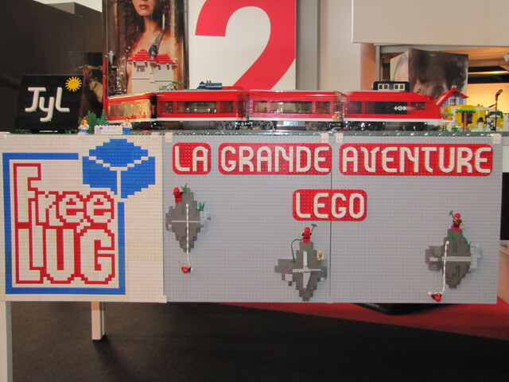
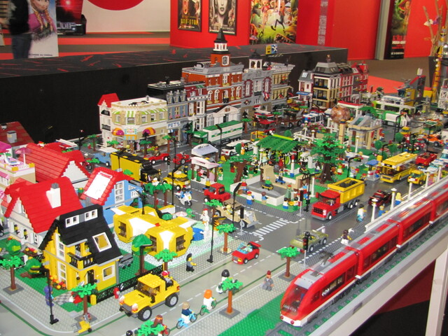
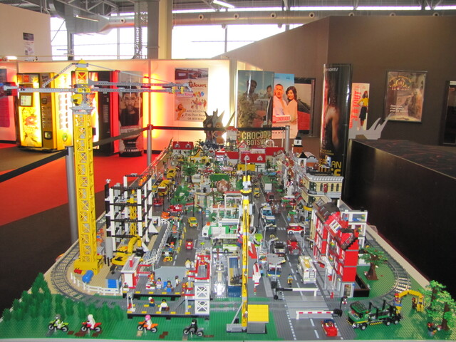

Je rencontre la directrice du cinéma pour lui montrer quelques photos d’expo auxquelles j’ai participé. Elle est emballée par l’idée et nous convenons donc de l’organisation : j’aurai quelques tables installées dans le hall avec un espace "dédié" et le montage pourra se faire le samedi soir, pendant la dernière séance. Je n’ai donc plus qu’à préparer ma présentation !

Nous y voilà donc ! Le samedi soir j’apporte tout mon bazar au cinéma pour un montage de 21h30 à minuit 30 ! Je me suis pas mal organisé et ça n’a pas trop traîné finalement. Bien sûr, il reste encore les personnages et les petites mises en scène à faire mais il se fait tard et le cinéma va bientôt fermer. Donc, finitions demain matin avant l’ouverture du cinéma !

Dimanche matin, arrivée 30 minutes avant l’ouverture au public et c’est parti pour une journée d’exposition ! A peine le temps de mettre une mini touche finale et les premiers spectateurs arrivent.  
Beaucoup d’enfants pour démarrer la journée : entre l’avant-première du film "LEGO, La Grande Aventure" et d’autres dessins animés à l’affiche, ils sont nombreux ! Et comme toujours, ils ont les yeux qui brillent ! Même les adultes, qui ne sont pas venus pour ça, s’arrêtent, jettent un coup d’œil et posent des questions pour les plus intéressés.

Le contexte change d’une exposition où les gens viennent pour voir des LEGO mais on retrouve le même intérêt chez les adultes et la même admiration des enfants avec pas mal d’échanges au final ! Bref, une bonne journée de partage au rythme des séances des films, entre cohue et moments très calmes.  
Mais tout a une fin et le moment de remballer est finalement arrivé. On remettra ça avec plaisir pour la sortie de "LEGO La Grande Aventure 2" !
