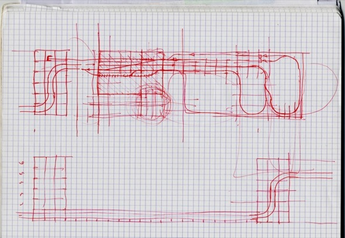
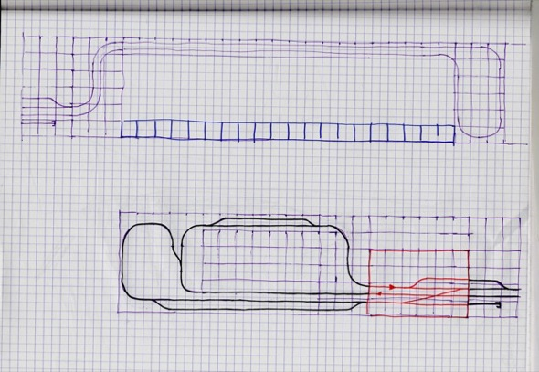
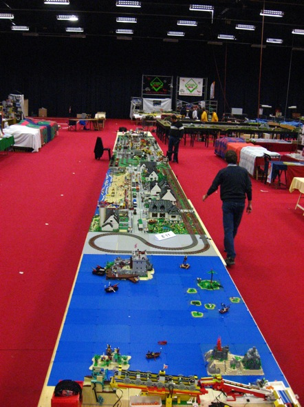
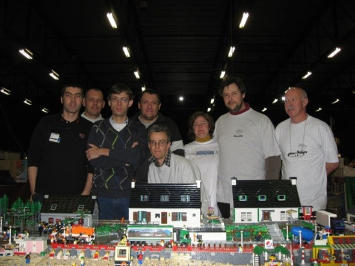
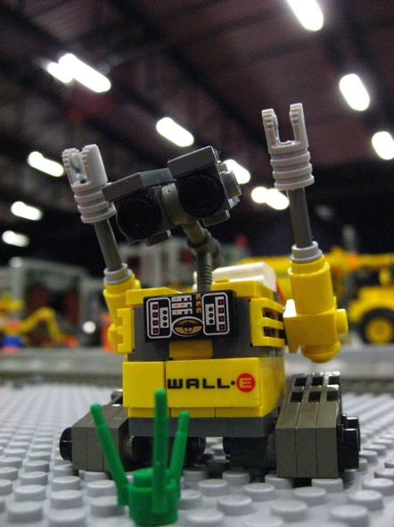

C’était la 21ème édition de cette exposition qui a eu lieu ces 14 et 15 novembre 2009. La plus grande exposition de modélisme de Belgique sur une surface de 7000 m², annonçaient les affiches !

Les organisateurs nous avaient invité pour cette édition 2009. "Régional de l’étape" habitant à 10 min de la frontière Franco-belge, j’ai répondu présent à cette invitation. Le diorama a été réalisé en collaboration avec nos amis de BeLUG, également invités à cette édition.

En relation avec BeLUG et notamment Vincent leur trésorier depuis la participation de Jean-Marc à l’[exposition de Mouscron](/articles/resume-de-l-exposition-a-mouscron-avril-2009/) en avril dernier, l’idée de réaliser un diorama commun FreeLUG/BeLUG est tout naturellement venue.

Il a fallu tout d’abord combiner nos modules respectifs. Le réseau de trains allait être le fil conducteur. Nous avons imaginé l’interface permettant aux deux modules de se raccorder et aux voies de basculer d’un côté à l’autre de la table. La diorama général étant visible des deux côtés, il fallait l’animer de part et d’autre.

La mise au point du diorama a commencé sur la table d’un restaurant à Lille.

**Réflexion au resto**

Prétexte pour déjeuner ensemble, nous avons mis sur papier nos idées.

**Croquis resto mis au propre**

Avant que Vincent utilise le [logiciel de Banban](http://bluebrick.lswproject.com/) pour mettre au propre le diorama.

Finalement à Ciney, c’est un stand de pratiquement 20m de long qui se développe pour le plus grand plaisir des enfants et des plus grands.

**Vue Générale**

Vue générale, le dimanche matin avant l’ouverture au public, au premier plan le GBC de Michel et Jean-Marc, puis une zone Pirates de Jean-Marc, le module breton de Vincent, le mien et le module de Peter et Peter, au bout une zone de MOCs avec le Technic de Jean-François.

En fait les trains passaient du module Wallon au module Flamand en passant par le module Français...

L’équipe de Ciney 2009, de gauche à droite : Richard, Peter, Vincent, Jean François, Peter, Anne, Jean-Marc et Michel.

**Equipe de CINEY**

Ce qui m’a frappé et touché à Ciney, c’était le fait de ne pas avoir eu recours aux barrières. Un public émerveillé ou connaisseur qui observait le diorama dans sa globalité ou cherchait les détails sans la tentation de toucher.

**Wall-E**

Ainsi j’avais placé un Wall-E à hauteur des yeux des enfants, qui s’empressaient de tirer la main de leur parent pour leur dire "_Regarde, c’est Wall-E !!!_"

[Les photos de ce week end](http://photos.freelug.org/main.php/v/Charlie/CINEY/).
