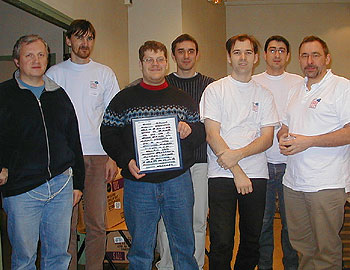
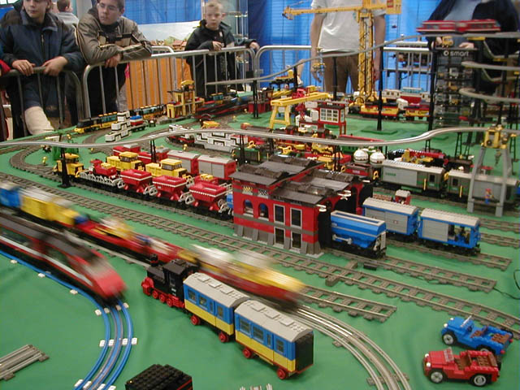
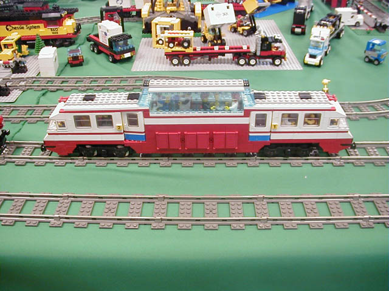
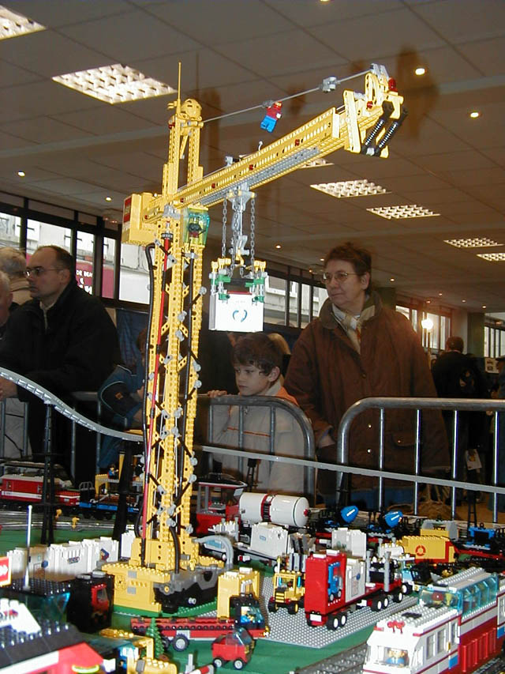
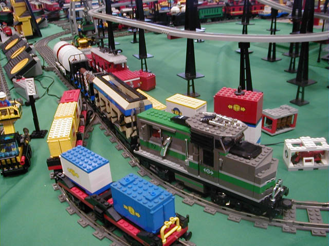
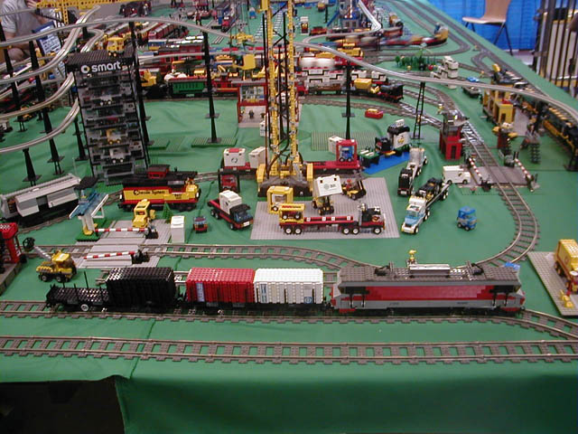
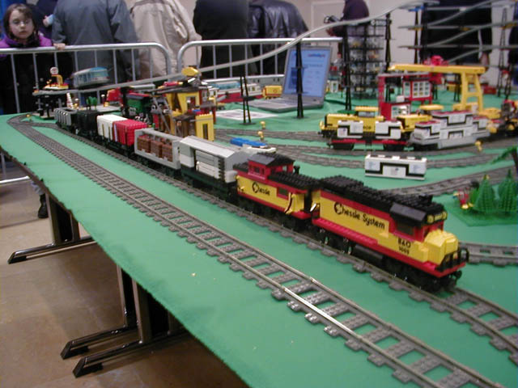
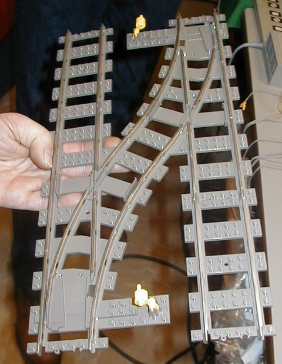

Ce weekend du 24 et 25 Janvier 2004 s’est déroulé une exposition de modélisme ferroviaire à Bourgoin Jallieu. FreeLUG était présent pour présenter une collection quasi exhaustive des modèles officiels LEGO dans le thème Train ainsi que quelques réalisations personnelles.

Etaient présents Philippe, Loys, Raphaël, Damien, Didier, Jibouille et Denis.

Sxpert tient dans les mains le "poster" des modèles de trains LEGO depuis les origines, disponible sur [digitalbricks](http://www.digitalbricks.nl/photo.html).

Pour faire court vous trouverez de nombreuses photos sur [brickshelf](http://www.brickshelf.com/cgi-bin/gallery.cgi?f=70137) ou sur [FreeLUG](http://photos.freelug.org/diapo.php?cat=41&expand=all) et des videos toujours sur [FreeLUG](http://perso.freelug.org/chimere/).

Sets officiels :

Réalisations personnelles :

Un réseau monorail par Jibouille

Une très belle automotrice (Denis)

Une grue radiocommandée remarquée (Philippe) :

Une motrice rutilante par Loys :

Un ensemble CC6500 + porte container par Didier

Un ensemble train de marchandise qui nous viens des Etats-Unis (Steve Barile - [Bricworx](http://www.bricworx.com/))

Enfin, selon une idée de ce même Steve Barile, Raphaël a réalisé un magnifique "Z" avec deux aiguillages (le barbare)

Remercions aussi vivement Damien, Raphaël et Olivier pour leur soutien matériel et logistique et les nombreux visiteurs (1500 adultes) parmi lesquels (ils se reconnaitront) Jef, Maxime et Christian.
