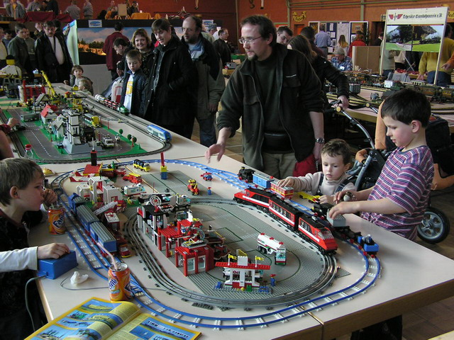
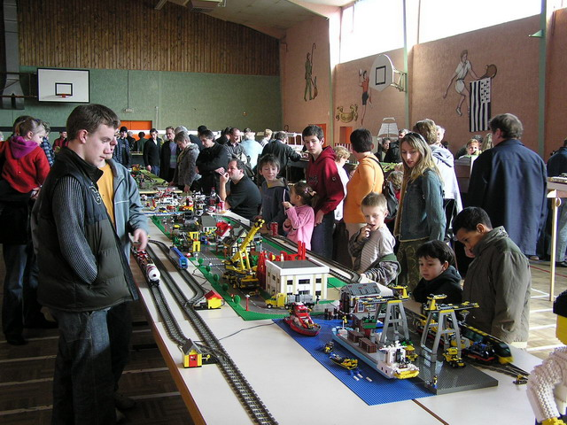

C’était la première fois que nous nous rendions à l’exposition de Lipsheim, et je dois avouer, vu l’accueil chaleureux et convivial, nous sommes impatients d’y retourner (Thierry et moi-même). Notre modeste stand a été la proie d’un public "legophile" qui a pu découvrir nos réalisations, ainsi qu’une petite rétrospective sur les trains d’antan (4.5V et 12V). Nous avons même fait office à certain moment de "garderie" pour le plus grand plaisir des enfants ...et des parents, qui pouvaient visiter tranquillement l’exposition.

Des légophiles en action !

Un public admiratif, scrutant le moindre détail.
