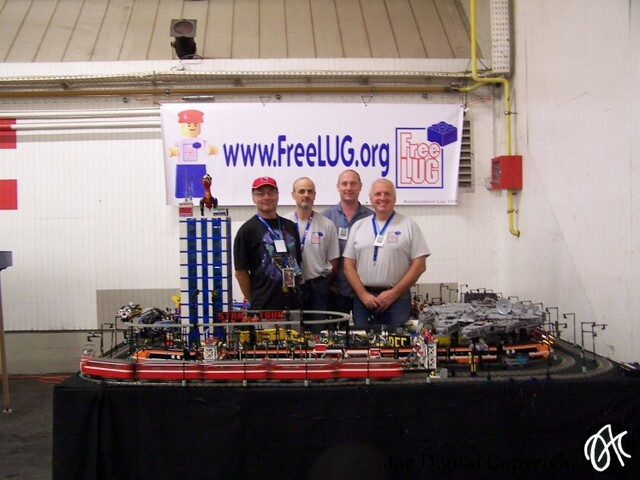
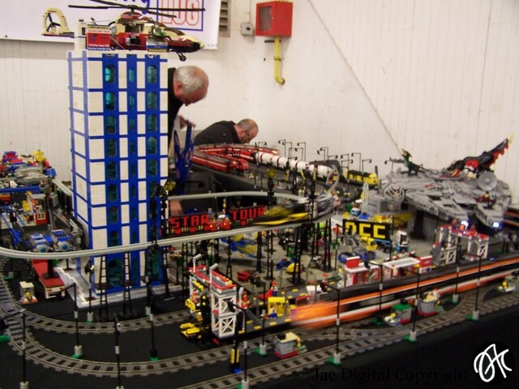
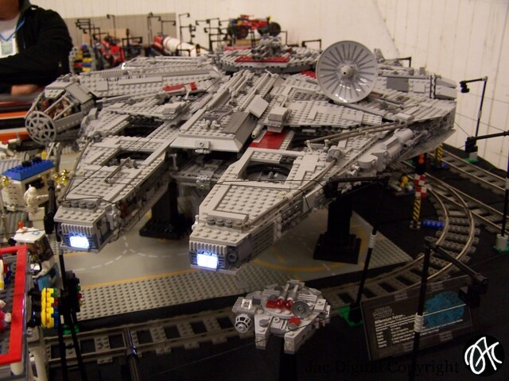
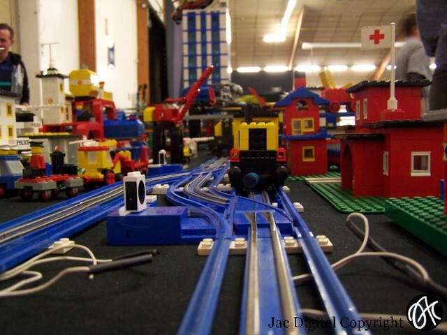
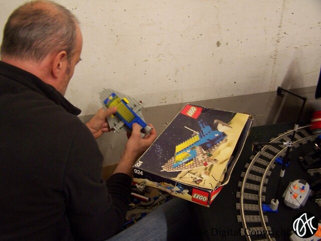
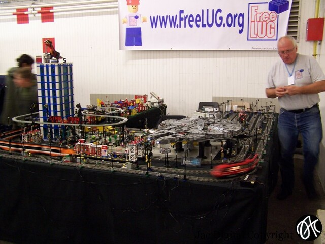

Le week-end des 30 Septembre et 1er Octobre 2017 nous étions à nouveau invités par l’Arverne Ferroviaire Miniature Club ([AFMC](http://afmc63.fr/)) à présenter un réseau en briques LEGO.

Pour cette édition, nous avions demandé un espace de 21m² pour permettre l’installation d’un nouveau réseau commandé par le système de commande digitale de Philippe. Malheureusement, nous apprenons deux semaines avant le salon que pour des raisons de sécurité, l’espace total a du être réduit. Il passe de 1800 à 1500m² et notre stand perd un tiers de son espace de jeu. Qu’à cela ne tienne, nous arriverons à présenter tout ce que nous avions prévu.

C’est un salon multi-thème, génial nous allons pouvoir tout mélanger. Après une recherche de nos adhérents disponibles pour ce week-end nous voyons ensemble ce qui pourrait être exposé. Du train, par "Frogleap" (ne me demandez pas d’où vient le pseudo !!!), du vieux city, voire très vieux par Franck, des modèles Star Wars et un monorail avec Xavier et puis moi-même avec mon immeuble bleu et le Millenium. Oui, vous lisez bien. Nous avons réussi à caser le gros vaisseau de Han Solo au milieu de la caténaire et du décor ferroviaire.

L’AFMC profite du salon pour installer son réseau géant, fait de plusieurs dizaines de modules, plus de 25 m de voies, qui reproduit en HO la ligne entre Riom (63) et Vichy (03). De superbes reproductions de bâtiments connus sur cette ligne. Nous avons pu aussi contempler de magnifiques maquettes d’avions, de motos, de bateaux dont un superbe Titanic. Un espace vraiment réussi qui a attiré plus de 1500 visiteurs.

Tout cela nous a permis de passer un agréable week-end. Une bonne ambiance régnait entre tous les exposants. Nous avons circulé sur tous les stands et posé quelques questions. Mon Racer Buggy a encore fait des étonnés : "C’est du LEGO ça ?"

Les visiteurs ont bien apprécié notre réseau, euh stand. Les vieux LEGO de Franck on fait des heureux. Certains se sont revus tout petit, pas nous on l’est déjà... Le Millenium avec ses spots en a surpris plus d’un. Et les trains n’ont eu de cesse de tourner pour faire tourner les têtes des enfants qui ne partaient plus pour les revoir passer.

_JAC_

* * *

Pour une première exposition me concernant, je suis tres content. On a réussi à s’adapter pendant tout le week-end, en fonction de ce que chacun apportait, rajoutant des LEGO ou en en enlevant.

Je rajouterais aussi que certains ont fait des affaires... Un château médiéval tout jaune en superbe état, set 365, ainsi qu’un LL 924 avec boite et notice.

_Xavxav !_

* * *

Oui !!! Excellente ambiance entre adhérents de FreeLUG à jouer au LEGO ensemble simplement, comme des enfants et pour les enfants. Le public le voyait bien qui revenait plusieurs fois voir le stand. La réorganisation de dernière minute a été bénéfique finalement. Quand on est peu d’adhérents à exposer et que le thème est libre, le LEGO nous permet de lâcher notre imagination. ELTEP !

_Frogleap_

* * *

[Galerie photo](http://photos.freelug.org/main.php/v/JAC/Exposition/2017/cournon/)
