Les weekends du 18 et 19 novembre, avec Olivier, nous avons participés à l’exposition de modélisme à la Ferme du Manet (78 / Montigny le Bretonneux).

Pour cette exposition, suite à un échange avec les organisateurs nous nous sommes arrêtés sur le diorama des temples Egyptiens accompagnés d’un réseau de train et d’un bateau télécommandé.

[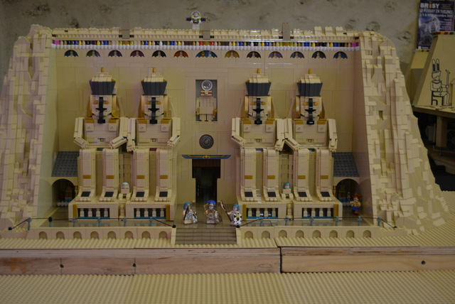](https://www.freelug.org/IMG/jpg/dsc_0193.jpg)

Cette exposition très interactive (tous les stands permettaient au visiteur de manipuler des véhicules) a ressemblé plus de 70 exposants sur 1500m². Nous avons rencontré plus de 5000 visiteurs sur le weekend ! Beaucoup de ces visiteurs ainsi que de nombreux exposants ont été surpris par ce qu’un AFOL peut faire avec des briques Lego.

[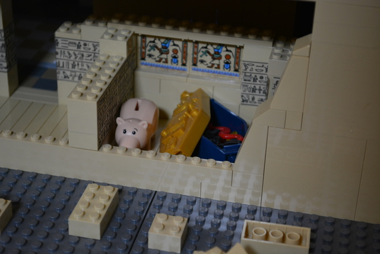](https://www.freelug.org/IMG/jpg/dsc_0214.jpg)

[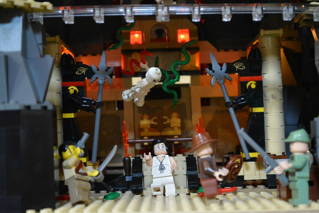](https://www.freelug.org/IMG/jpg/dsc_0211.jpg)

**vidéo du temple**

**Vidéo du bateau**

Plusieurs stands avec des véhicules téléguidés :

[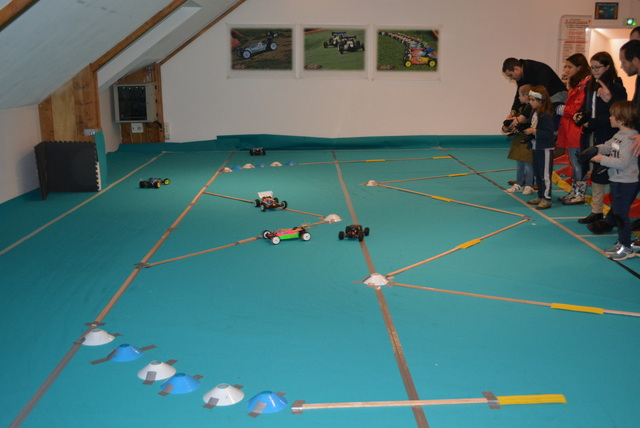](https://www.freelug.org/IMG/jpg/dsc_0197.jpg)

[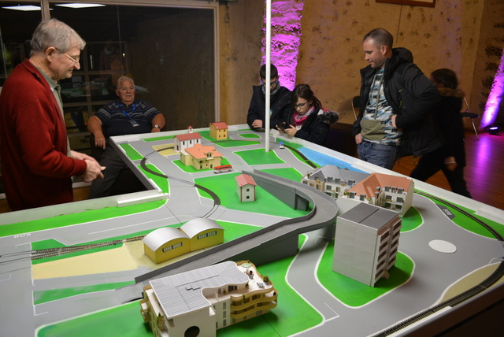](https://www.freelug.org/IMG/jpg/dsc_0199.jpg)

[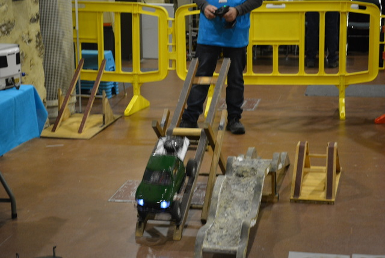](https://www.freelug.org/IMG/jpg/dsc_0202.jpg)

du simulateur (train, auto, avion...) :

[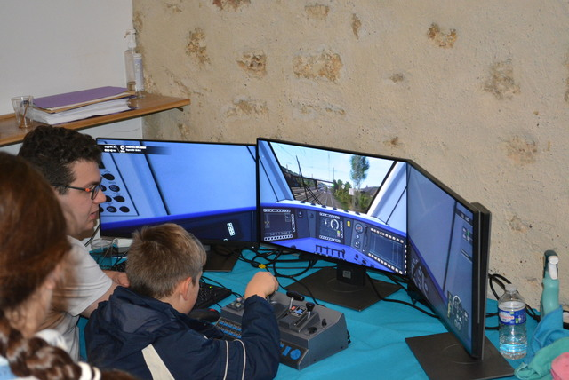](https://www.freelug.org/IMG/jpg/dsc_0198.jpg)

du slot racing :

[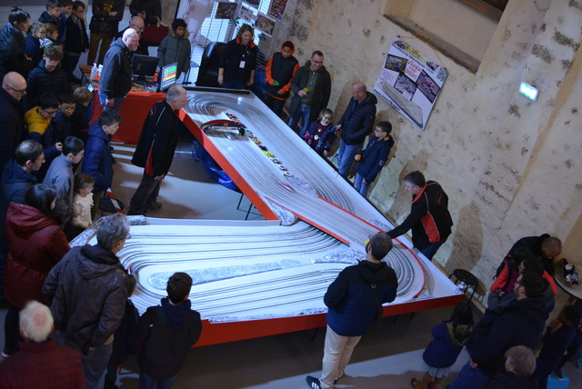](https://www.freelug.org/IMG/jpg/dsc_0195.jpg)

et du statique :

[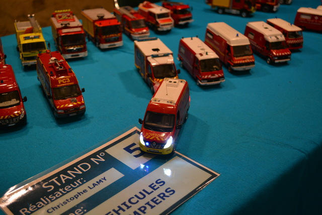](https://www.freelug.org/IMG/jpg/dsc_0201.jpg)

[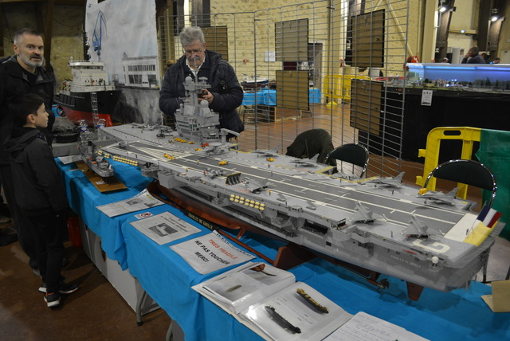](https://www.freelug.org/IMG/jpg/dsc_0206.jpg)

[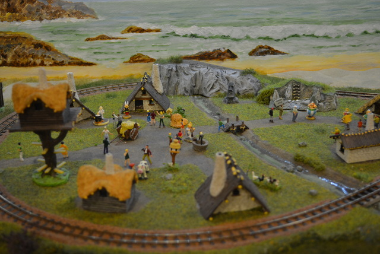](https://www.freelug.org/IMG/jpg/dsc_0210.jpg)
