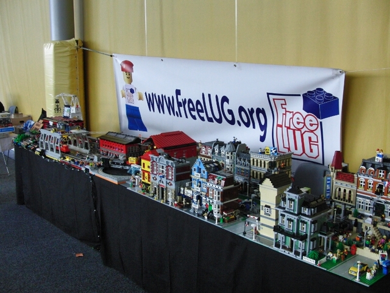
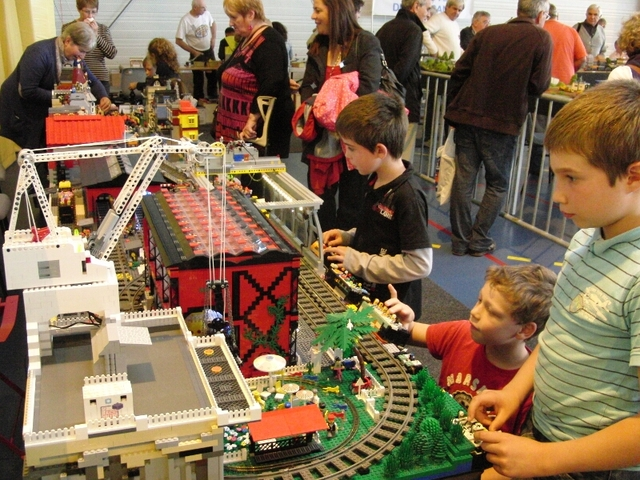

A l’invitation de l’Arverne Ferroviaire Miniature Club ([AFMC](http://ffmf.railfrance.org/mondial/8MMR/AFMC63/AFMC63_present.htm)) et de son Président Michel Bourdier, FreeLUG a participé à l’exposition intitulée "Maquettisme au pied des volcans".

Nous étions deux adhérents à avoir répondu présents pour cette modeste exposition, très simple et sympathique par l’ambiance bon enfant qui y règne. Selon les chiffres de l’organisation, 400 visiteurs sont venus nous rendre visite sur la journée et demie d’exposition.

Après une coordination de notre stand menée à l’aide des outils web de l’association (liste de discussion, échange de photos, plan du stand), nous avons choisi de faire cohabiter un diorama interactif de trains, proposé par Frogleap, et de grues et une ville pleine de détails et de petites scènes cocasses, proposée par Mamy Danny.

Les enfants étaient à la fête, car c’était un des rares stands où ils avaient le droit de toucher et même de jouer autant qu’ils voulaient... dans la limite de la patience des parents :)

Un week-end agréable à jouer au LEGO entre enfants plus ou moins grands.

A l’année prochaine !

* * *

[Voir les photos de Frogleap](http://photos.freelug.org/main.php/v/Frogleap/ExpositionsLego/Chamalieres2013/)
