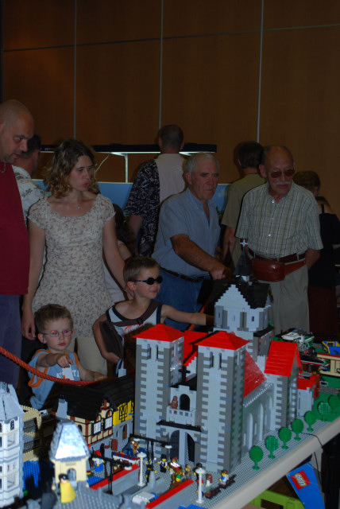
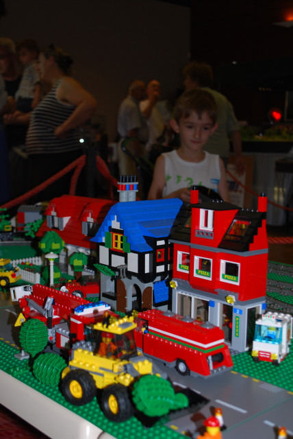
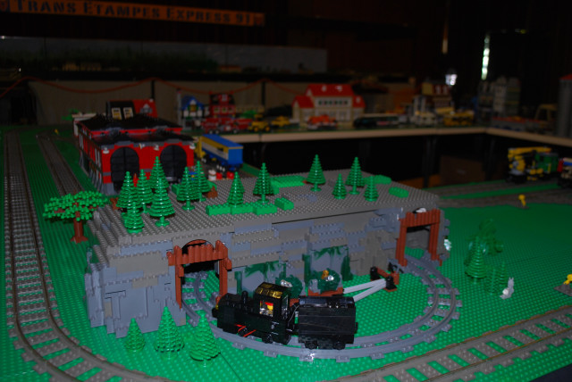
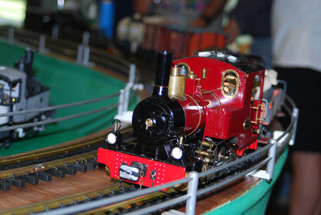

A l’initiative de Patrick Fourré, le délégué régional IDF-sud de la FFMF, la municipalité d’Angerville (91) a invité FreeLUG à participer à une exposition de trains miniatures.

Du train LEGO a pu donc être présenté en même temps que les réalisations en Z, N, HO et vapeur vive des membres des clubs d’Orléans (AMFC) et d’Etrechy (TEE).

C’est donc un réseau de type "tour de table" qui a été présenté au public.

Monté la veille sur une surface de table en "O", le réseau mêlait à la fois quelques sets du commerce et quelques réalisations personnelles.

**Eglise Romane**

Le réseau en rails 9V a permis de faire tourner trains électriques et trains RC dont les télécommandes étaient laissées à disposition des enfants du public.

Pour m’aider, dès le montage, j’ai pu bénéficier de l’aide du petit Thomas et de sa grande sœur Léa dont la mamie exposait à coté de la salle "train", les réalisations des différents ateliers de travaux manuels de la commune.

**La ville, avec Thomas mon chef de gare adjoint.**

En dehors de la salle se tenait une kermesse, agrémentée le dimanche d’une brocante.

Dès la mise en place des rails, [l’Emerald Night](/articles/le-train-nuit-d-emeraude-mis-au-jour/) a fait sensation auprès des modélistes présents. Il n’y a pas, une locomotive vapeur ça a quand même plus de charme qu’une motrice électrique...

Cependant l’usage sur un circuit développé de ce train m’a quand même conforté dans l’idée que j’avais, depuis la dernière animation au [PicWic de Sainte-Geneviève des Bois](/articles/animation-lego-au-picwic-de-sainte-genevieve-des-bois/), qu’une alimentation PFS pour cette locomotive où l’embiellage génère déjà quelques contraintes, n’est pas forcément une bonne solution. En tout cas elle nécessite de fréquents démontages/remontages de la mécanique, pour remettre en place le pignon baladeur.

Dans le même ordre d’idée des chalenges mécaniques à relever, j’ai également testé le modélisme train LEGO en voie étroite : "Le" (L pour LEGO gauge et e pour voie étroite).

**Train de Mine en Le**

Utilisant les derniers rails en 4 tenons de large du récent set [Indiana Jones 7199](http://shop.lego.com/ByTheme/Product.aspx?p=7199&cn=534&d=519), j’ai réalisé un petit train de mine, utilisant un micro-moteur et un entrainement par élastique, car si les mini-roues ont une empreinte d’axe cruciforme, je n’ai pas trouvé de solution sur des pièces existantes pour entrainer les roues directement depuis le moteur. La seule solution trouvée "à l’arrache" a été d’utiliser une transmission par élastique en utilisant le champ des roues. Je pense qu’il y a là matière à faire appel à la créativité de nos adhérents.

Le dimanche j’ai été rejoint par Sébastien Hamon, qui a pu s’extraire de ses activités professionnelles. Je le remercie pour sa visite et pour son aide.

Je remercie également les membres de l’équipe municipale d’Angerville pour leur accueil et leur mot de remerciement et merci également à tous nos amis exposants et visiteurs de la FFMF. J’en profite également pour attirer l’attention des personnes à la fois fans de trains et de techniques, que la vapeur vive en modèle réduit est une autre activité de "dingues".

**Vapeur Vive**

Chapeau à tous et à bientôt, vraisemblablement pour Orléans 2010.

[Photos de l’événement.](http://photos.freelug.org/main.php/v/La-Gallerie-de-qdm/Expositions/2009-Angerville/)
