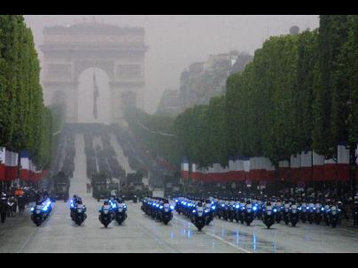
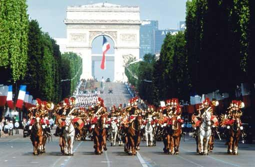

Suite au succès médiatique locale de cette événement en 2007 et suite aux bonnes relations avec le magasin Toys’R’Us de Dijon, l’exposition du 14 juillet 2008 sera donc renouvelée dans ce magasin.

Après les 120 motos de Gendarmerie en 2007,

le projet du 14 juillet 2008 s’oriente sur la garde républicaine et quelques véhicules. L’arc de Triomphe en bleu blanc rouge au 1/45ième est toujours d’actualité mais demande plus de temps que prévu donc pas sûr d’être fini à temps.

Pour le moment, trois Freelugiens s’associent pour faire vivre cette exposition. Si jamais vous êtes intéressé n’hésitez pas à me contacter : legodefile@yahoo.fr

Si vous êtes de passage, n’hésitez pas à venir nous voir en exposition cela nous fera plaisir de vous rencontrer.

[Précédente édition](/articles/exposition-du-defile-du-14-juillet-a-dijon-la-grande-vadrouille/)
