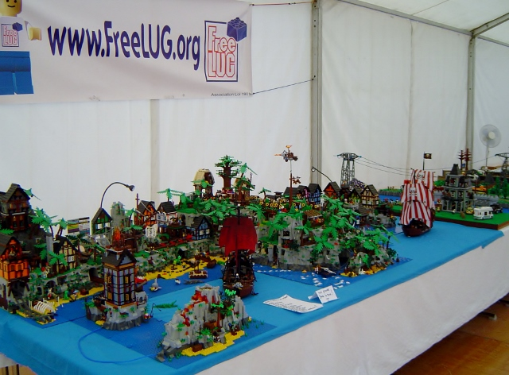
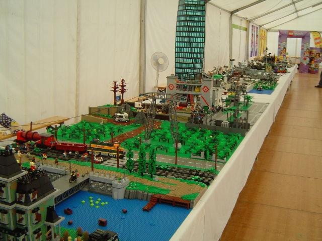
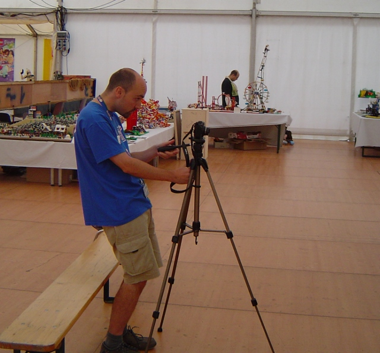
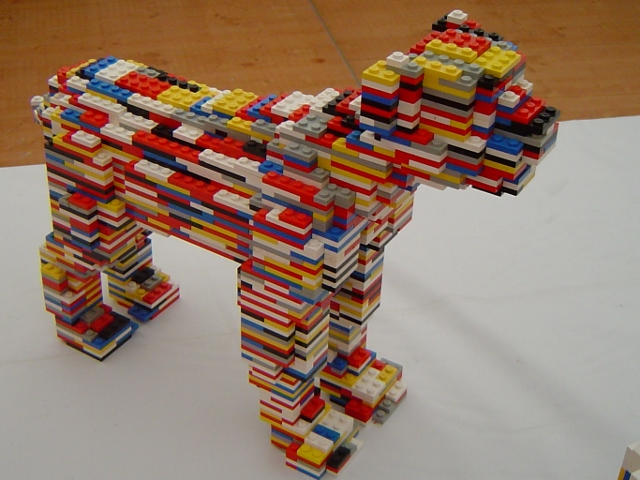
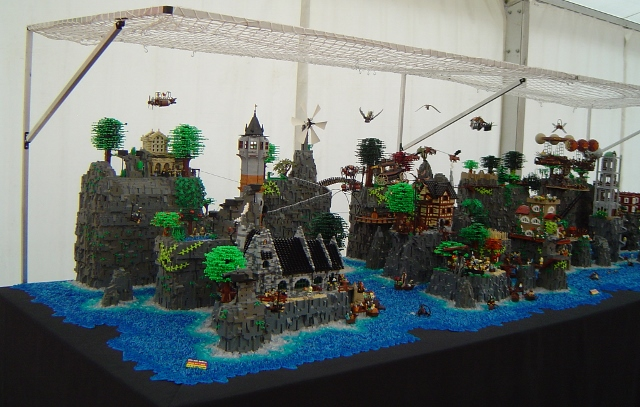
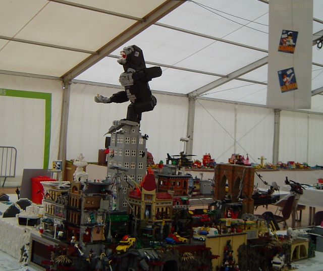
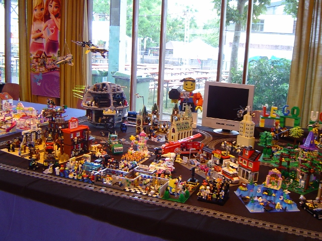
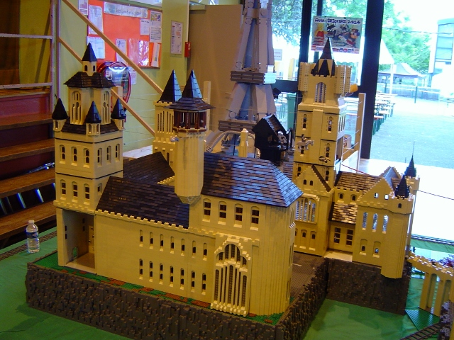

Nous avons participé à la neuvième exposition de Fana’Briques à Rosheim. Cette nouvelle édition de 5000 m² est une des plus grandes expositions de briques LEGO en France. L’équipe de Fanabriques nous a réservé un excellent accueil qui ne démérite pas d’années en années, bien au contraire !

Fana’Briques pour petit rappel, c’est une exposition de briques LEGO organisé dans une petite ville typique de l’Alsace, à Rosheim. Elle est organisée par l’association Fanabriques domiciliée dans cette même ville. Elle regroupe plus de 300 membres et cette exposition depuis maintenant 9 ans est entièrement organisée par leurs soins. Chaque édition l’a vu grandir et améliorer, 5000 m² de surface pour cette année ! Plus de 14000 visiteurs !

Le départ a eu lieu le vendredi matin pour la plus par d’entre nous, la veille pour certains ! Le lieu d’arrivée, tout le monde le connait maintenant.  
Il ne faut pas oublier qu’une exposition de prépare longtemps avant, quasiment début septembre pour les organisateurs. Dés janvier pour nous exposants !  
Denis a choisi la fête foraine, Mickael une île pirate des plus merveilleuses et Pierre, Erik et moi un diorama basé sur la série américaine "Walking Dead".

L’installation a lieu dès le vendredi après midi, car l’ouverture se fait dès 18h00 jusqu’à 23h00, et cette ouverture nocturne est bien remplie de visiteurs ! Dès que nous sommes tous arrivés le stand se monte très rapidement et tout est prêt à l’heure !

Dès que nous avons terminé un petit tour pour une visite rapide de l’exposition, des réalisations superbes et très diversifiés , chacun va trouver la construction qui lui plaît !

**L’île Pirate**

L’île Pirate de Mickaël

**The Walking Death**

La série américaine Walking Death réalisé par Erik , Tribolego , SystemDbrick

Toute la logistique est assurée sur place et réglée comme une horloge ! Le ventre rempli, nous pouvons commencer la soirée et accueillir les visiteurs le plus chaleureusement possible et entamer les discussions passionnées !

La nuit, bien que courte, permet de récupérer un peu du voyage ... !  
Le samedi matin l’ouverture se fait à 10h. C’est le moment idéal pour faire les photos et rencontrer les exposants qui sont quasiment tous des fidèles et des amis.  
Le thème général de l’exposition est le Cinéma, comme il change chaque année, cela permet d’avoir un renouvellement des constructions exposées ce qui fait de Fana’Briques, une nouvelle exposition à chaque fois ! Et un immense plaisir de s’y retrouver tous les ans, Erik et moi, nous faisons notre 8 ème participation !  
Nous participons dans une plage affectée à l’avance, aux activités pour l’organisation de l’exposition, car tout le monde est bénévole et Fanabriques assure toute la logistique pendant l’exposition, accueil parking, caisses, stand de restauration, animations, nettoyages , ...

La soirée du samedi soir se conclut avec le repas de fête pour tous les participants. Cela permet à chacun de discuter de ce qu’il a apprécié le plus dans l’exposition et de prendre des nouvelles familiales de toutes les têtes connues ! Des animations de loto et d’enchères sont proposés pour égayer la soirée qui se termine aux alentours de minuit !

**Brickerik en photographe**

Une des activités d’une exposition , la photo !

Le dimanche ouverture 9h00, c’est la grosse journée de weekend qui verra défiler beaucoup de visiteurs ! Nous profitons des absences sur le stand pour faire des petites bêtises sur le diorama des voisins qui ravissent le public et l’auteur de la réalisation !  
Une petite visite au stand de vente pour rechercher quelques pièces manquantes et/ou modèle particulier. La visualisation des films d’animation ou la participation à une conférence avec les designers invités de chez LEGO.

**Le Chat**

Une sculpture étonnante multicolore

**Le monde Steampunk**

Le monde Steampunk vu par l’équipe de Brickpirate

**King Kong , le roi des gorilles**

**Des créations par centaines !**

Et il faut déjà penser à la fin ! Le rangement !  
Cette année nous ne sommes que 2 à prolonger la fête pour une visite du parc LEGOLAND en Allemagne le lundi !  
L’aller a été pour le moins difficile beaucoup de circulation et ralentissement suite à un accident sur la voie rapide ... la pluie . La météo a été chaotique toute la journée, mais la visite s’est déroulée dans la bonne humeur !  
Le retour (toujours plus rapide), nous a permis de terminer la soirée chez Thierry pour un dîner en famille !

Descriptif des constructions et mot des exposants :

Sylvain CACHEUX (Sylca) :  
Un grand merci à l’équipe Fanabriques, pour une organisation sans faille, comme d’habitude, ainsi qu’à tous les LUGs venus présenter leurs créations.  
Mention spéciale à Eric "Potter" Philan pour sa venue au pied levé avec son château de Poudlard, qui a émerveillé petits & grands !

**Le masjestueux Château de Hogwarts**

A l’année prochaine !

Galerie photos :

[Photos d’Eric](http://photos.freelug.org/main.php/v/f1tvf/expositions/fana2014/)
