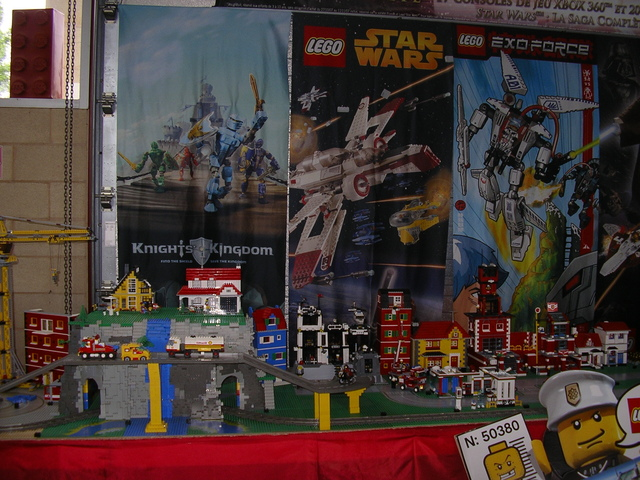

Pour la troisième année consécutive, l’association _les GRANDS Z’ENFANTS_ organise une exposition de Jeux et de Jouets.

**–** Nom : A la Croisée des Jouets - 3ème Edition  
**–** Lieu : Razac-sur-l’Isle (24) à 10 km de Périgueux sur la RN 89 en direction de Bordeaux  
**–** Date :

-   Le samedi 15 mai de 9h à 18h
-   Le dimanche 16 mai de 8h à 18h
-   Restauration et buvette sur place
-   Vide grenier le Dimanche

Entrée gratuite

Salle de 1200 m².

Exposants : toutes collections confondues, LEGO, Playmobil, jouets des années 80, BARBIE, Robots, jeux vidéo, modélisme ferroviaire, miniatures voitures, cosplay...

Plus d’informations sur le Forum [http://lesgrands-zenfants.xooit.com](http://lesgrands-zenfants.xooit.com/)

FreeLUG sera représenté par moi-même (lesgoss) et Pascal.

Alors venez nous rencontrer sur notre stand !
