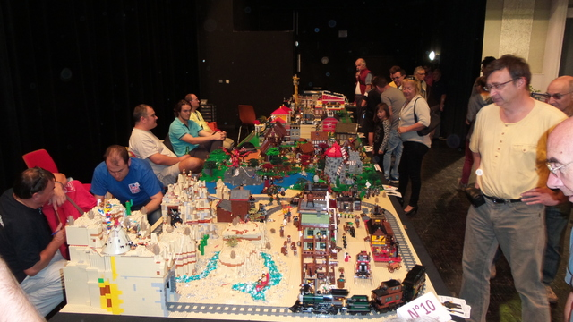
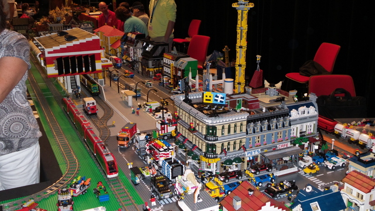
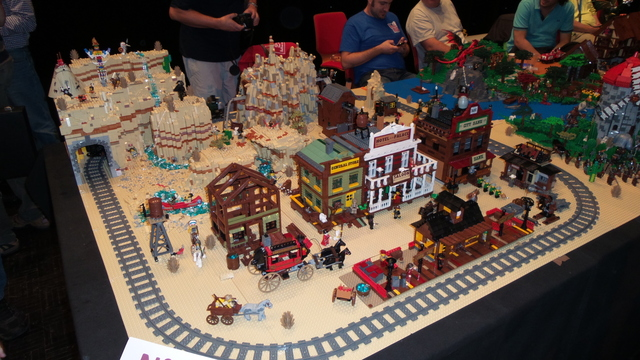
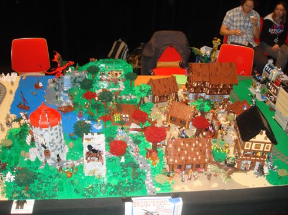
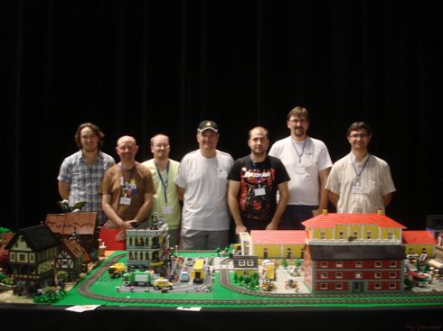
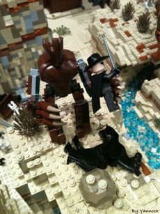
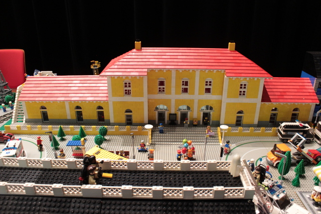
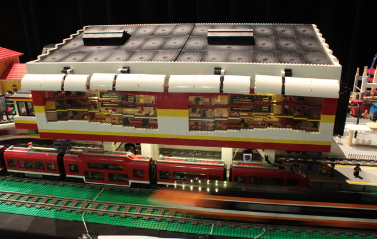
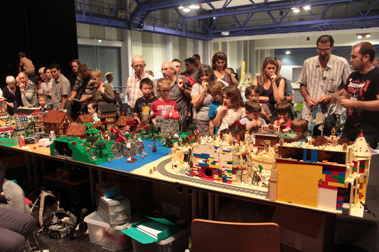

Un aller-retour en covoiturage sur la journée qui valait le coup, pour voir les copains et s’en faire de nouveaux !

Et puis l’intérêt de ce genre d’expo c’est qu’on peut aussi s’intéresser à autre chose qu’aux briques LEGO... Mais bon : "chassez le naturiste : il revient au bungalow..." ! Je veux dire par là, euh... que... euh... Mais bon, vous aviez compris : c’est nous qu’on est les plus beaux ! ;-)

La prochaine, c’est quand ?

_Jérôme (jivé69)_

* * *

A la demande de Jean-Yves, je me suis décidé à me joindre à la petite bande pour cette exposition de modélisme ferroviaire à Montélimar, et histoire de coller au thème, j’ai opté pour un diorama..... médiéval !

Et oui, avec Candia, nous avons une fois de plus proposé un diorama collaboratif, avec plein de hobbits, nains et autres joyeuseté chevaleresques :

**Diorama collaboratif**

Une exposition très conviviale, avec une bonne bande de potes.

Ce fut l’occasion de faire plein de nouvelles connaissances, de saboter le Diorama de Jean-Yves, s’amuser. Une exposition qui restera pour moi un excellent souvenir !

**Un des nombreux sabotages du Dio de Jean-Yves : Zorro en mauvaise posture**

Un petit mot de l’instigateur tout de même :  
C’était la première expo à domicile, et pour une première ce fût vraiment réussi, avec des nouvelles rencontres, des retrouvailles et un public conquis.  
D’ailleurs on m’en parle encore au boulot !!  
Montélirail c’est tous les 2 ans et on nous attend de pied ferme en 2016, avec du train, encore du train et avec à la clé quelques bouteilles de clairettes de Die et autre paquets de nougats !!!  
Alors à très bientôt et encore MERCI à tous !!  
Pour finir quelques souvenirs :

**la superbe gare de Montélimar**

**Le TGV à fond !**

**L’envers du décor**

* * *

Pour ma part c’était ma première expo, venu avec quelques sets officiels qui m’ont permis de m’intégrer au groupe en attendant mon premier MOC !

Très bonne ambiance, on a beaucoup rigolé, les cow-boys de Jean-Yves se souviendront longtemps de ce passage à Montélimar !  
Vivement l’année prochaine, la date est déjà marquée sur le calendrier (et en espérant qu’on soit encore plus nombreux ;))

_Niko LEMAIRE_
