Après plusieurs participations d’abord à l’exposition de Parigné l’Evêques, puis celle de Mulsanne, j’y suis de retour cette année.

C’était la 1e exposition où le temple Egyptien (dans sa 1e version) a été exposé.

Pour cette édition, j’ai apporté le temple au complet ainsi que le temple d’Abbu Simbel pour sa 2e sortie

[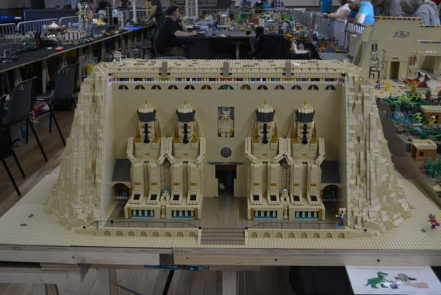](https://lh3.googleusercontent.com/pw/AM-JKLXpspySZUqM2jwgtE74T9byJxwV-FkayJeXaTEDkYozyCL_s8viF9l9HhrizSsbN-hhEqIklQcfwmIuhDxqSCqgShbCsZ3lB6N-swn1rwwx32otxf7LlYh_XHYeWOyXXuiU9dAxpg-xJtIT535I1Bq6=w1450-h969-no?authuser=2)

Pour cette année 2022, je suis retourné voir mes amis de Briques Mulsanne, organisateur de cette expo. J’y ai également retrouvé Manu, avec son monde suspendu !

[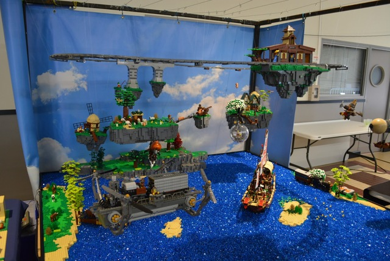](https://lh3.googleusercontent.com/pw/AM-JKLVy8BpnzQYQO2N9gMnR1fm4j1lt4Tf_ef-8dTpDyoz53y1MEPwCQKb5zoacMukCoVq-IR5eQp4weEj6Z25_bCS6n9FOXliNYMTikpvmk52hz-YxDRu-Xh7gAQBa1Ll_d3I2k2mJTdu5LQ8RPPIv8uak=w1450-h969-no?authuser=2)

Malgré un weekend prolongé, nous nous sommes retrouvés à une trentaine d’exposants et avons pu rencontrer plus de 2230 visiteurs.

De très beaux dioramas étaient présents sur des thèmes peu vus en exposition : Fabuland, Militaire, 24h du mans...

2 Mosaïques ont été assemblées durant ce weekend dont une dédié à la fête des mère qui avez lieu ce dimanche :

[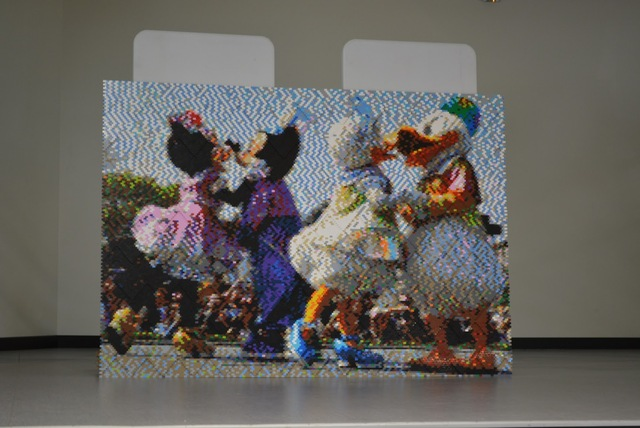](https://lh3.googleusercontent.com/pw/AM-JKLWrGK4tJ92ByQaGcqMxNlBO2rNOeHSsRjP2U_q9Hcp-AqZPEAc1GFW7EGQRpV3gaSkyttwQuUWPe89_rnooF5MDW0XypKB1TNaPvDtM7ZL4_FGQnaIBpuvcTvjDrxgKx9lsevB6YW68WszlGRiS95bn=w1450-h969-no?authuser=2)

[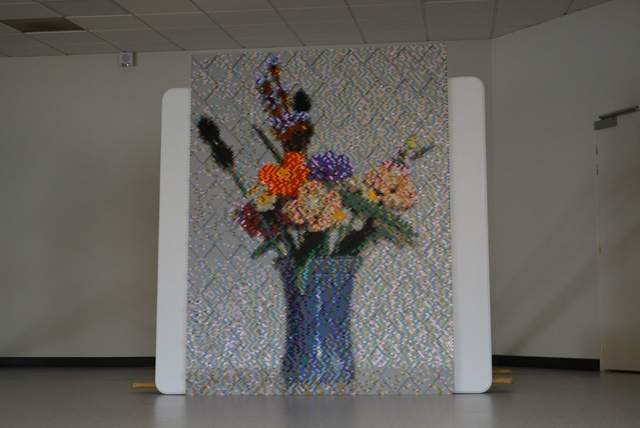](https://lh3.googleusercontent.com/pw/AM-JKLX7ZIaDa-tI_NW1MKjLmdFMC8KbiseP67rhlMa9nVgkFKbevEWm0KSrPv7Ggv9zX0v1cUJ7Hl1VxoekF3kNVCTC25ae2smJ2aQ-lQNcPUjEjX3-OGxAAGZ7XnasWwx6-_4R0tXIq-09gIcHUj3GX1q-=w1450-h969-no?authuser=2)

voici quelques photos de l’exposition :

[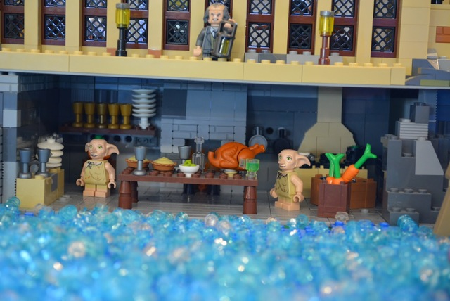](https://lh3.googleusercontent.com/pw/AM-JKLUqb3HlZ1aSeNMHg309x2_KKKYGZdKBL86ertbRbCRNYYUMOI9ZQRKNXiOrqv5xVWgZPrNwm5fL4o81iQpIfRFUuExjLbBEMFRl5c1jbD10CEjl1jrH8pAOArd4nFre3veMcOqY2JkseRlS3JMNBtMI=w1450-h969-no?authuser=2)

[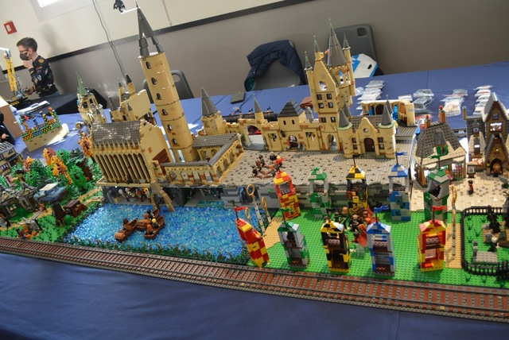](https://lh3.googleusercontent.com/pw/AM-JKLX8KxXD8BqEVvbp1z6am2y_MK70sFDOs-cyyos1fFbeHOWvsGyRWqetPkpaqzboMn223b0omZBM6agorkJGRKD1ZLe4x2Z_-cieKMuKOiZ19-baOmTjK64A78YYR169pEq40Zm5i9jQa-csED01Ph1y=w1450-h969-no?authuser=2)

[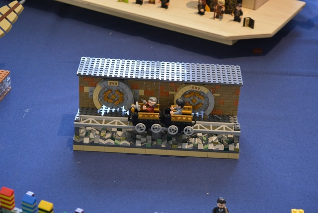](https://lh3.googleusercontent.com/pw/AM-JKLX-jw3_OtuNaw-OfUdIKtiiV4DF9a4OAbVR7ccVbOpyRCLVZJVdvcq0J4t2GE8qXYo_qeSwwHDslMfO_bwcEh18BWKcspZAIM56hPK7lp17xawf_PzhGkUl1q_MsngS3k8MJPmm4lHjfsaRp_wZZLjs=w1450-h969-no?authuser=2)

[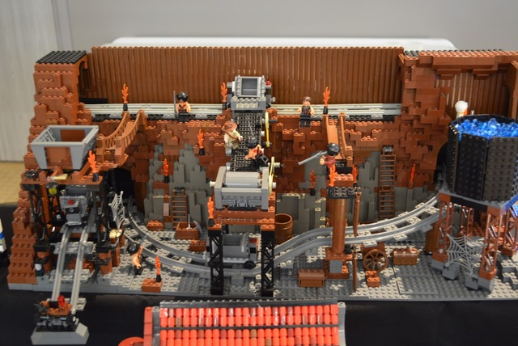](https://lh3.googleusercontent.com/pw/AM-JKLW7YCqwSYQY1QKVaM9B88fJu3JCQEnGlYXPZIf1veKj8Z34HqJRfiJ7MNDzZXU20pVwJ9f0VQtUbM6_H6CJ7A2iWMetXe5X9mG8_bEkbuxambSK14DZHeYhLs8GlCtX0AuZrWNlBy0xuAEY_X9Kkf2Q=w1450-h969-no?authuser=2)

[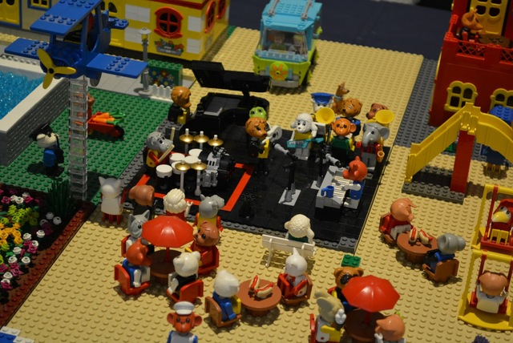](https://lh3.googleusercontent.com/pw/AM-JKLXEX9X06u-qAMirUeIi6tntOqH-4Vih3P7RdqSLy3gxZTGNQ8JjvbgDW52EyA3tlkq8ksMKoTpkOdwuWiA-gOqJaP4clKmnmrNykfcHp3EZECCP9guaMJj87qtoSrj6j2Tc7q1mDKRw7E0dGqIc6UH-=w1450-h969-no?authuser=2)

[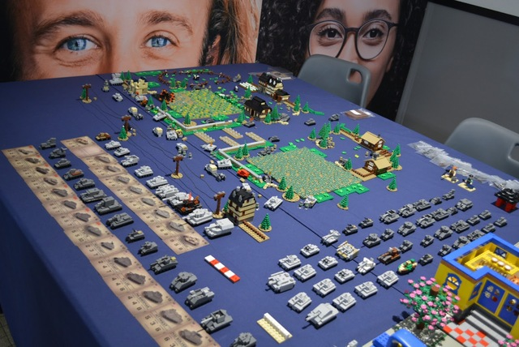](https://lh3.googleusercontent.com/pw/AM-JKLX93pVLtGYIghG024_bsdj2T8j4Non8bSZYaJNLI4daw-52jdFsqGiBKvOeVT-u03n-9ZbgcA5DOtvTsuVVGSnP72zPUSMBS7uRV2HreBQdNskz5S6LlsQvOkznvwDJOelReME6M59OiDRqT7svm9F3=w1450-h969-no?authuser=2)

[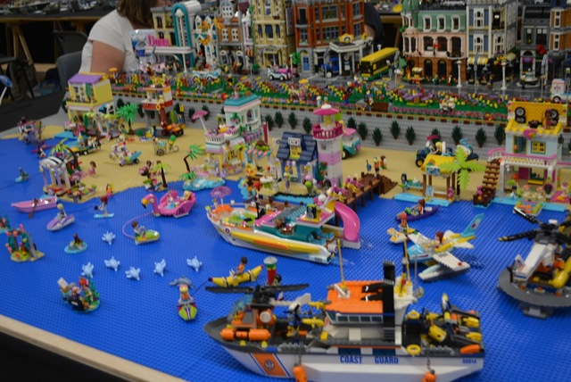](https://lh3.googleusercontent.com/pw/AM-JKLUTDN7S92F5tXP0yrEyW3FcHB4v6pGg5yN4V--0rc8IjI_TPZIJjZS2fxOUuEbTBpOqDLDyR7RUGSmxQKEp2I4K05uKEm8THLkDx4f5hwCbmlgba5tR2Iiys6fqZDrj8wG2BGIar9TZLA9DUgw_CZry=w1450-h969-no?authuser=2)

[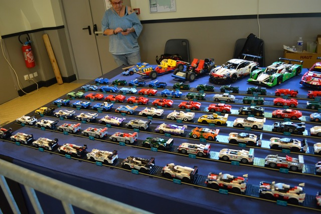](https://lh3.googleusercontent.com/pw/AM-JKLUxtNasWrUlpqRvXxcK9NtPcyEUVU2K9cyLspslM2bGQT3GqtFw87Eergs2Kdx0MQtx6B0hviR670m8OtHqRysv72PO9SX71UYx_WsW0Lza7fciZ-_x6QatO0nrV4FP9NKbE0Qn0uyK-kI91g3mf9WY=w1450-h969-no?authuser=2)

Retrouvez toutes mes photos sur [le lien photo](https://photos.app.goo.gl/iT7swnFSmChy6V2RA)

Voir en ligne : [Toutes mes photos](https://photos.app.goo.gl/iT7swnFSmChy6V2RA)
