Les expositions de modélisme sont demandeuses des stands des briques Lego. Voici mon retour d’expérience sur l’une d’entre elle ! Les RMA au Mesnil St Denis (78), les 17 et 18 septembre 2022.

Les RMA sont les rencontres du modélisme et de l’automobile organisés tous les 3 ans par le Mesnil Saint Denis. Ainsi, cette exposition présentait au public venu nombreux, des voitures à toutes les échelles, réelles, miniatures, radiocommandées, mais également des réseaux de trains, des bateaux… un concours d’élégance, un thé dansant et une petite ferme pédagogique. Que des domaines dans lesquels la petite brique peut se mélanger aux classiques réalisations modélistes.

C’est pour ma part également un moment de rencontre entre le modélisme et les Briques Lego. En effet, de plus en plus de dioramas LEGO s’appliquent à reproduire des scènes (réel, de cinémas…) le plus détaillé possible. De l’autre coté, les modélistes classiques utilisent de plus en plus souvent des briques Lego pour leurs maquette, décores...

Sur plusieurs stands, nous avons pu découvrir des maquettes, des ateliers qui utilisent nos habituelles petites briques.

[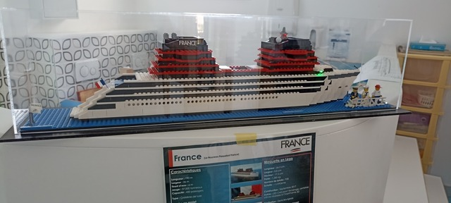](https://lh3.googleusercontent.com/pw/AL9nZEUfJDk3_20UY_V9Ynn-mybcwEijeJV0BOLPUi4rdDvR6RPZ65ELyQLdK80btj8ZHrvcavM31lULPgSsrUVVOIyehXuXJBZiIRSoeOGl8EcH_RXbKmyEo2nGG3L9dl5i9ECpTypj55iqPfvxBiq4Yh_K=w1490-h670-no?authuser=2)

[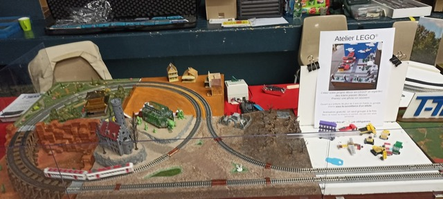](https://lh3.googleusercontent.com/pw/AL9nZEXc6NNk3w5twhO4a77y_teH7koaB8WWqi2F4SdCSpheyM7f8Pe5TWuJ4YDw_MCabCZC9PaXqrqqyMEvgG42vsRxubcN5qNxif2E2CT9uh6th0fb2XPsI2XOa9SgVhgKcSB661W4LTpVua0FVY82T30-=w1490-h670-no?authuser=2)

De mon coté, avec un ami, nous avons réalisés un diorama avec une partie ville réalisée principalement avec des Modular accompagnée d’une partie zoo afin de mettre en valeur la diversité animale de nos briques !

[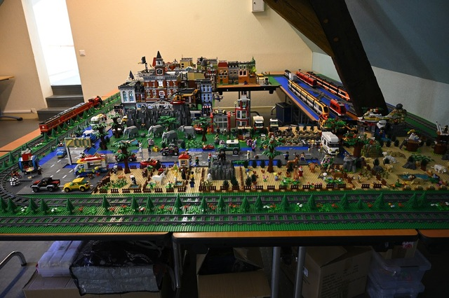](https://lh3.googleusercontent.com/pw/AL9nZEXAGtYwJ3hkzfLBUH7Nt3wEyMODxQoLp85tgFrUKQHpGWyxmHFV0DsZbofm5dmklJEJRDgFJp1KjYCDmm8bUI9idsHJzowWjRpOVtXRG0HAfza30u8jRzgc9MkRFUIpspUuTmXEJ_rEq7HDX0fY2ICU=w1371-h912-no?authuser=2)

Une autre table présentait une exposition de voiture issue de la gamme creator.

[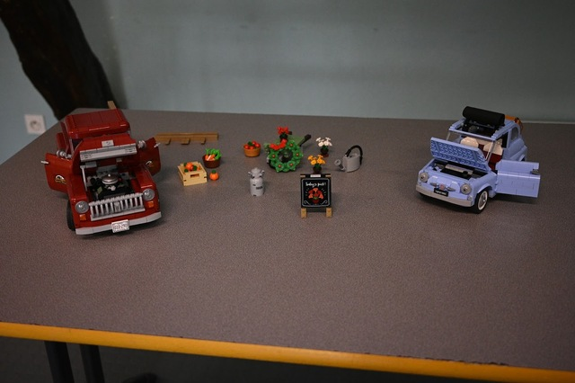](https://lh3.googleusercontent.com/pw/AL9nZEV5RHtuK-p2y2FrVq0DsAZEutkt5zbFcuUF2mmv6-GvP0vq9_oD1VyDLt6poAFj0ilYkHa0rUMF-v2Zknpu2PNetgxo2XtHbIf73zuqIQ28LcPiPNd2Y0ZdQMKBa7vDFzo4zGHoa3ZsP1g7GhBj3esF=w1371-h912-no?authuser=2)

[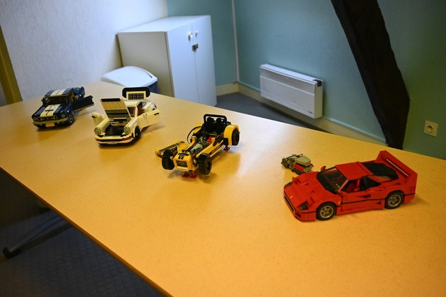](https://lh3.googleusercontent.com/pw/AL9nZEWaS9VXvWT9SAZN2mXcl5zeYOD6fkmFWy81hJCnpCv47G7_LUn9EM2QQ9zqYkbzy2aN-wsIxMVX58Aesu4A5KRTthKcudVPPUNNTCtXTpKEHGj9vyo1epdSzPoL6hrEpzXGB9CnR8j4nzzW-SmNx26a=w1371-h912-no?authuser=2)

Quelques photos de l’exposition :

[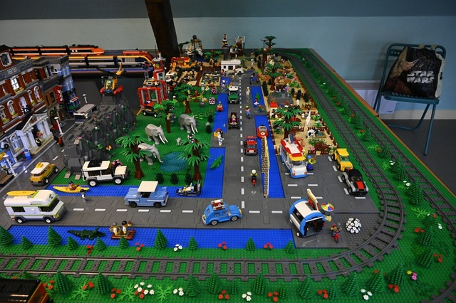](https://lh3.googleusercontent.com/pw/AL9nZEXXVyGH-s9o0BuRQCf36s9oEyk4fj2ym0vFqpjgt7BhmjlpxBTomHxCowrF0zUcvHXi5QVfyp2sSqUSLt8L5IQkqnzLOFR9IV7rH56KBcBj7K7k45NapkRLPB3DC2-respuc-YC-wqUNz5qYKsxkkh2=w1371-h912-no?authuser=2)

[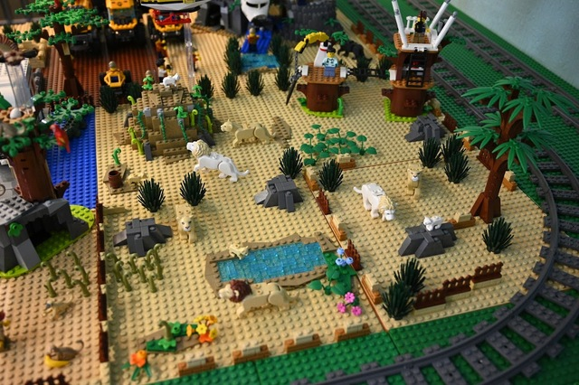](https://lh3.googleusercontent.com/pw/AL9nZEWWkAr0vz6rzTdX9gtG4jVZIXFWHudo3potr0cUDaiGi7E7BrfUX-KC_SMaAP0osOeF5ya5Mo_PNL4B3lYASNO58gaE0GCKDCD3aaAEWvQ9pqJ2tSF2C2qqEFfCoQVGMO4j_IAFTXIdA1eWkNuywwWz=w1371-h912-no?authuser=2)

[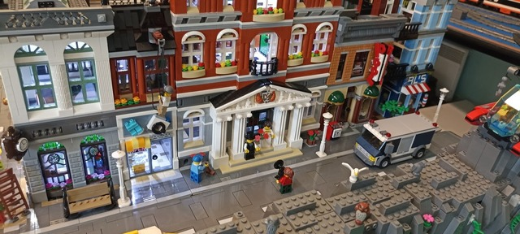](https://lh3.googleusercontent.com/pw/AL9nZEXt0DlbUu6gpqAkSEMGJSw5Gri_vVLOSAgOHRmSJNRtZmrIa7ZB_esne2rwY0fkZShIgM5EKIC2E1BTx8o2V899RFHVDq6fIITsQYtMPJpm6D9UBpoxwEAPV-PlvrPHwr_ApyHQhLLXMSwos5shOStH=w1490-h670-no?authuser=2)

[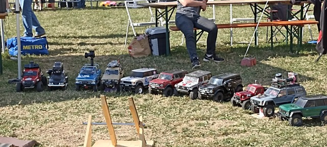](https://lh3.googleusercontent.com/pw/AL9nZEWbJ6F7NKMCzAKxLGQHXF5mBLo9oyGU-g6f5v_wsnMF651_u7Wgj2PSjgyLipr57QyqXLiMtB_I8czgzq56uPu1_2UFK2LRdbj3cLEPZ6z0TZhqxz0JwsBy4iirBTSPNoMNQ8Zsz-aBLUwE531E2Em5=w1490-h670-no?authuser=2)

[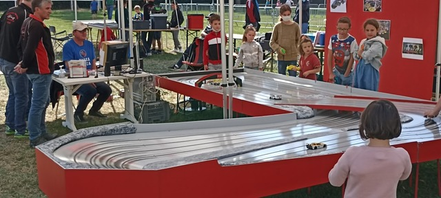](https://lh3.googleusercontent.com/pw/AL9nZEWDRvS1OHXx6XsUZ1wbswJCrFoKCORj7dllDrG64wep1o9OGiCUzicx0GvGKQZt9H5RaVhKoU9oPyIbs6dQNiJOjDGLSQeA13Wjhav0ItmE4HqFF-xq4R-v-0-Ip1HPLXPsk0Z13O4HQwGUfClsXhZa=w1490-h670-no?authuser=2)

[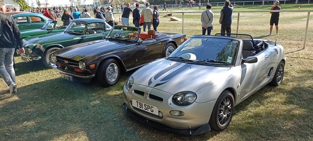](https://lh3.googleusercontent.com/pw/AL9nZEX3gsnY1g4rXFPtf2q7yGaFDzJMV4qGj2YsmIp9Njep5mMGkQj3ye3r_4rACOV_Cs6d-NCYhJq6-dE4iCgiQjWCemDG5_1qzN1tDg4OoX0o67ndycu_U2M-9cfoG0YMbykzFj5nC-NxoljfvARqmtOx=w1490-h670-no?authuser=2)

Retrouvez toutes les photos [ici](https://photos.google.com/share/AF1QipMKznuToHiRdZCi7n9STVXU-qXLCp3N4A8afGszDYtwL4jnwCpOcOnTBgn5ENS_mw?key=TWlpcVJIWkNiMVpuMm5GR0ZYb0h5SFh4UktNdGlB)

[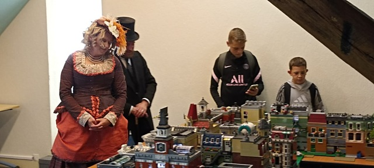](https://lh3.googleusercontent.com/pw/AL9nZEV--fFOURbBjJeeFAm3Shpf4oYAn1ZXGGk4OJT0lX_1XLYflJSrqIR4wtH76ZcMbKl2_QGKZKj5B6ge1uhv3376RPpcwxDvJCxUElByWpjP9CpEhu-AojaaD48r1eqW0EWgJkZ9on-BD92ACNXIiypr=w1490-h670-no?authuser=2)
