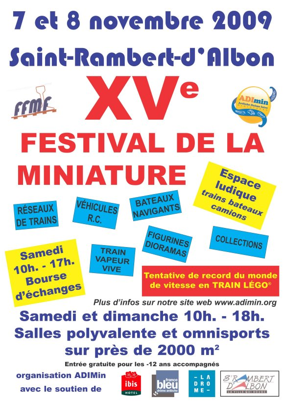

C’est une exposition de modélisme (14ème édition) qui est organisée par l’ADIMin (Ardèche, Drôme, Isère Miniature,) et qui se tient tous les deux ans (en Alternance avec Orléans).  
Nous y [avons déjà participé en 2007](/articles/compte-rendu-de-l-exposition-de-saint-rambert-d-albon/) et les organisateurs nous ont d’ores et déjà invité pour 2009.

C’est le 15ème Festival d’Automne de la Miniature et les 20 ans d’ADIMin, les samedi 7 et dimanche 8 novembre 2009, salles polyvalentes et omnisports. C’est un des grands évènements modélistes du sud-est de la France et qui se déroule tous les deux ans en alternance avec Orléans.

Nous disposons d’un grand espace permettant beaucoup de possibilités (environ 38m x 2m de surface de tables xBaB permettant toutes les fantaisies ou de tables traditionnelles).

**Informations générales :**  
**–** Organisateur : ADIMin - FreeLUG + BaB  
**–** Thème : Multithème sans restriction ; trois axes de bases : un/deux réseau train/ville, une LGV, autres modèles (ville, technique, SW, etc...)  
**–** Horaires public :

-   Samedi : 10h-18h
-   Dimanche : 10h-18h

**–** Parking : grand parking gratuit  
**–** Bourse d’échange le dimanche matin à partir de 10h  
**–** Entrée : 4 euros, gratuit pour les -12 ans accompagnés

Pour les membres souhaitant exposer, [une page Wiki est à votre disposition](http://wiki.freelug.org/tiki-index.php?page=Saint+Rambert+2009).

Alors je vous dit à tous à bientôt pour St Rambert 2009.

Et si vous ne pouvez pas exposez ou si vous voulez découvrir notre association, n’hésitez pas à venir nous voir.

chimere/Loys - cdhd/Denis.
