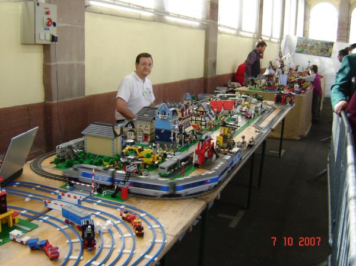

Dany, un AFOL que j’ai rencontré lors d’une précédente exposition, nous a invité à participer à ExpoTrains.

Thierry et Félix, Nicolas étaient de la partie. Nous avons passé un bon dimanche sympathique et convivial.  
Placé à coté du stand de Dany, ce fût l’occasion de discussions, d’échanges de bons procédés, etc...

Le stand de Dany est en arrière-plan.

[Les photos de l’exposition sont visibles ici](http://photos.freelug.org/main.php/v/samrotule/haguenau2007/).  
Merci à Nicolas pour les photos. Quelle idée d’aller à une exposition sans appareil-photo !
