Le week-end du 1-2 juillet 2006 fut sans conteste un succès pour cette première expo entièrement consacrée à nos chères briques . L’association "[Ritte Ritte Ross](http://ritte.ross.free.fr/)", co-organisateur pour cet évènement a fortement contribué à cette réussite. Au programme : animations, concours, bonne humeur, soleil, évenement sportif...  
Ce week-end fut également marqué par le passage du Tour de France aux portes de notre salle d’exposition à [Rosheim](http://www.rosheim.com/home/fr/home/).

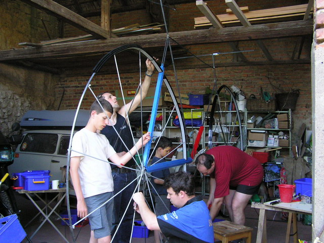

Le vélo en construction chez Thierry, avec la participation de Philippe, Alexandre, et Pierre (la personne qui a monté la structure métallique)...

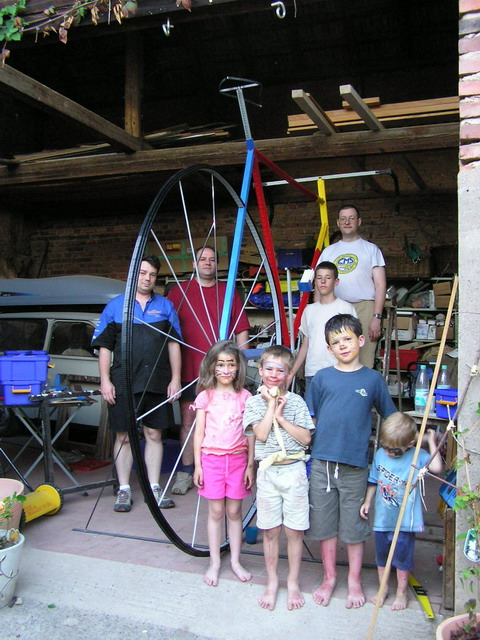

...Après une demi-journée de montage, voici l’équipe au complet avec les petits supporters.

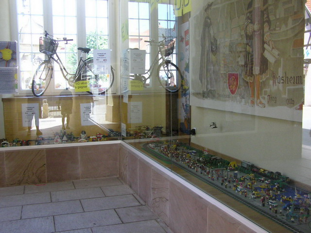

Superbe vitrine animée à la mairie, reconstitution d’une arrivée du Tour de France réalisé par Thierry.

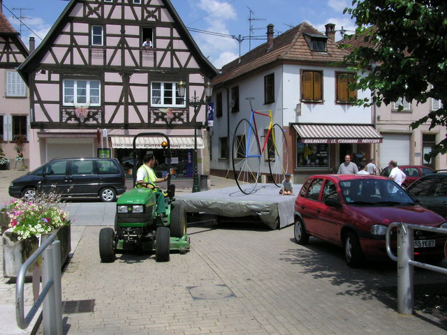

Le convoi exceptionnel arrive à bon port, sous l’oeil attentif de Thierry.

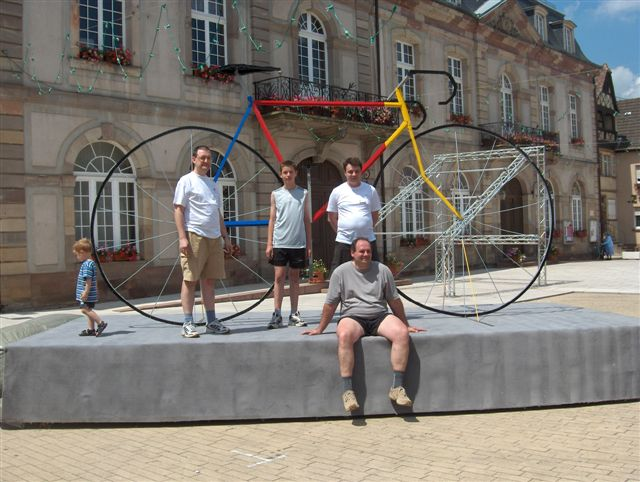

Une petite pause pour la photo devant cette immense réalisation et un grand "OUF !" de soulagement ! Petite précision : Aucune brique n’est collée et aucune perte à déplorer.

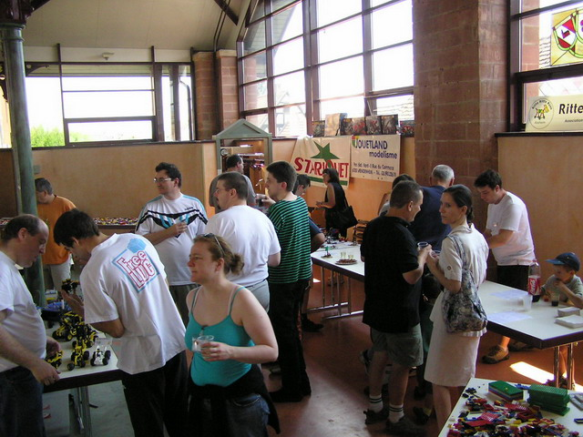

Le verre de bienvenue.

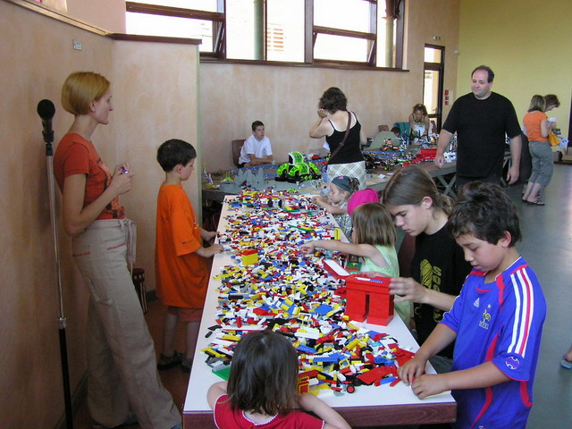

Mise à disposition des vieilles briques de Thierry pour assouvir les jeunes créateurs.

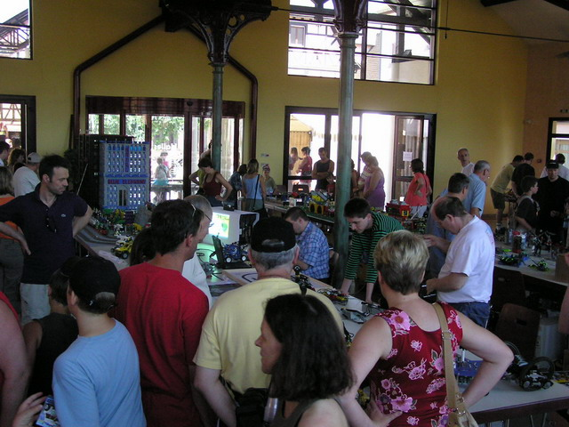

Un public nombreux et très intéressé. Nous avons pu découvrir de nombreux AFOLs.

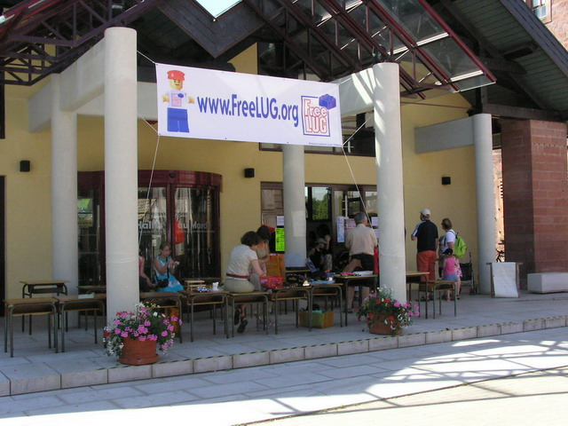

La bourse aux jouets du dimanche matin.

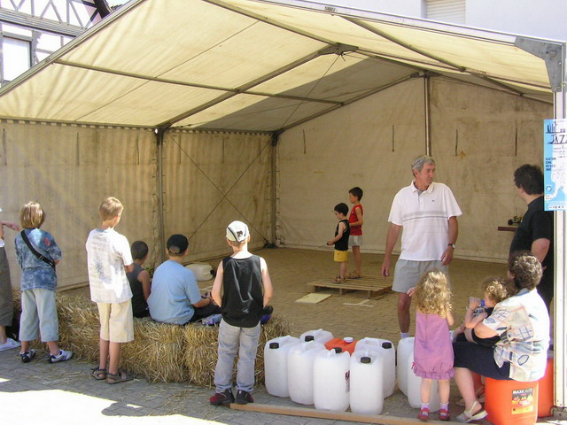

Le stand des racers. Les batteries des voitures ont souffert.

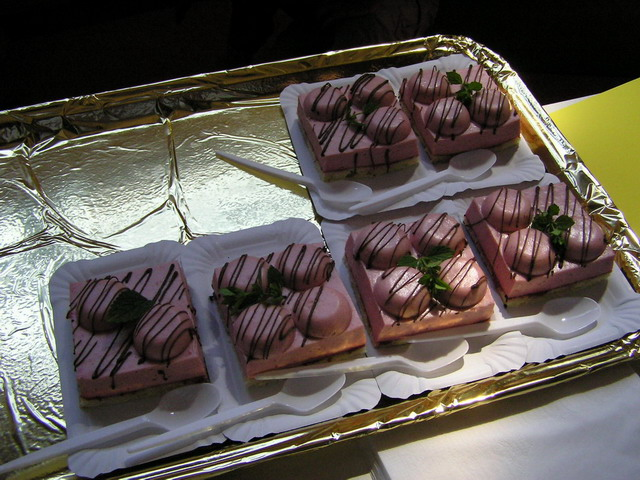

Les briques, ça se mange, Si ! Si !... Un délice ! Un grand Merci au pâtissier.

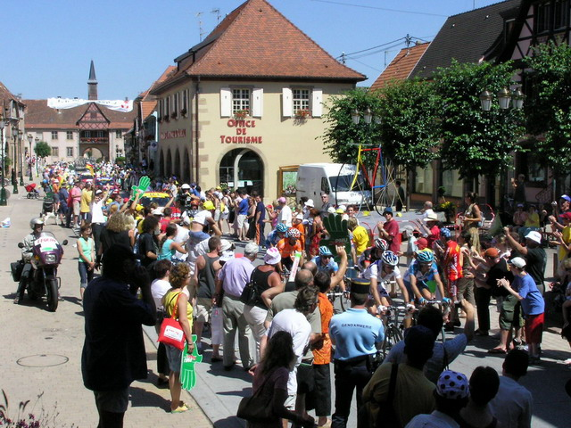

Et Dimanche, le Tour de France est de passage, devant le grand vélo.

Ainsi s’achève le reporting de cette exposition qui a tout de même attiré environ 750 visiteurs. Et en prime, deux albums-photos sont visibles dans la [galerie de Marc](http://photos.freelug.org/main.php/v/samrotule/Fana_briques_2006/) et [celle de Philippe](http://photos.freelug.org/main.php/v/legophil/fanabriques-2006/?g2_page=2).

Tous les exposants ont été ravis par cette première manifestation, et tous, sont prêts à se donner rendez-vous pour la prochaine édition.

Remerciements :  
**–** Aux membres de l’association "Ritte Ritte Ross" qui ont été d’une formidable aide ;  
**–** Aux exposants d’avoir partager ce week-end avec nous, à savoir les membres de FreeLUG, Thomas, Maximilien, Philippe, Marc ,Nicolas, les membres de 1000Steine, Belug, Robonauten-camp, ainsi que des particuliers, dont André, Julien, Lucien, François, et Christian.  
**–** A Thierry d’avoir eu cette géniale idée d’un vélo de course géant en LEGO.  
**–** A tous ceux qui ont participé de près ou de loin à cette réussite.

Merci !!!
