Plus grand, plus d’exposants, plus de briques, plus de vitesse. Voilà comment on pourrait résumer cette édition si on devait la comparer aux précédentes.

## Et de 3 Fana’briques. Film de l’évènement.

**En préambule, figeons le décor.**

Ritte Ritte Ross et FreeLUG sont co-réalisateurs. Ritte Ritte Ross est aussi producteur, c’est l’association responsable, qui couvre (organisation, assurances, locations, etc) et qui enregistre recettes et dépenses. Le bénéfice va donc intégralement à cette association. Le metteur en scène est la famille Meyer à Rosheim. C’est par leur initiative que tout est parti.

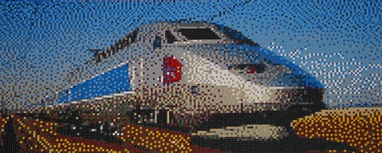

**Mosaique par Didier**

Cette année, nous avons investi une salle plus grande. Un chapiteau monté à l’avant de la salle permettait l’accueil du public et proposait l’exposition de Maxifigs Olympiques, des tables de jeux remplies de briques, la Bugatti et la buvette.

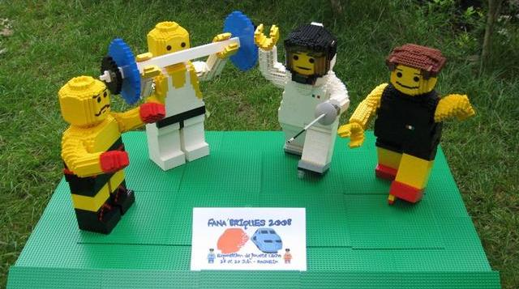

**Les Maxifigs**

La salle accueillait les exposants (60 exposants de six nationalités différentes) et leurs réalisations.

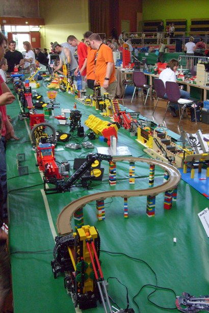

**Gbb**

Sur le parvis droit, tables et bancs permettaient au public de se sustenter. Le parvis gauche était réservé au coin repas des exposants.

A l’étage, Odile proposait un atelier vidéos, constructions, jeux et coloriages,  
Au sous-sol, une salle était investie par Marc S. pour la REF2009 (où concours de bull et de sumo allaient se succéder)

Pour clore la description du décor, à la sortie de la salle, le public trouvait un magasin LEGO proposant des produits occasions et neufs.

En tout 2.000 m2 dont 1.400m2 réservés à l’exposition des briques.

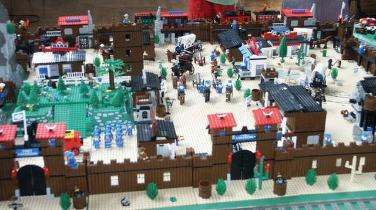

**Base Manu**

**Le scénario**

Vendredi matin, construction du chapiteau par dix personnes, achats alimentaires dès 7 heures du matin, arrivée de Jan Beyer (LEGO).

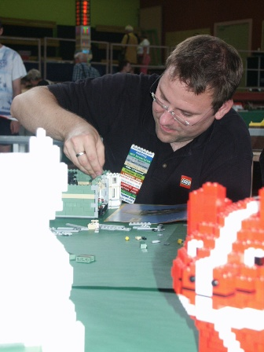

**Jan**

Les exposants arrivent par petits groupes, tiens une camionnette allemande, tiens une camionnette de Lyon, tiens une golf du 29, une voiture de Belgique, etc. A 14 heures, ouverture de la salle, mise en place des surfaces d’exposition, etc. La longue ligne TGV commence à s’imposer, Denis, Loys et Jac s’activent, Xavier, grosse fièvre en prime reste dans un coin (chapeau à toi d’être venu malgré ta chaleur interne excessive), Jean-Marc et son voisin Dominique (le Capitol) s’observent, Daniel se rassure (pas simple d’assembler des dizaines de modules composant une route intergalactique),les exposants continuent d’arriver et s’installent au fur et à mesure.

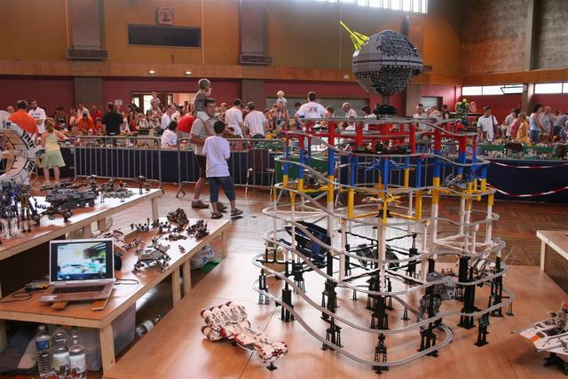

**Base Daniel**

En cuisine aussi on s’active, préparation du repas du vendredi soir oblige.

Fin de soirée calme, dodo.

Samedi, la préparation continue, montage des lay-out, buvette, magasin (plus de 600 boîtes neuves à étiqueter, et 200 articles d’occasion), mise en place des tables de jeux et de l’espace jeux (tenu à l’étage par Odile).  
Derniers préparatifs avant l’apéro. Le conseiller général ainsi que le maire de Rosheim nous font l’honneur d’y assister.

13 Heures : Ouverture au public.  
Les Oh, les ah, se font entendre. Le public répondra timidement à cette demi-journée (500 personnes).

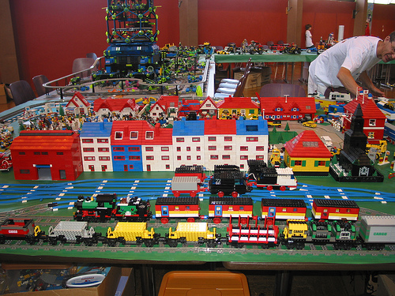

**Base Guy**

  
19 Heures : Départ pour notre soirée, 120 personnes pour déguster notre tarte flambée locale, ainsi que deux gâteaux, un en l’honneur des 5 ans de FreeLUG, le deuxième en l’honneur des jeunes mariés, Anne et Jean-Marc de Belgique.

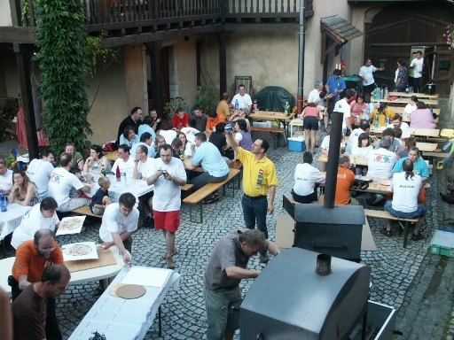

**Soirée Tarte Flambée**

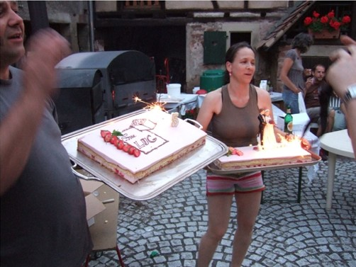

**Les gâteaux**

Dimanche, le soleil est à nouveau de la partie (soleil et chaleur n’engagent peu à la visite d’exposition, dommage).

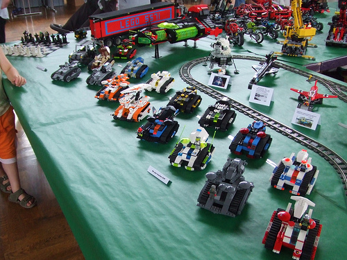

**Les Tanks de Seb**

Marc Klein met sa casquette de guide et emmène les personnes intéressées pour une visite d’Obernai. Le concours enfants voit les premières créations arriver. 50 participants et que de belles créations ! Prix, discours en fin de matinée - lot de consolation pour tous les participants.

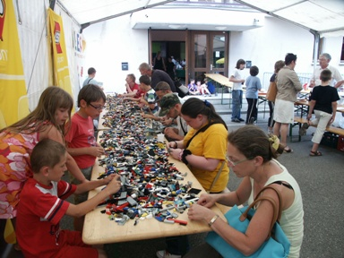

**Ca travaille !**

Dans la salle, le public apprécie le spectacle (1200 entrées payantes).

17 heures : on range.

La fête fut belle.

Au total 2200 personnes (payants, invités, exposants et organisateurs) auront arpenté le chemin bordé de briques.  
Je m’amuse et je me fais plaisir, telle est ma devise depuis le 1er Fana’briques.

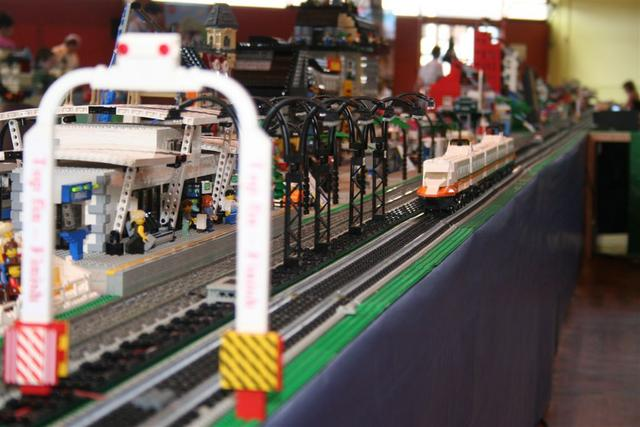

**Comme c’est long**

Un regret : celui de n’avoir pu passer du temps avec les afols.

Fana’briques 2009 : l’expérience des années passées nous servira à améliorer son organisation. Je souhaite que cette édition voit le jour, mais il faudra l’implication de chacun. A voir !

Coté remerciements, un grand merci à tous ceux qui ont mis la main à la pâte, les exposants en premier, les membres de RRR (Isabelle et Philippe en tête), Odile pour son atelier, à Lise, Eliane et leurs acolytes en cuisine, Isabelle et Hubert Maetz du Rosenmeer, les "hébergeurs" (50 lits "gratuits" dont 8 chez Laurence et Julien !), Denis, Xavier, Loys et Jac pour leur Projet TGV et les services techniques de la ville de Rosheim.

En tout cas, un grand merci aux exposants et longue vie à notre passion.

Thierry  
Plus d’infos : [http://fanabriques.freelug.org/index.php?menu=old&langue=fr](http://fanabriques.freelug.org/index.php?menu=old&langue=fr)

## Stand finistèrien à Rosheim

Chers amis , bonjourrrrrrrrrrrrrrrrrrrrr !!!!!!!!!

A la demande de notre ami Thierry, j’ai accepté son invitation au pays des vignobles alsaciens et tartes flambées.

C’est donc avec ma vénérable et vaillante Golf que j’ai amené pour la deuxième année consécutive mon GENIAL ET AMUSANT réseau trains et ferries.

Comme l’an passé, j’ai bénéficié des tables surbaissées au même titre que mon voisin, la fameuse équipe allemande qui a fait une construction KOLOSSALE (capitole américain pour mémoire).

Je dois avouer que j’ai été un peu intimidé par les Allemands au fur et à mesure de leur montage MAIS au final, mon layout a beaucoup intéressé le public, OUF !!!!

Ce n’était pas évident à ce niveau là, il y a encore des progrès à faire de mon coté, j’y travaille ...

Fanabriques 2008 est et restera un très bon cru par la diversité des thèmes et des concours (bull, sumo, TGV...).

Un mot sur l’organisation : toutes nos félicitations finistériennes et bretonnes à tous les niveaux : hospitalité, accueil, dévouement malgré la charge écrasante qu’implique une telle manifestation sur Thierry, Eliane et leurs amis .

CLAP.CLAP.CLAP...

A bientôt Les Alsaciens  
Jean marc et... Ronan et sa petite famille venus en visiteurs .

## Première expérience

Je suis très heureux d’avoir "mis la main à la pâte", j’ai pu découvrir en vrai la "famille" LEGO (ah oui, on dit la "communauté"). J’ai découvert FreeLUG par hasard, au fil d’une discussion avec Philippe Chatin. Le hasard a voulu que ce soit quelques semaines avant Fana’Briques 2007. Par sympathie (et un peu de curiosité tout de même !) j’ai été trébucher une fin d’après-midi à Rosheim pour aller voir "ce truc" (bleu !). Et là PAF tu prends un de ces coups derrière les étiquettes ! J’étais d’abord scotché par le travail accompli (Bugatti, Hermione, Ferry ferroviaire etc...) puis très vite j’ai été séduit par la valeur et l’importance quasi vitale aujourd’hui d’avoir ainsi des odes à la futilité dans notre monde de dingues. Si tu réfléchis un peu on pourrait considérer cela presque injurieux de consacrer tant d’énergie à quelque chose qui peut apparaître inutile (au regard des malheurs du monde, proches ou lointains) ; mais NON !, justement ! vous nous offrez là un formidable message de rêve et d’émerveillement, qui nous permet d’aborder le lendemain avec force ! Quel merveilleux self-service à rêve où chacun, petit et grand, trouve son menu jusqu’à satiété ! (à consommer sans modération).

Très vite j’ai expliqué à Marc Schickelé, qui est aussi un collègue de travail, que rien que pour la beauté de la manifestation, "j’vous prendrai une carte de membre pour soutenir ce que vous faites". Puis, en fait de carte de membre, j’obtiens une... invitation au resto ! ( et pour ça, faut pas me demander deux fois !). Et me voilà donc embarqué dans les ElsassAFOLs, et ceci en toute simplicité, moi qui ne connait qu’un ou deux numéros de référence de boîte par coeur et qui n’ait jamais possédé plus d’une ou deux dizaines d’exemplaires d’une même brique ! Merci d’ailleurs à vous de m’avoir accueilli ainsi, sans chichi, sans prétentions. Bien décidé à respecter mes engagement de soutien, me voilà donc embarqué dans les "coups de mains à donner" sur Fana’Briques 2008. Et là, le jour J, pour ma première participation je n’étais pas encore au bout de mes agréables surprises : il règle une véritable ambiance "familiale" dans la communauté LEGO (ou dans la famille Fana’Briques ? je dois avouer que j’en fait l’amalgame pour l’instant). Ici les gens d’une demi-douzaine de nationalités se rencontrent, partagent, discutent en toute simplicité, presque sans barrière de langue. En fait tout le monde comprend cet espèce de patois LUG, harmonieux mélange de bafouillages Nederbelgiquo-germanoengliquo-françois ! En fait un weekend de bouleau pour qui s’investit (à sa mesure, comme il le souhaite) mais un vrai bol d’oxygène !

Très amicales et très sincères salutations à Eliane qui mérite un grand coup de chapeau !

Benoît

## Ma petite participation

Ayant beaucoup entendu parler de cette exposition comme l’**événement français** en matière de LEGO, c’est donc tout naturellement que je me suis lancé dans une petite participation.

Je me suis donc joint au layout commun, CITY/train. J’ai présenté une rue tout en longueur. Une gare côtoie la mairie, avec une série d’immeubles, et quelques maisons...

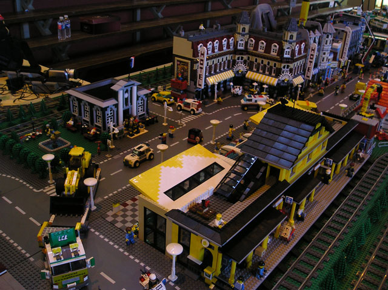

**ma p’tite partie**

J’ai aussi présenté lors de cette exposition, mes Corner Cafe... J’en ai acheté trois... Il y en a un monté normalement, un monté en angle intérieur, et le dernier en ligne droite. Je me suis bien amusé à modifier ces Corner Cafe, et je suis bien content du résultat final !

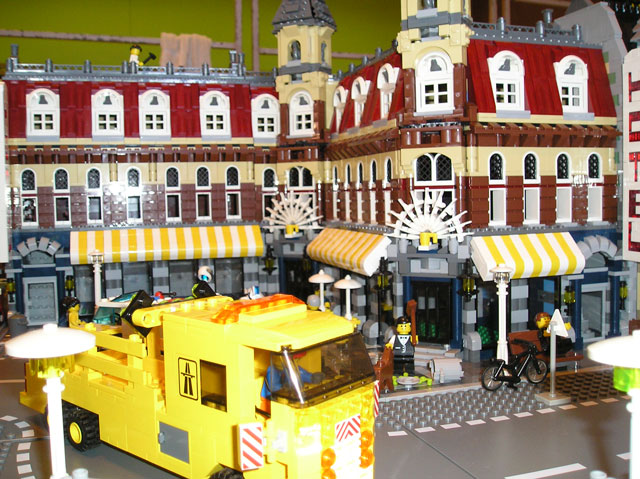

**les 3 Corner Cafe**

Mais tout ceci n’est rien avec tout ce qui était présenté à mes cotés, et surtout partout dans la salle.  
C’est vrai que de voir des LEGO de partout, de magnifiques créations, plein d’idées germent dans la tête...  
On n’a pas envie que ce week end ne s’arrête ! Cette édition, avec le record du monde TGV en LEGO, a été bien prenant.  
Des créations venues de toute l’Europe, et même de l’autre côté de l’Atlantique, j’ai vraiment participé à un événement européen et peut être même mondial...?

J’ai profité de mon voyage en Alsace pour aller au Legoland en Allemagne, avec trois autres Afols. Que dire que c’était génial ! Une exposition que de LEGO, suivie de ma première visite d’un Legoland... Ce fut des journées inoubliables pour un Afol comme moi...

Une mention spéciale à Thierry, et à tous ces bénévoles qui fait que cette exposition ai pu voir le jour, et continu de vivre...

Longue vie à Fanabriques !!

Pierre L. (Pierrolego)

## Le Canada représenté ! Et pour moi une première exposition

J’ai moi aussi rencontré FreeLUG par hasard lors du [mondial de la maquette de 2007](/articles/le-mondial-du-modelisme-2007-au-jour-le-jour/). Déjà un grand fan de LEGO, j’ai rejoint les rangs de l’association au mois d’août 2007. J’ai 15 ans et une préférence pour les modèles CITY/trains car ils se rapprochent un maximum de la réalité que l’on connait de nos villes.

Arrivé vendredi en fin d’après-midi, je commence par une première prise de contact avec la communauté d’afols et première discussion pour trouver un endroit pour mes véhicules. Eh oui, venant du Canada, je n’ai pu venir avec autant de LEGO que j’aurais souhaité ! Pierrolego m’accueille gentiment sur son Layout où nous mettons en place différentes petites scènes.

[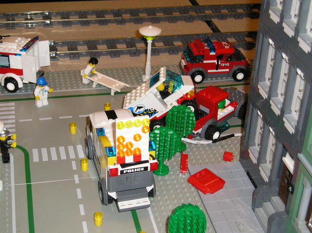](https://www.freelug.org/IMG/jpg/P6290122.jpg)

**un accident et un**

Jean-Marc fait également une petite place sur le sien pour que j’installe quelques véhicules.  
Samedi matin, réveil à 6h du matin, mise en place des derniers détails et première manipulation des trains avec Jean-Marc.

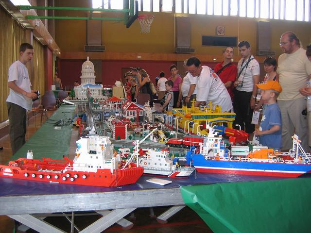

**ne pas faire tomber le train.. ne pas faire tomber le train dans l’eau ......oups il est tombé**

Une longue journée nous a donc attendus. Mais nous entendons des OHHH !!! AHH !!! devant nos modules qui nous réconfortent pour le reste de la journée ! Début du record de vitesse des TGVs, allons voir ce qui si passe et apporter une aide éventuelle ! Si on évitait qu’ils tombent par terre au niveau du virage ? J’assiste à l’arrivée du premier TGV et au premier arrêt à la dernière seconde, comme beaucoup qui suivront.

[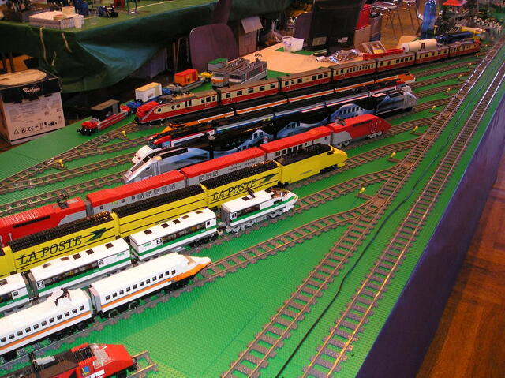](https://www.freelug.org/IMG/jpg/P6290048.jpg)

**attention ! trafic anoncé !**

Deux jours d’exposition très intenses, un public très chaleureux, merci à tous les exposants et une mention spéciale à Thierry Meyer, Pierrolego et Jean-Marc Barre. À Fana’brique 2009 avec plus de LEGO et plus d’intensité. Ainsi je vous laisse sur une note humoristique de nos amis belges.

[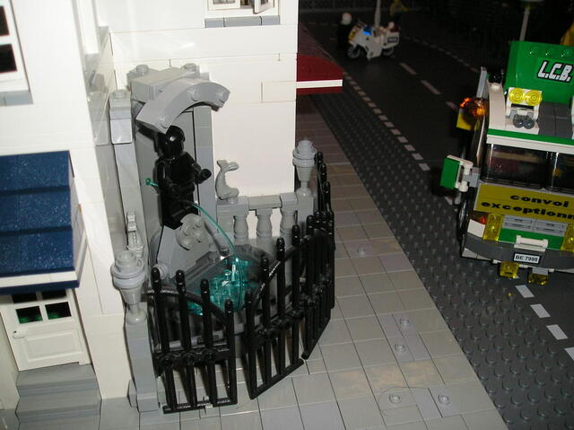](https://www.freelug.org/IMG/jpg/P6290105.jpg)

**le Manken Pis de nos amis belges**

Loïc (loic.ca)

## Galeries de photos

**–** [Pierrolego](http://photos.freelug.org/main.php/v/pierrel/exposition/Fanabriques+2008/?g2_page=1)  
**–** [StephanV](http://www.brickshelf.com/cgi-bin/gallery.cgi?f=327086)  
**–** [Denis cdhd](http://www.brickshelf.com/cgi-bin/gallery.cgi?f=309421)  
**–** [Didier SixStudS](http://photos.freelug.org/main.php/v/6studs/FanaBriques08/)  
**–** [JLB](http://photos.freelug.org/main.php/v/JLB/Fanabriques2008/)  
**–** [Eric Letang](http://photos.freelug.org/main.php/v/f1tvf/expositions/fanabriques2008/)  
**–** [Pierre L.](http://photos.freelug.org/main.php/v/pierrel/exposition/Fanabriques+2008/)  
**–** [JAC](http://photos.freelug.org/main.php/v/JAC/Exposition/Fanabrik-2008/)  
**–** [Philo](http://photos.freelug.org/main.php/v/philo/FanaBriques+2008/)  
**–** [Daniel S](http://photos.freelug.org/main.php/v/DanSto/Evenements/Fanabriques08/)  
**–** [Jean-Yves](http://photos.freelug.org/main.php/v/JY+BROT/fanabrick+08/)
