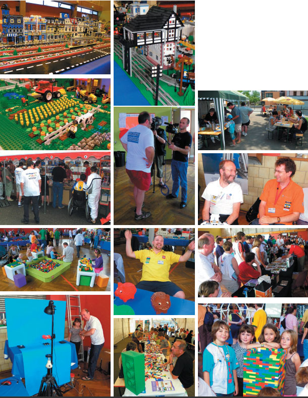

The event is special in that way it is purposely open to foreign people. Rosheim is not far from the german border (less than 15km - 10mi) and the event is supported by «Ritte Ritte Ross», a local organization which promote bilinguism  
in the area.

In 2007, among various layouts (train and city, GBB, Star Wars), visitors discovered a real life size LEGO Bugatti car side by side with the real one!

Read more in this pdf document

**Fana’Briques**

