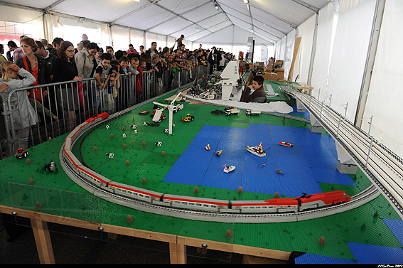
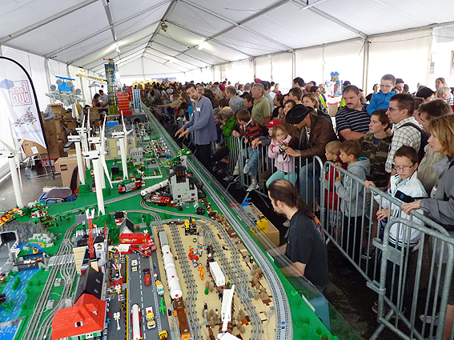
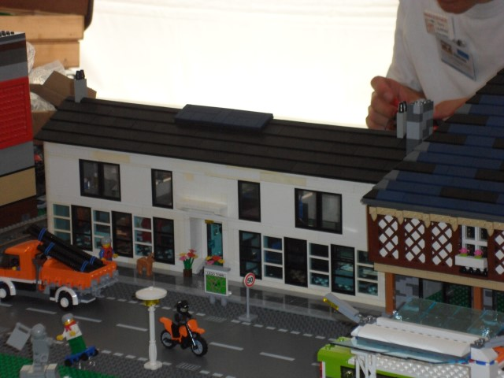
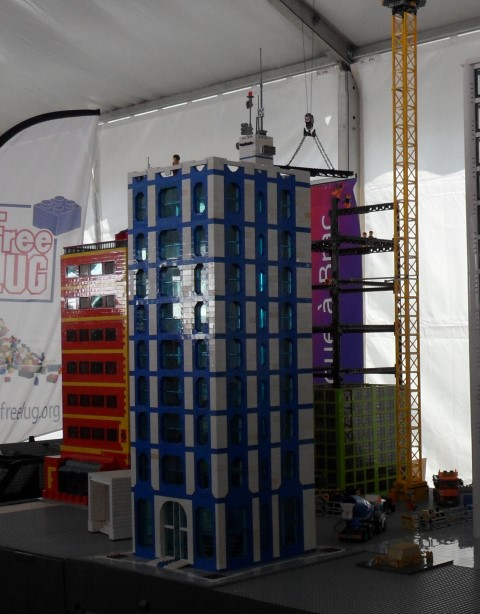
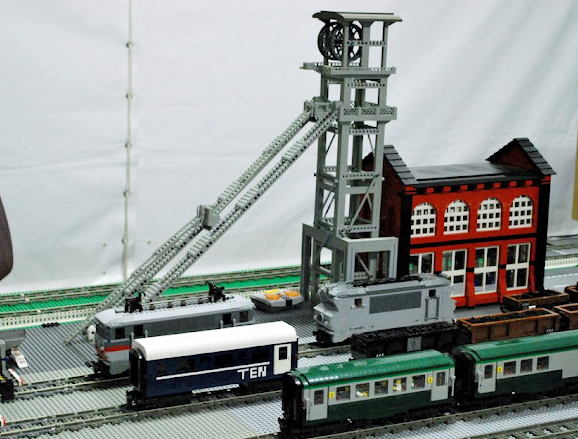
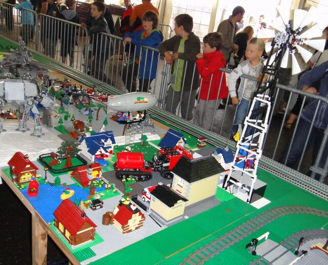

Pour l’édition 2012 de Fana’briques, la LGV est de retour donnant l’occasion de se retrouver sur un grand layout train - ville.

Cette fois-ci, j’ai posé des congés pour venir enfin à FANA’BRIQUES. Je dois avouer que je n’ai pas regretté !

C’est tout simplement une exposition géniale. Une journée de route à l’aller, et la même chose au retour, c’est épuisant, sans compter la chaleur... On est Normands, on n’a pas l’habitude.  
Bref !

Une fois arrivés sur place, dès le jeudi soir, on a commencé à monter. Deuxième fois sur la LGV, deuxième fois dans la boucle en fin de ligne droite.  
Mes sapins étaient les bienvenus il parait... cela s’est confirmé.  
J’ai donc pris place avec mon réseau 12V, au premier plan.  
Florence et Médérik étant derrière, comme à l’exposition de Festibriques, car nous pensions que le public irait sur le côté, comme là-bas.  
Ils ont été masqués du coup par mes maisons. dommage.  
Ma maison hantée Version 2 était de sortie pour une dernière fois, remise en état pour l’occasion. Vivement la nouvelle de LEGO pour en faire une nouvelle Version 3 à ma sauce...

J’ai eu l’occasion d’exploser mon train de pompiers sur la LGV, et aussi de faire beaucoup rire les visiteurs avec mes deux motos-speeder StarWars montées sur moteurs 9V débridés. Une course-poursuite infernale à plus de 20 Km/h...

Sinon, la nuit du samedi a été vraiment éprouvante, avec cette tempête qui nous a frappés. Nous avons moins souffert que Festi, mais étant en bas de parking, l’eau s’écoulait chez nous, et passait sous les toiles. Résultat : les cartons trempés, et surtout, la galère du dimanche, avec l’évaporation de l’eau sous le chapiteau, et la condensation sur les structures en aluminium. Qui dit condensation, dit pluie... et forcément, sur le réseau, et pile sur les moteurs, écran de PC, réseau 12V...  
Donc, pas mal d’essuyage au remballage.

Sinon, un monde fou sur la durée de l’exposition.  
J’ai quelques photos aériennes pour illustrer ça.

On a eu aussi quelques petits cadeaux fort sympathiques, une jolie boite Architecture, brique gravée, T-shirt, et JeanG A fait un petit cadeau sympa aussi ;)

Gros boulot pour eux le dimanche pour le tri et le nettoyage suite au sinistre.  
Bravo aux G.O.s ( Gentils Organisateurs ) !

On reviendra !

_Pascal ( LEGnOme )_

* * *

A cause de mon travail, nous n’avons pu arriver sur les lieux de l’exposition seulement le samedi à midi. Cela fait bien court pour profiter d’une LGV que l’on ne peut pas sortir tous les jours. D’ailleurs, durant le week-end, il est impossible de faire des mises au point de prototypes. Il faut absolument faire tourner des trains complets. Malgré cela, nous avons pu nous amuser, présenter nos diorama, l’immeuble que j’ai pu mettre en place à l’emplacement réservé.

Je regrette ce temps qui passe si vite... Mais cela veut dire que l’on passe de bons moments. Il y en aura d’autres, encore plus grands. Aucune photo de ma part. J’ai seulement pensé aux runs... Heureusement que Séverine était là pour les souvenirs visuels.

**Maison de Séverine pour la rue FreeLUG**

**Immeuble "Bleu azur", JAC**

_Jac/Séverine_

* * *

Et de 5 !

C’est ma cinquième participation à Fana’briques... et encore un grand bonheur de participer à ce weekend intensif.

Déçu de n’avoir pu arriver avant 22h le vendredi soir... J’ai quand même profiter des deux jours suivants.

Sur cette LGV, j’ai ramené mes deux tours (dont la Ferrari qui a rendu l’âme le dimanche soir) et je me suis occupé de la rue FreeLUG où j’ai réparti les 15 maisons des participants... merci au passage à Laurent pour avoir fini d’agrémenter les rues et la gare.

Sinon quoi d’autre ? ben plein de LEGO à voir et pas assez de temps pour profiter de tout.

Prendre des photos, regarder de près les MOCs, faire des runs sur la LGV, discuter, faire un tour dans la tente des magasins, tenir son poste...

Merci à toutes les petites mains pour l’organisation et bravo encore à Thierry.

Vivement l’année prochaine pour revivre ça encore une fois !!!

_Pierre L_

PS : un regret tout de même... l’orage qui a gâché la fête samedi soir et qui a privé Festi’Briques d’expo le dimanche... Mais ce n’est que partie remise... !

* * *

C’est toujours avec impatience que j’attends la venue de l’exposition Fana’briques !

Cette année encore et toujours plein de surprises et de nouveautés !  
\_Je remercie Erik pour son soutien logistique sans failles.  
\_Je remercie Denis et Xavier pour la place sur la LGV qui était prête à mon arrivée !  
\_Je remercie l’équipe Fanabriques pour son énorme dévouement.  
\_Je remercie Thierry qui nous permet le gîte dans son jardin !

L’exposition était magnifique, je ne suis pas sûr d’avoir tout vu, tellement c’était grand ! :)

Je déplore malheureusement la pluie et le vent qui ont un peu compromis l’activité de mon réseau train le dimanche mais cela m’a permis de visiter un peu plus l’exposition !  
Et si cette année mon module avait un air de déjà vu, bien qu’en fait il a été entièrement refait ! L’année prochaine il y aura autre chose, c’est sûr !

_Eric L_

* * *

Une bien belle exposition, la plus grande depuis 3 ans que j’y expose. 4 000 m² cette année (3 000 l’année dernière), c’est quelque chose !

Comme à chaque itération, j’ai vu de bien belles réalisation, que ce soit chez FreeLUG ou ailleurs (le capitole, les grandes grues, les diorama moyen-âge, le château de Rigny-Ussé, le château d’eau de Sélestat, la tour de communication, le musée de Laurent Thévenard, la rotonde de Pierre Charles, ...). Ça inspire.

En ce qui me concerne, j’étais un AFOL 100% Technic jusqu’ici, et cette année, avec le concours de ma compagne (que je pourris de LEGO pour qu’elle s’y mette - oui, je sais, c’est fourbe, mais ça a marché), nous avons rempli un petit espace de la LGV avec du City. Un premier jet, fait de maison Creator en majorité, qui nous a donné envie d’aller plus loin.

Oui, je n’ai pas résisté, j’ai quand même un peu de Technic recyclé en éolienne :-)

Comme chaque année aussi, j’ai pu m’amuser avec les enfants via mon Star Wars Hailfire que j’ai motorisé. Je choisi un enfant au hasard, et je dirige le Hailfire sur lui et le suit. La plupart sont amusés (et moi aussi). Encore un bon moment.

Autre nouveauté pour moi cette année, j’ai aussi pu constater l’attrait du LEGO et d’une telle exposition sur une petite cousine qui n’avait pu venir aux éditions précédentes. Un très bon moment. Merci pour elle aux exposants qui nous ouvert leurs coulisses.

Malgré les intempéries et la casse, dimanche a été une journée de très forte affluence, ce qui prouve encore, s’il en était besoin, l’intérêt du public pour LEGO et les belles réalisations présentées par les fans.

Merci encore à Thierry Meyer et tous les membres & bénévoles de l’association Fanabriques !

Merci à BàB pour la LGV, joli support pour nos créations !  
Merci aussi à Pierre Normandin et au Directeur commercial de LEGO France, qui nous ont fait l’honneur de leur présence tout au long de cette édition. Il est bien agréable de pouvoir passer certains messages, mais surtout de se voir confirmer que pour certains, travailler pour LEGO n’est pas qu’un boulot mais une passion !

Vivement l’année prochaine !

_Sylca_

* * *

Troisième présence de la LGV (et deuxième pour sa zone BàB/FreeLUG) remarquée encore cette année par sa longueur et par sa diversité.

Cette année, nous avons même réussi à inclure un magnifique pont qui passait sur le virage droit de la LGV ce qui a permis de voir circuler les trains à grande vitesse entre les piliers du pont.

Ma contribution personnelle s’est limitée à aider Denis et Xavier à monter leurs tables, à ajouter les miennes pour le layout pont et à proposer mes trains pour les faire circuler sur la LGV. C’est toujours plaisant de voir circuler mon Thalys de 3m40 (n’est ce pas Denis ?), de pouvoir valider mon nouvel AGV et d’essayer mes nouveaux prototypes dont le modèle RC a établi la meilleure marque dans la ligne droite à 1320 km/h.

Encore un superbe weekend qui est passé à la vitesse d’un TGV et qui donne envie de répéter l’opération.

_Daniel_

* * *

34 mètre le layout, c’est pas rien à habiller. Mais avec l’aide de tous, cela devient (presque) facile et le résultat est splendide.

D’ailleurs, toute l’exposition est splendide : De la gigantesque construction à la petite vignette.

Encore merci à tous de votre participation et de votre bonne humeur.

Et merci aussi à toute l’organisation de Fana’Briques efficace et chaleureuse.

_Denis_

* * *

## Galeries photos

**–** [Photo de Pascal](http://www.brickshelf.com/cgi-bin/gallery.cgi?f=507529)  
**–** [Photo de Séverine](http://photos.freelug.org/main.php/v/JAC/Exposition/2012/fanabrique/)  
**–** [Photos de Sylca](http://photos.freelug.org/main.php/v/sylca/Expos_001/Fana2012/)  
**–** [Photos d’Erik](http://photos.freelug.org/main.php/v/brickerik/expositions/2012/fanabriques2012/)
