Fanabriques pour sa première année en partenariat avec FreeLUG et avec Ritte Ritte Ross a organisé cette 4ème édition de Fana’briques.

L’exposition a tenu toutes ses promesses, qualité des constructions, ambiance géniale, grosse affluence, beau temps.

Tout était réuni en cette édition pour que le sourire soit sur les lèvres de tou(te)s les organisateurs(trices).  
60 exposants, 1500 m2 de LEGO, 3700 visiteurs.

Le thème général de cette édition était le basket, inspiré par le succès précédent du GBB et de ses innombrables ballons. A cet effet, Fanabriques a pu obtenir en prêt de LEGO France, deux grandes sculptures de basketteurs qui accueillaient les visiteurs à l’entrée.

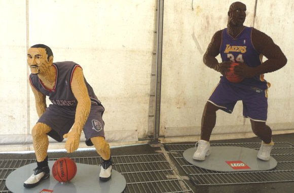

A l’extérieur, sous les tonnelles, les enfants pouvaient s’adonner à des tournois de basket LEGO avec la mise à disposition de 10 terrains [3432](http://www.bricklink.com/catalogItemPic.asp?S=3432-1). Des vitrines présentaient l’ensemble de la gamme LEGO Basket. Enfin, des maxifigs se livraient à un match sur un grand terrain - la suite des maxifigs "jeux olympiques" de l’année dernière.

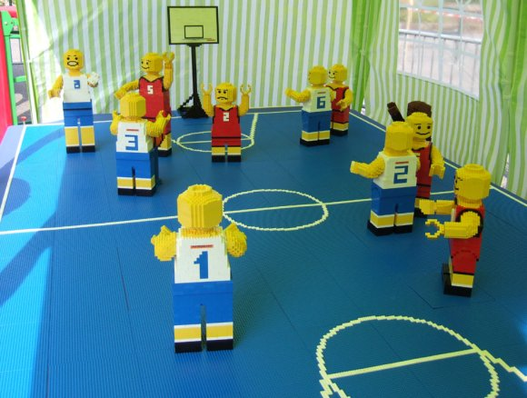

## Les stands

A l’intérieur, nous retrouvions les très nombreux exposants. Face à l’entrée, un champs d’éoliennes Vestas annonçait aux visiteurs l’ambiance de l’exposition : grande et animée.

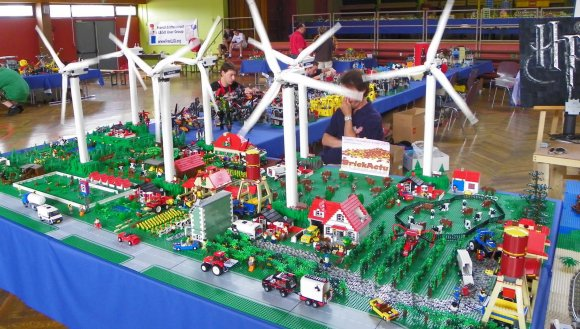

Toujours plus grand chaque année, le GBB fait le bonheur des enfants obnubilés par ces petites balles sautant d’un module à un autre. Cette année, les modules étaient disposés en un grand carré.

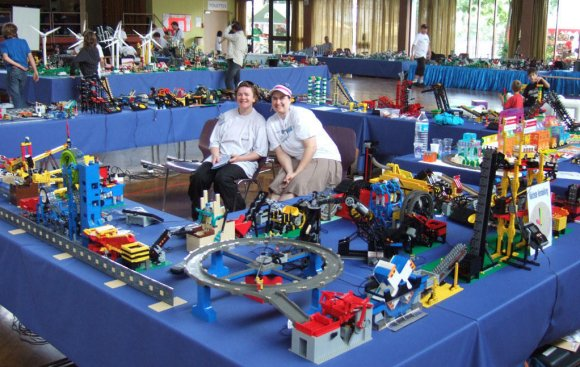

Sur la scène, des membres de Festibriques et de FreeLUG présentaient un grand diorama composé, sur une partie, d’un aéroport regroupant de nombreux sets officiels, au centre un grand ensemble d’immeubles et sur la dernière partie des sets City et trains.

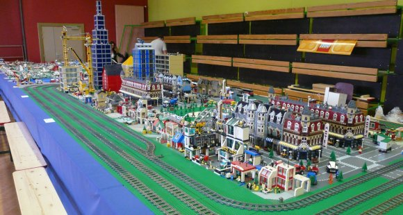

Tout citer serait trop compliqué, mais en vrac, voici ce que le visiteur pouvait découvrir :  
**–** un grand diorama Castle réalisé par les Allemands du club [MBFR](http://www.mbfr.org/home/index_d.php)  
**–** les gammes Castle, proposées par Yannick

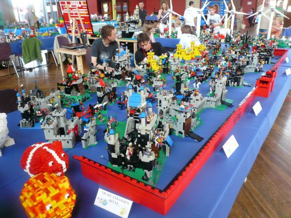

  
**–** des dioramas StarWars  
**–** un petit diorama Apocalego  
**–** des dioramas City, notamment de BeLUG, de Jordan et de Laurent  
**–** des manèges motorisés et illuminés (orchestré par A.Thul, notre doyen de 75 ans)  
**–** des dioramas espace, notamment celui de Sébastien  
**–** un cublego géant  
**–** des tirelires cochons  
**–** un diorama Harry Potter, mettant en scène les boîtes de la gamme, à travers un grand château et saule cogneur mouvant

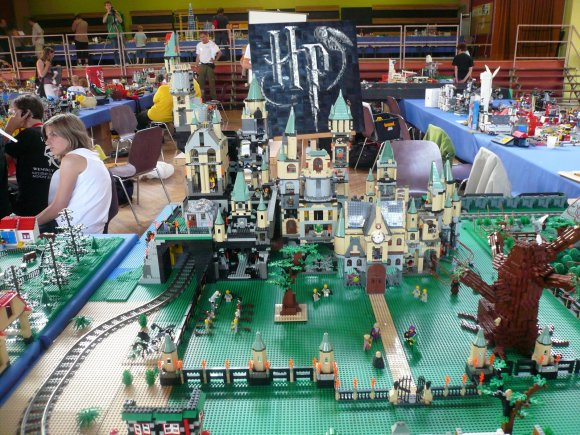

  
**–** des modèles et créations Technic  
**–** un stand de présentation du NXT  
**–** un stand de la First LEGO League  
**–** etc.

Il faut dire qu’avec tous ces exposants venant de France, Belgique, Allemagne, Suisse, Pays-Bas, Danemark... il y avait de quoi voir !

## Animations du samedi soir

Nous avions durant l’exposition la présence de Pierre Normandin, désigner City chez LEGO, qui présentait l’ensemble des nouveautés City du second semestre 2009, ainsi que les jeux de société prévus pour 2010. L’après-midi s’est terminée par une présentation en avant première du transport d’éolienne, dont Pierre est le désigner et a répondu aux questions des participants lors d’une séance de questions-réponses.

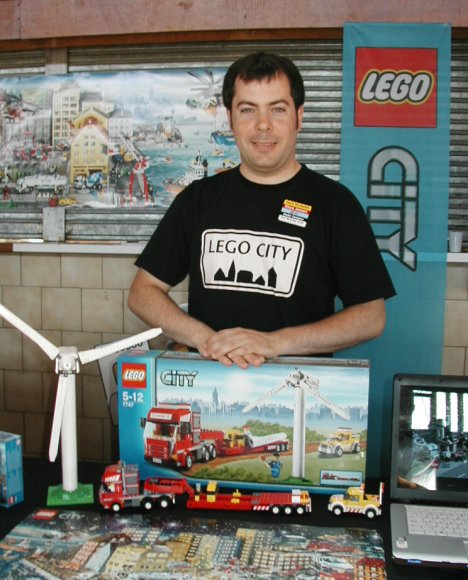

A suivi la traditionnelle soirée tartes flambées qui a permis à tous les participants de se retrouver ensemble. Des enchères et un quizz LEGO ont animé la soirée.

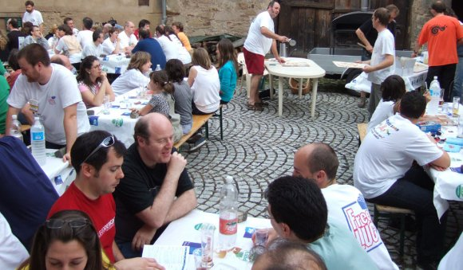

## Ateliers d’animation

Des membres de FreeLUG proposaient quelques ateliers d’animation à destination des enfants.

**Course de camions**

Jac a transformé son circuit de course en une adaptation du jeu de l’oie. Chaque enfant disposait d’un camion de course, et avançait du nombre de plaques indiqué par le résultat du lancé de dé.

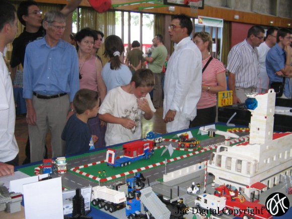

**Découverte des sports**

Daniela a choisi d’étendre le thème de l’exposition à tous les sports en invitant les enfants à trouver le nom de chaque sport représenté par une petite vignette.

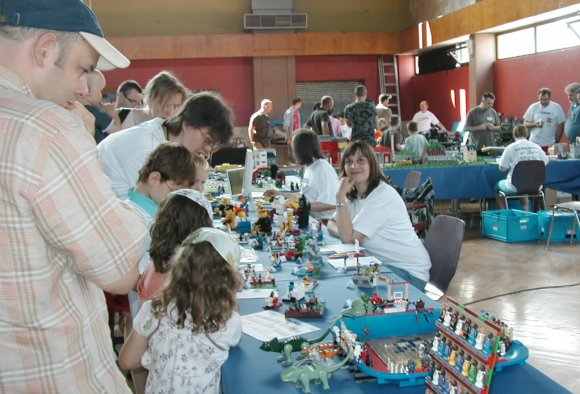

**Atelier PFS**

Pierrick de son côté proposait un atelier composé de trois activités :  
**–** match de sumo ou Techball en alternance ;  
**–** un tas de briques à faire bouger avec un bulldozer ;  
**–** un slalom à réaliser avec un module PFS.

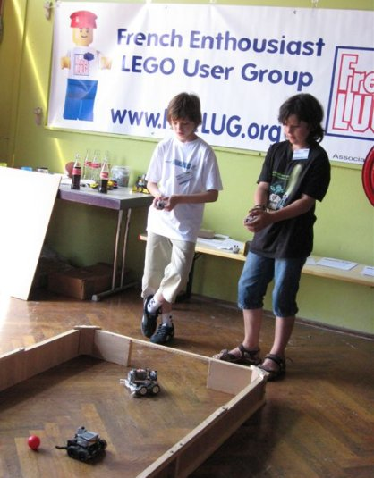

**Atelier BrickFilms**

Jean-Yves, gardant en tête la bonne expérience du [salon du cinéma](/articles/salon-du-cinema-2009-paillettes-et-strass-pour-nos-minifigs/), proposait un stand d’animation image par image. La scène prenait place dans un bar perdu quelque part dans une galaxie lointaine.

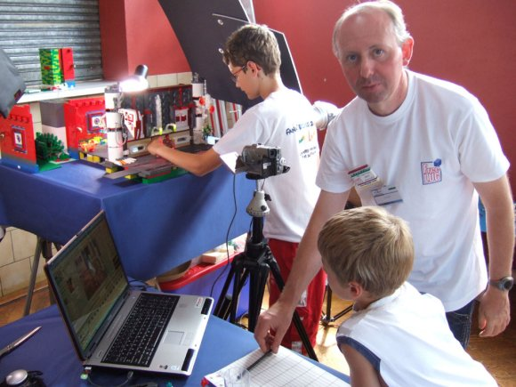

Et découvrez le film, une fois achevé !

[Vidéo de la publication d’origine](http://www.dailymotion.com/swf/x9v6jt_la-taverne-intergalactique_creation&colors=background:DEDEDE;&related=1)

  
**[la taverne intergalactique](http://www.dailymotion.com/video/x9v6jt_la-taverne-intergalactique_creation)** par Jean-Yves

En plus de cela, le concours enfants organisé par Fanabriques permettait aux jeunes passionnés de montrer leur création ([Voir article](http://fanabriques.free.fr/index.php?conect=&action=articles&catid=2&scatid=&artid=36%20Fanabriques)).

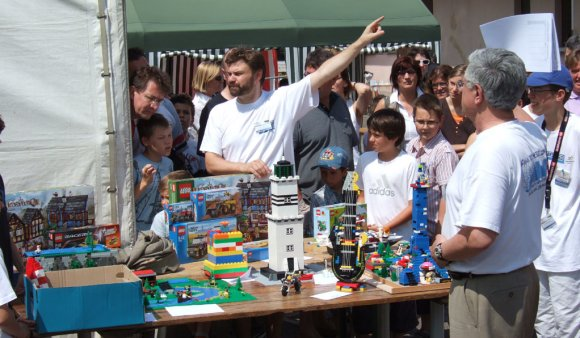

Des aires de jeux, comme des tables pleines de briques ou la piscine de Duplo prêtée par LEGO France faisait le bonheur des plus jeunes qui pouvaient alors construire à leur tour.

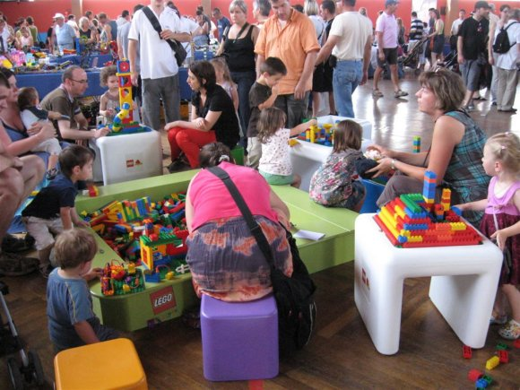

Enfin, à la sortie de l’exposition, un stand de vente offrait la possibilité aux visiteurs d’acheter les dernières nouveautés ou bien des modèles d’occasion. Le samedi soir déjà, 80 % du stock avait été vendu !

Un grand bravo à l’équipe en cuisine dont Eliane et Manu tenaient les rênes, qui a assuré 600 repas aux exposants sur le week-end.

Un grand merci et bravo à toute l’organisation qui a permis de réaliser cette exposition !

## Petit mot de Eric , SystemDbrick

Fanabriques 2009, c’était l’événement à ne pas manquer cette année ! J’avais le plaisir de pouvoir faire participer mon neveu à sa première exposition ! Malgré le fait que j’ai aussi pris un an de plus ce week-end là ! :)  
Le succès était au rendez-vous ! Encore Bravo et merci à tous, également à Erik (brickerik) pour nous avoir supporté et permis de venir en voiture.

## Petit mot de Pierre , Pierrolego

C’était ma deuxième participation à Fanabriques. Je suis venu avec mon frère, nous avons présenté deux dioramas StarWars : un sur Endor et un autre représentant une grande bataille entre clones et droïdes.

Que du bonheur ! Du LEGO partout ! Le samedi soir, magnifique soirée avec les tartes flambées, très bonne ambiance. Puis j’ai eu l’occasion de prolonger la soirée en compagnie d’Allemands... et puis là... ben j’ai passé un dimanche, comment dire... avec quelques nausées... ;-)

Qu’une chose à redire.. Fanabriques c’est l’événement incontournable en France pour les LEGO !  
Merci Thierry et à l’association Fanabriques de nous faire partager de très bon moment !

## Quelques mots de Jérôme, JAC

A la question "As-tu fais bon voyage ?", je répondais par un petit "Non !" en arrivant à Rosheim vendredi soir. Deux ou trois gros orages, je ne sais pas vraiment, avaient bien perturbé mon trajet dans la région de Besançon. Mais, c’était le seul bémol du week-end, sans compter la fin et le moment de rentrer bien sûr...

Parce que tout était bien, l’ambiance, les visiteurs intéressés, tous les joueurs des courses de camions. Sur le circuit, c’était bien amusant de courir après le dé pour connaître le nouvel avancement du concurrent. Les courses se sont enchaînées à vitesse grand V. Et il fallait que je prenne quelques pauses pour calmer le jeu !

Et en attendant Fanabriques 2010, bon vent, comme ils disent.

## Le mot de Philippe Chatin : "Juste comme n’importe quel exposant"

Depuis le début de l’aventure Fanabriques dans l’organisation derrière le projet lancé par Thierry, j’avais cette année décidé de ne plus participer à l’organisation et aux préparations et constructions diverses, histoire de profiter de l’exposition à 100% du côté exposant, comme n’importe quel autre exposant, ayant en plus été inspiré cette année et ayant quelque chose d’original à présenter, aussi modeste cela fut-il.

Cela afin également d’être libre de toute contrainte et pression car organiser une telle manifestation n’est pas rien, être exposant et seulement exposant est vraiment beaucoup plus paisible. Et permet d’apprécier encore plus !  
Cette année, plus de Capitol et autres constructions pharaoniques (enfin... pas aussi visible dirons nous), mais alors quelle richesse et quelle diversité !  
Bien sûr la Bugatti dont je me remémore encore la construction en groupe trône au milieu de la salle, bien sûr LEGO nous a prêté deux stars "NBA", bien sûr les organisateurs nous ont construit des basketteurs maxifig...

Mais le vrai intérêt à mon sens résidait dans la diversité et le détail, du brickfilm à la robotique, du traditionnel GBB - que l’on pourrait rebâptiser Grand Bidule Bondé !! :o)) - aux impressionnants alignements de figurines médiévales, des sets officiels, avec la gamme moyen-âge, au design au 3D (clin d’oeil à mon sympathique voisin et sa maman). De quoi faire voir au public très nombreux que le LEGO à Fanabriques est bien plus qu’un pâquet de briques sans âme... et quand je dis âme cette exposition n’en a pas manqué, des exposants souriants et ouverts, un public intéressé, des organisateurs aux petits soins...

Cela reste une expérience vraiment agréable, de bonnes tartes flambées dans une bonne ambiance, des échanges de conseils de montages, une présentation inédite par un designer d’une nouvelle gamme, la présence de beaucoup, avec beaucoup, et le public qui répond présent !

Un grand succès et une seule envie, vite y retourner !  
Vite retrouver Laurent, Yannick, Jérôme, Sébastien... et tous les autres avec qui partager passion et enthousiasme.

Mention particulière au sympathique Laurent, et son ensemble d’immeubles qui reste pour moi ma construction favorite, à tous ceux qui ont contribué au très bel ensemble d’éoliennes, très agréable à voir et suivre du regard, à Yannick (et sa maman), voisin souriant d’un jour et au bonheur de nous faire découvrir ses travaux et son approche original du LEGO...

Et puis finalement un grand bravo à tous, organisateurs ou exposants qui ont permis au public de découvrir toujours plus et faire de cet événement une grande réussite.

A l’année prochaine, "comme n’importe quel exposant" au minimum !

Briquement vôtre  
\_Philippe Chatin

## Le mot de l’organisateur

Cette édition a été géniale ! Superbe ambiance et public heureux.

Pour information, Fanabriques couvre une grosse partie des frais de nourriture et d’hébergement des exposants.  
Ainsi le week-end coute 10 euros à l’exposant (hors frais de déplacement).

Fanabriques a aussi su rendre service aux exposants en proposant des sets, des plaques et des vaches (nouveau produit) au prix d’achat.

Chaque exposant s’est vu offrir une briques gravée, une balle de basket et un tee-shirt.

Les exposants FreeLUGiens étaient bien moins nombreux qu’en 2008. J’invite les personnes n’ayant pas encore franchi le pas à le faire, car c’est un moment génial dans la vie d’un AFOL.

Donc, à l’année prochaine !

Thierry

## Galerie photos et vidéos

**–** [Galerie d’Erik](http://photos.freelug.org/main.php/v/brickerik/expositions/2009/Fanabriques2009/)  
**–** [Galerie de Didier](http://photos.freelug.org/main.php/v/6studs/Expos/FB09/)  
**–** [Galerie de Phil-c](http://photos.freelug.org/main.php/v/legophil/fanabriques2009/)  
**–** [Galerie de Philo](http://photos.freelug.org/main.php/v/philo/album_004/)  
**–** [Galerie de Pierrick](http://photos.freelug.org/main.php/v/-PZ/Exposition/fanabrique09/)  
**–** [Galerie de Daniel](http://photos.freelug.org/main.php/v/DanSto/Evenements/Fanabriques_09/)  
**–** [Galerie de Jordan](http://picasaweb.google.com/tuningxxl92/Fanabriques2009#)  
**–** [Galerie de Yannick](http://picasaweb.google.fr/yann243/Fanabriques200902#)  
**–** [Galerie de Joris](http://picasaweb.google.fr/BrickActu/Fanabriques_2009#)  
**–** [Galerie de Jac](http://photos.freelug.org/main.php/v/JAC/Exposition/Expositions2009/Fanabriques-2009/)  
**–** [Vidéos sur Dailymotion](http://www.dailymotion.com/relevance/search/fanabriques)  
**–** [La page des liens photos et vidéos de Fana’briques](http://fanabriques.freelug.org/?menu=old&langue=fr)
