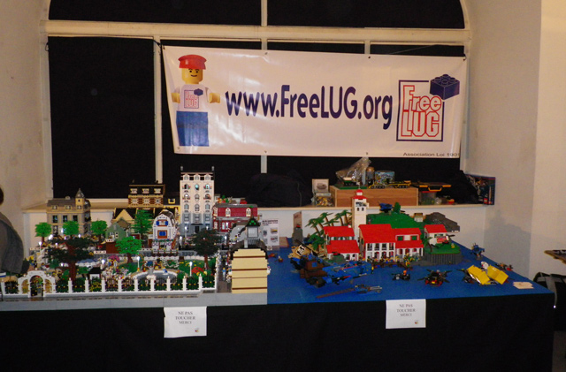
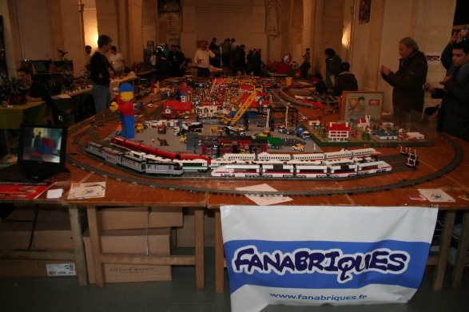
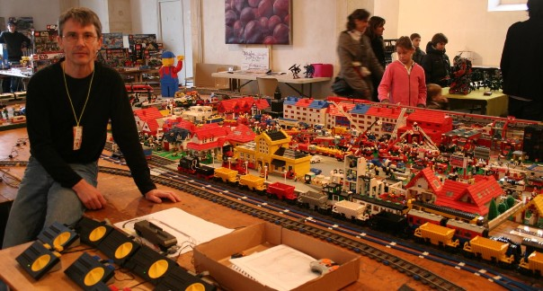
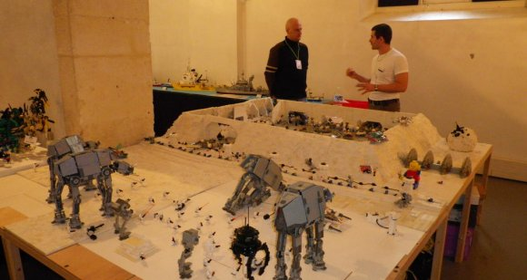
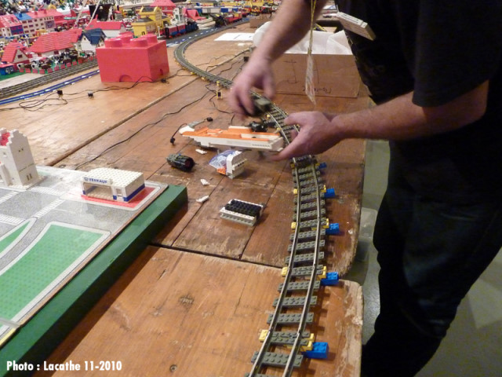
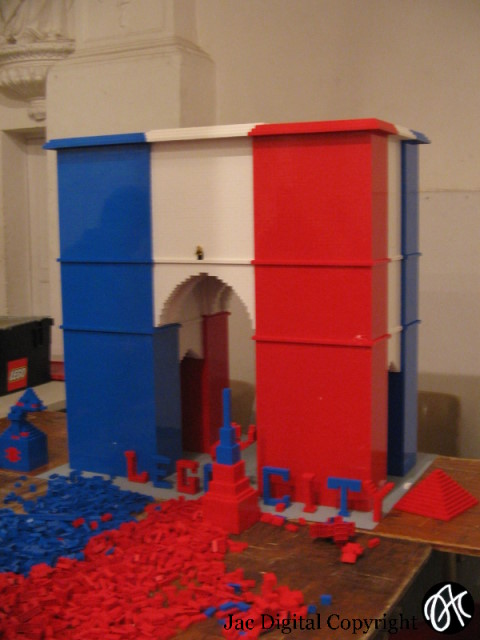
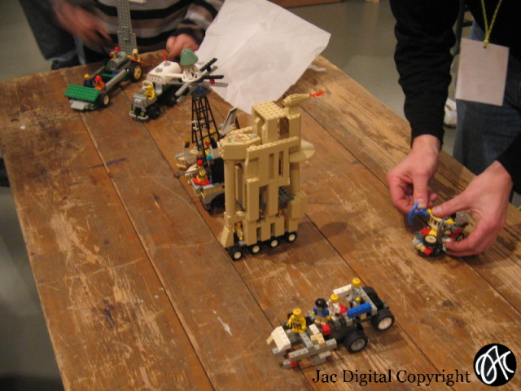
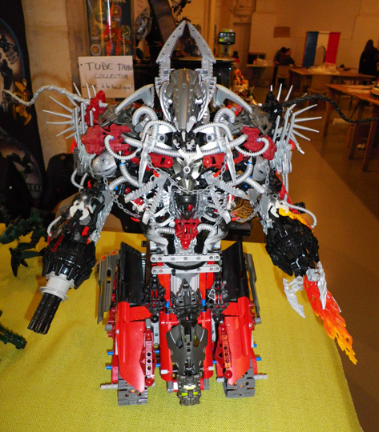
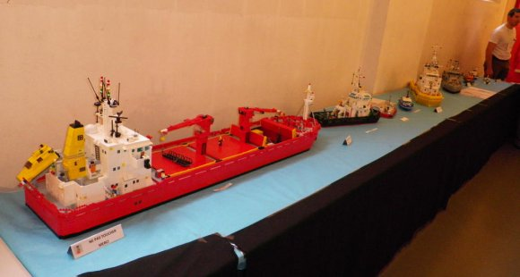

Cette année, les LEGO ont vraiment fait la fête à Beaune avec une première édition en janvier, puis cette deuxième édition en novembre.

Nouveau départ donc pour Festi’briques avec une nouvelle date - pour éviter la neige, paraît-il :) - et une nouvelle salle.

Bien qu’aménagée également dans une ancienne chapelle, cette salle est bien différente de la précédente : plus grande, plus basse et surtout, un chauffage efficace !

L’organisation de la salle permet de présenter un maximum de LEGO, mais aussi plusieurs tableaux de la marraine de l’exposition. On retrouve les thèmes récurrents, le train, la ville, Star Wars, Technic et maintenant Bionicle, et des thèmes moins fréquents, avec du space pirate, de la ville futuriste et des bateaux, ainsi que divers objets en LEGO (mascotte de foot, maxifig, bustes...).

**le stand FreeLUG**

Cette édition s’est annoncée très vite prometteuse, puisque les premiers visiteurs sont arrivés pendant l’inauguration. Et cela s’est confirmé avec plus de 1200 entrées durant le week-end.

* * *

Pour ma deuxième participation à Festi’briques, après celle de janvier et le diorama Harry Potter, l’objectif principal était d’installer une ébauche de Ligne de Grande Longueur afin de préparer l’édition 2011 - qui fêtera le vingtième anniversaire du moteur de train 9V - en réunissant tous les aspects techniques sur une surface "réduite" de 3,8 mètres par 10 mètres.

**Surface dédiée aux trains 9V et 4.5V**

Quelques données statistiques pour commencer :  
**–** **2** comme 2 mois de préparation avec l’aide de Bluebrick et d’Excel pour définir la voie de rails extérieure,  
**–** **3** comme 3 heures de route pour rejoindre Beaune sous la neige impatient de passer de la théorie à la pratique,  
**–** **4** comme 4 heures de route pour rentrer chez moi après un week end plus que satisfaisant,  
**–** **9** comme les 9 cantons qui constituent la Ligne de Grande Longueur (voie extérieure),  
**–** **10** comme 10 heures pour l’installation des voies, de leur alimentation et des trains,  
**–** **11** comme les 11 alimentations pour électrifier les voies,  
**–** **40** comme les 40 mètres de câbles électriques pour relier les cantons à leur alimentation,  
**–** **187** comme les 187 rails droits de la LGL,

Heureusement, ma participation ne se réduit pas à cette liste un peu trop austère.

D’abord, le projet repose sur une collaboration avec Guy Meyer - un autre membre très actif de l’association [Fanabriques](http://www.fanabriques.fr/) - qui a installé une ville de 2 mètres sur 4 mètres entourée de 3 voies de chemin de fer (lignes intérieures) et avec Pierre L. qui a répondu à mon appel à contributions sous la forme d’une zone de chantier.

**Guy et sa ville**

Ensuite, la partie technique du projet était de valider le concept de Ligne de Grande Longueur pour la circulation de trains de grande longueur. En effet, faire circuler de longs trains sur du matériel 100% LEGO ne se fait pas aisément. Il faut d’abord minimiser les frottements dans les virages en adoptant des [virages avec un grand rayon de courbure](/articles/une-ligne-moyenne-vitesse-pour-la-mise-au-point-des-trains-pour-la-lgv2/) qui permettront de faire circuler les trains sans avoir à les ralentir dans une zone trop "courbée". Il faut ensuite fournir une puissance électrique suffisante, soit sous la forme d’une [ligne sectionnée en cantons](/articles/le-principe-du-cantonnement-applique-a-une-lgl-en-exposition/) permettant d’alimenter plusieurs locomotives réparties sur le convoi, soit sous la forme d’une [tension appliquée supérieure à 9V](/articles/une-ligne-moyenne-vitesse-pour-la-mise-au-point-des-trains-pour-la-lgv2/). Tout le long du weekend, différents essais ont permis de valider l’approche : (1) le cantonnement a permis à mon Thalys propulsé par deux locomotives distantes de 3 mètres de circuler à une bonne vitesse et de lui faire faire la course avec le train de marchandise Maersk de JeanG de plus de 4 mètres de long et (2) le survoltage de la ligne par mise en série de 2 alimentations nous a permis de faire une petite séance de chute de table de Turbo-Train (celui de JAC) et autre Shinkansen à grande vitesse.

[Vidéo de la publication d’origine](http://www.youtube.com/v/kYN0ua-SQGo?fs=1&hl=fr_FR)

_Une petite vidéo présentant les différents aspects de la LGL_

Enfin, et c’est l’essentiel, cette édition a été l’occasion de se retrouver entre AFOLS autour d’une passion commune et de faire la connaissance de nouvelles têtes côté Technic, Bionicle, de discuter des futurs projets (notamment avec Denis H.), de déguster d’excellentes crêpes (forcément avec une bonne farine) dans une ambiance surchauffée et une non moins excellente raclette le samedi soir tout en participant à différents jeux (et de repartir avec des trophées sous forme de boîte LEGO). Bref, je suis reparti dimanche pleinement satisfait avec la tête pleine de bons souvenirs.

Je conclus en remerciant JeanG de m’avoir accordé sa confiance sur ce délicat projet, toute l’équipe de l’organisation pour leur efficacité et leur bonne humeur, Guy et Pierre L. pour avoir plus que complété le diorama et les exposants (et visiteurs) pour leur encouragements.

Rendez-vous pour d’autres aventures en 2011.

**DanSto**

* * *

Salut les LEGOMANIACS !!

Nous voila de retour exceptionnellement pour une deuxième édition avec festibeaune dans la même année.

Cela pour dorénavant être soit fin novembre ou début décembre, afin d’éviter la neige. Et beh, c’est raté cette année qui se révèle être exceptionnelle coté précocité de l’hiver.

Ca tombe bien moi je faisais un truc "hot", euh... froid en fait :-) la planète de glace, Hoth, et un Han Solo pris dans la carbonite, lui, alors que nous étions pris dans la neige.

Je n’ai oublié qu’une seule chose, mon appareil photo... dommage pour vous ! Mais d’autres ont mitraillé donc cela devrait être pas mal pour vos yeux.

Festibriques a encore été l’origine de vocation côté exposition pour certains car certains faisaient leur première exposition...

Merci aux exposants sans qui rien ne serait possible !  
Merci à Fanabriques et à FreeLUG pour toutes les aides apportées.

L’année prochaine 2011 à l’occasion du 20ème anniversaire du train 9 volt chez LEGO, nous vous donnons rendez-vous pour l’année prochaine avec du train, du TRAIN et encore du tchou tchou !!

A très bientôt, amicalement

**Le phenix21000**

* * *

Cette deuxième édition de l’année pour Festibriques ne se veut pas être simplement un doublon. C’est un double effet comme pour Kiskool ! D’ailleurs, ça tombe bien avec la neige. Mais on presque prendrait l’habitude...

La salle que nous occupions pour les 2 représentations précédentes commençait à être un peu étroite. Jean G nous a dégoté une nouvelle chapelle, toujours dans le centre de Beaune, mais mieux isolée contre le froid et bien sur plus grande. Du coup, nous nous sommes bien "lachés" sur les surfaces à occuper. Il y avait beaucoup de thèmes représenté et je ne vais pas les citer pour ne pas en oublier.

Juste tout de même le grand plan de jeu de Daniel était euh géant. Bin oui faire circuler les trains avec du cantonnement c’était excellent. Ralentir les trains, réaccélerer sans rien toucher aux commandes... Enfin, c’est un autre article. Mon train turbine a encore touché le fond, forcément, il va plus vite.

**Remontage du Train turbine**

Merci Catherine pour cette photo prise sur le fait. Il me manquait une pièce mais je l’ai retrouvée après....

Tout de même pour construire un arc de triomphe en bleue blanc et rouge, il fallait oser. Franchement je n’y croyais pas trop au début !!! Puis ça a plu à tout le monde finalement. Moi ce sont les gros sacs de pièces que j’ai apprécié et mettre des briques n’importe où de temps en temps.

**l’Arc de Triomphe en briques.**

Nous avons aussi fait l’épreuve de [crash test](/articles/le-crash-test/) organisée par FreeLUG. J’avais fait une construction pour expliquer, mais j’étais le seul. Du coup, nous avons mis à disposition du vrac pour une construction de véhicules en temps limitée. Il y a eu de la variété et impossible de faire respecter la règle des dimensions sur certains engins. Du coup nous avons permis un seul run. Mais il valait mieux, certains véhicules éclataient complètement. Je ne pense pas que l’auteur aurait pu le reconstruire ! Enfin, cela a encore été une franche partie de rigolade et c’est bien sûr le principal.

**Des engins de toutes sorte !!!**

**JAC**

* * *

Venus en visiteurs le samedi, nous avons pu apprécier l’accueil réservé au publique. C’était un plaisir de retrouver des copains, rencontrer de nouvelles personnes ainsi que de partager la soirée avec tout ces Afols !

Ce qui est bien quand on vient en visiteur, c’est qu’on peut participer aux concours qui leurs sont réservés ! Et quelle chance, chacun de nous a gagné une boîte !

Promis si j’y pense j’en ferai la revue sur FreeLUG !

**Emilie & Pierre/Tribolego**

* * *

Arrivé vendredi soir, j’ai pu commencer la mise en place de mon quartier de ville tout de suite, grâce aux tables modulaires déjà montées par Jac.

Je n’avais pas ouvert les cartons depuis le retour du Legoworld, et j’ai constaté que le transport avait quand même bien secoué l’ensemble. Il a donc fallu pas mal de temps pour tout installer (avec de nouvelles soudures à refaire côté lampadaires) et l’exposition avait ouvert ses portes avant la mise en place du dernier arbre.

Ces deux jours d’exposition se sont très bien passés, grâce notamment à l’organisation (toujours !) exceptionnelle de Festibriques, et à un afflux de visiteurs qui incite à voir encore plus grand l’année prochaine.

**Laurent**

* * *

Et de 3 Festi’Briques...! ça passe vite...

Pour cette édition, je suis venu encore les mains dans les poches... enfin presque. J’ai comblé un trou sur la table de la lgl avec un chantier improvisé sur place...

Mais ce qu’il faut retenir de cette nouvelle édition, c’est encore du 100% LEGO... Du Technic, du Bionicle et Hero Factory avec de superbe moc...

**un moc Bionicle**

Des bateaux, un base Hoth de Star Wars... deux boutiques de LEGO... et bien plus encore...

FreeLUG a organisé une partie de crash test... ça c’est passé vers minuit le samedi soir aprés la raclette...  
Pas moins de 15 participants. Pour la plus part, ils ont réalisés leur modèle à partir du vrac que j’ai ramené sur place.  
Un total de 6 personnes eurent des sachets de Minifigs de la série 1 donné par FreeLUG (il y a eut des ex aequo à la 5e place..).

Pour finir... une expo qui devient incontournable dans le paysage Afol français. Vivement l’édition 2011 qui s’annonce déjà comme le grand show du train...!

**Pierre L./Pierrolego**

* * *

## Galerie photos

[JAC](http://photos.freelug.org/main.php/v/JAC/Exposition/Expositions2010/FestibriquesBis/)

[DanSto](http://photos.freelug.org/main.php/v/DanSto/Evenements/Festi_2010_bis/)

[Pierrolego](http://photos.freelug.org/main.php/v/pierrel/exposition/2010/festibis/)

## Vidéos

[Setechnic](http://www.youtube.com/watch?v=W9n-jrCiS1I)

[Pelleteuse](http://www.youtube.com/watch?v=jvUmFEsxndU)

[LGL survoltée](http://www.youtube.com/watch?v=p5F2Il1tK6s)

[Bionifigs](http://www.youtube.com/watch?v=Ubg4fY7rMqY)

De MisterBrickFilms : [partie 1](http://www.youtube.com/watch?v=pg3k-_VKsvY), [partie 2](http://www.youtube.com/watch?v=6dZDy39fpLQ)

[By Lacathe](http://www.youtube.com/watch?v=C6sErFG2WpI)

[De regiscr21](http://www.youtube.com/watch?v=-L7RPQPvyg8)

[De Ackar1034](http://www.youtube.com/watch?v=WaVcBtw4KKc)

Crash test : [de Bionifigs](http://www.youtube.com/watch?v=4hqq6Xw3KJA), [de ramoutcho7387](http://www.youtube.com/watch?v=By67EGz8ERY)
