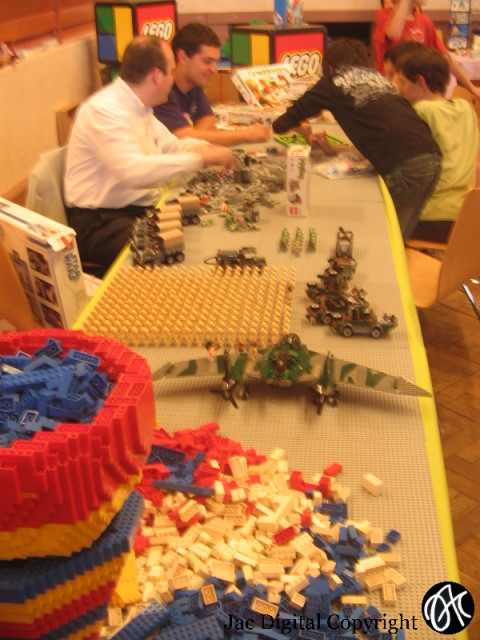
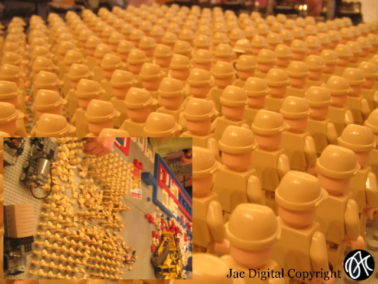
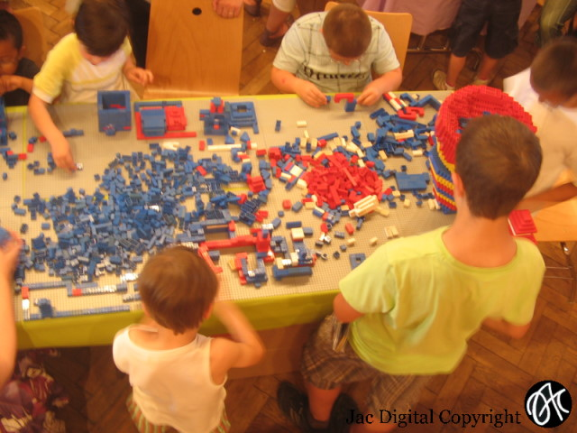
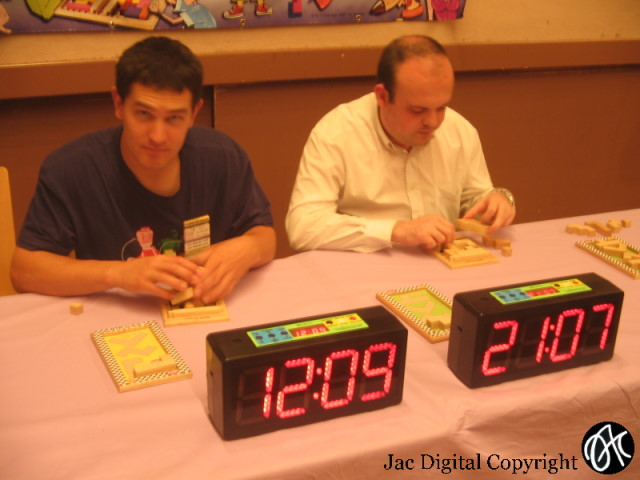

Pour cette septième édition, Festibriques et FreeLUG étaient invitées à présenter un stand ludique, orienté sur la construction.

Festiludis est organisé tous les 2 ans, depuis 14 ans, par le centre socioculturel de la ville de Saint-Marcel, à côté de Chalon-sur-Saône (71). C’est une fête consacrée aux jeux de société et cette année, l’accent était mis sur les jeux multiples, de par le monde : "80 jeux autour du monde".

**Vue complète du stand.**

Ayant déjà participé à la [précédente édition en 2008](/articles/recit-de-festiludis-une-exposition-pas-comme-les-autres/), c’est donc avec plaisir que je suis revenu. Dans la lignée de [Saint-Etienne](/articles/un-week-end-pour-jouer-a-saint-etienne/), nous avons présenté les jeux de société LEGO au public.

Il y a eu du monde autour de ces jeux, pour les essayer, y jouer, pour gagner.

Sinon un salon bien sympa, avec du jeux partout...  
Merci à l’organisation pour les repas et nuit pris en charge.

Et bravo à JeanG pour nous avoir supporté !

**Des militaires en vrac....**

Alors à dans 2 ans...

_PierroLego/Pierre L._

* * *

C’était ma première participation à un salon consacré uniquement aux jeux de sociétés. L’accueil était très sympathique. Dés notre arrivé, les organisateurs ont su nous prendre en charge pour nous guider vers notre stand. Le déroulement du salon a été très ludique, des jeux et des jeux. Beaucoup de personnes intéressées par ce que propose LEGO dans sa nouvelle gamme. Du coup, nous avons encore fait découvrir ces nouvelles boîtes sans nous en lasser.

Ce que je retiendrais aussi, ce sont les repas, de vrais festins. Le thème de l’exposition étant le tour du monde, les repas ont eu diverses inspirations : couscous le samedi midi, hamburger texan le samedi soir et norvégien avec du très bon poisson le dimanche midi. Tous cela servi par du personnel spécialisé, habillé en costume adéquat.

Les enfants ont pu improviser de la construction grâce à un vrac de briques bleu blanc rouge (!!) que JeanG avait apporté.

**Une aire de jeux colorée....**

De notre côté, nous avons pu tester certains jeux très intéressants, notamment un casse-tête ressemblant au Tetris.

**Casse-tête chronométré !**

Ma base spatiale pirate a eu du succès, mais, en étant le seul à proposer de l’exposition pure, il n’était pas toujours facile de retenir les petits doigts qui voulaient jouer avec les personnages. Cela n’a pas empêcher de passer un très bon salon et de répondre présent pour la prochaine édition.

_JAC/Jérôme._

## Galerie photos

**–** [JAC](http://photos.freelug.org/main.php/v/JAC/Exposition/Expositions2010/Festiludis/)
