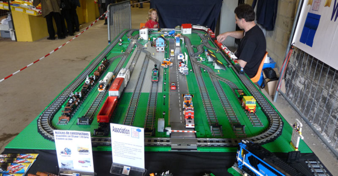
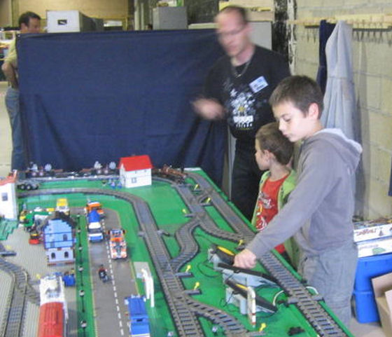
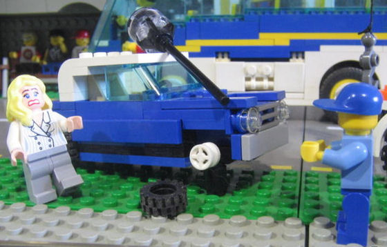
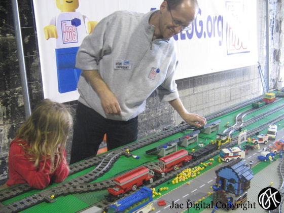
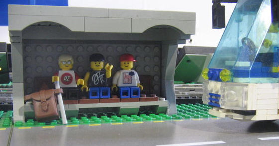
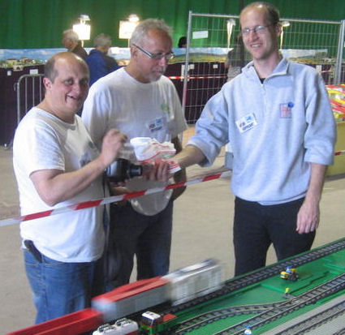

Le Festirail en Rouergue est organisé par La ville de Capdenac-Gare tout les deux ans. FreeLUG y était convié pour la deuxième fois consécutive.

## Un peu d’histoire

Capdenac-Gare est une commune récente : elle fêtera ses 150 ans en 2011. Située en limite de l’Aveyron (12) sur la rive gauche du Lot, elle est née et s’est développée autour de la gare.

L’activité de celle-ci était principalement due aux mines de charbon de Decazeville et de ce fait la gare connut son âge d’or avec celui de la vapeur. Ainsi, si au début du XXème siècle le trafic ferroviaire était d’environ 100 trains par jour (voyageurs et marchandises confondus), il a depuis bien décru.

Petite anecdote : c’est en 1866 à Capdenac-Gare que M. Raynal, gérant du buffet de la gare, s’est associé à M. Roquelaure, son chef cuisinier, pour fonder la conserverie alimentaire bien connue encore aujourd’hui.

Plus de renseignements à l’[office de tourisme de Capdenac](http://www.payscapdenacois.com/accueil.htm) et sur [wikipedia](http://fr.wikipedia.org/wiki/Capdenac-Gare).

## L’exposition

C’est sous l’impulsion de l’association _Courant d’Art_ que cette manifestation a lieu. Cette année c’était le troisième Festirail en Rouergue et les choses n’ont pas été faites à moitié. En effet, le Festirail n’a pas lieu dans une salle mais dans la ville entière. Il faut comprendre que tous les magasins étaient décorés pour rendre hommage aux trains, les exposants, nombreux, étaient répartis dans 4 salles, des animations avaient lieu sur la place de l’église, un groupe folklorique passait de salle en salle pour créer de l’animation et le samedi soir un repas animé par un chanteur a été organisé sous les halles. Un petit train (à pneu) permettait aux visiteurs de passer d’un site à l’autre gratuitement.

Pour cette occasion, JAC a créé un réseau un peu particulier. En effet, il ne s’agissait que d’un faisceau de triage avec sa butte et tout de même autour une boucle en voie unique.

**Le réseau**

JAC s’entraine pour le record du train le plus long

Le but n’était donc pas d’exposer des décors mais bien de montrer du train, de les faire tourner et manipuler par les enfants.

**Le dur apprentissage de la vie de cheminot**

Ce qui n’a pas empêché de créer quelques scènes...

**Oui c’est une femme qui conduisait et oui elle était blonde !**

désolé

Ou de tester l’épandage de têtes de minifig par wagon trémie :

**Oh mon dieu des têtes partout !!!**

aucune minifig n’a été maltraitée pour réaliser cette scène.

Nous avons eu la visite d’abord de quelques habitués :

**Trois étranges personnages**

Puis de nos [amis foreziens](/articles/estivareilles-2008/) qui, grâce à leur LGV modulaire faite par des enfants, ont obtenus le prix _Réseaux Ferré de France_ pour leur travail auprès des jeunes.

**Trois autres étranges personnages**

A noter tout de même que si Michel, le président du Club des Modélistes du Haut Forez d’Estivareilles, a déployé tant d’énergie pour avoir un prix, c’est uniquement pour faire la bise à la présidente de Courant d’Art.

En somme, si on exclut la météo, un bien beau week-end.

**–** [Article de la précédente édition](/articles/festirail-en-rouergue-le-festival-du-rail-a-capdenac-gare-17-et-18-mai-2008/)

## Galerie photo

**–** [Galerie photos JAC](http://photos.freelug.org/main.php/v/JAC/Exposition/Expositions2010/Festirail/)  
**–** [Galerie photos Pierrick](http://photos.freelug.org/main.php/v/-PZ/Exposition/Capdenac10/)
