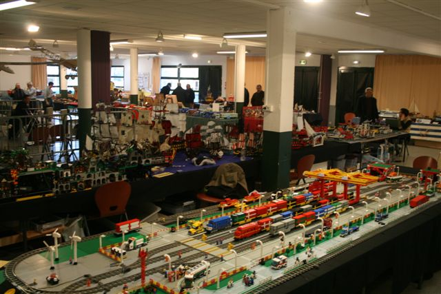
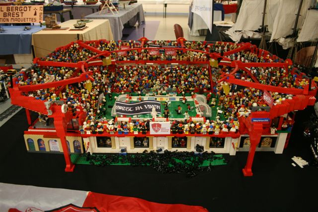
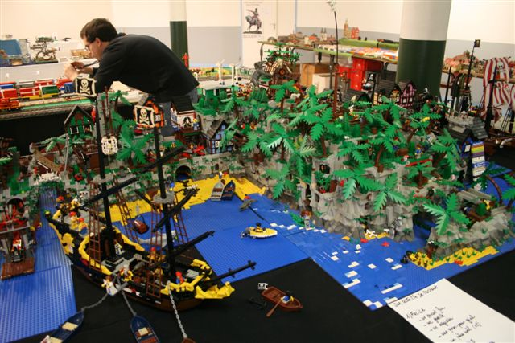

Le festival de maquette était à la salle de l’Astrolabe au Relecq Kerhuon, les organisateurs cette année ont décidé de nous mettre à l’honneur en nous accordant une surface généreuse (18mx1.60m) et une publicité exceptionnelle sur la petite brique.

Le team FreeLUG Penn Ar Bed (Finistère) a donc présenté un diorama pirates (Mick), bateaux (Richard et Laurent), stade de Brest (Laurent), diorama city et trains (Damien) et plate forme rail route (Jean-Marc).

Avant l’ouverture du salon , Laurent a sous estimé sa surface , il n’a pas pu présenter ce qu’il voulait, finalement, il a réussi à improviser son secteur.

Tout au long du salon, le public a apprécié notre stand (plus de 3000 visiteurs), et il parait que nous sommes les seuls exposants à se renouveler.

Deux exposants de FreeLUG ont été primés. Je passe, sous silence, les bêtises de mes collègues, je suis vacciné depuis belle lurette...

En conclusion, excellent week-end, félicitations des organisateurs du salon, satisfaction du public, merci à mes collègues. Je suis satisfait de mon diorama qui mérite quelques améliorations.

Merci à Laurent et Bruno pour l’hébergement .

Merci à Ronan Poirier (ex de paris) d’être venu nous voir, son retour parmi nous est à l’étude. Nous aurons un stand LEGO en 2013, il sera réduit par rapport à 2012.

A bientôt .

_Jean-Marc et Damien_
