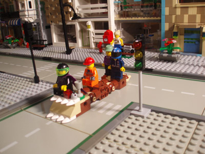
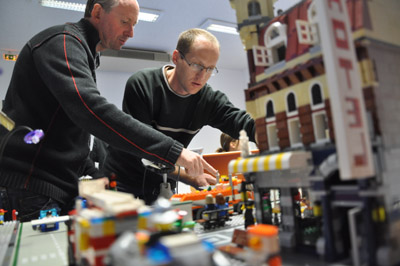
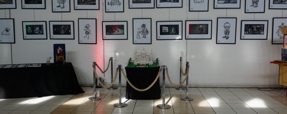
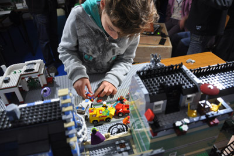
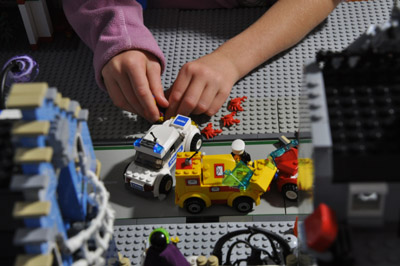
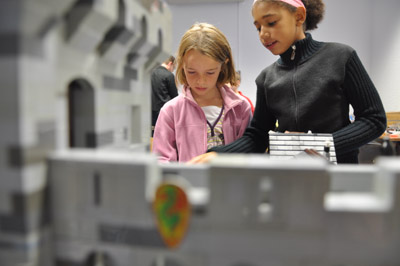
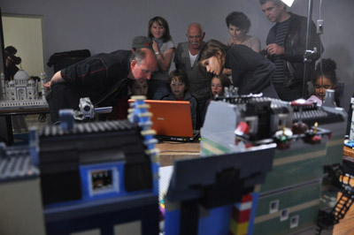
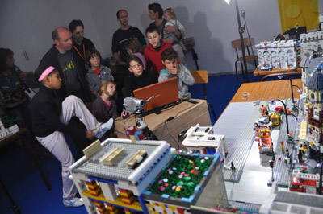

Une aventure qui commence bien loin du sud de la France : au salon du cinéma à Paris où le premier contact a été pris, avec Gaelle Ribeiro la programmatrice du festival.

## Le Festival

[Le festival « Voix d’étoiles »](http://www.voixdetoiles.com/) organisé par la ville de Port-Leucate, est consacré aux voix qui donnent vie à nos personnages préférés du cinéma d’animation, des Simpson en passant par les classiques de Disney. Cette année, il s’est déroulé du 27 octobre au 1er novembre.

## Notre participation

Le but du festival étant de s’ouvrir le plus possible au public, nous avons été invités à tenir un atelier toute la semaine.

Deux Freelugiens sudistes, Pierrick et moi-même (JY) ont répondu présent. Hélas, J’ai été seul à pouvoir poser une semaine de vacances en entier.

Le lundi a été destiné au voyage et au montage du premier décor, un diorama City, suffisant pour réaliser des petites animations, et laisser libre cours à l’imagination des enfants :

**L’imagination au pouvoir**

Le mardi et mercredi furent consacrés aux centres aérés de la région.

A raison de trois séances journalières avec 12 à 15 gamins, ce ne fut pas de tout repos.

Mais je me suis autant amusé que les enfants et on a fait des animations bien sympa, et en particulier [LE ROBOT BALAIS](http://www.youtube.com/watch?v=ymmevWsavZ4) sonorisé par Côme Alibert, un ingénieur du son qui travaille dans un studio spécialisé dans la sonorisation des films d’animations.

[Vidéo de la publication d’origine](http://www.youtube.com/v/ymmevWsavZ4&hl=fr_FR&fs=1&)

Du jeudi au dimanche l’atelier était ouvert au public du festival (sur inscription).

Le vendredi Pierrick a rejoint l’atelier :

**Les réalisateurs**

Il n’est pas venu les mains vides, puisque son Taj Mahal et ses jardins mis en valeur comme jamais, ont conquis le public :

**Le TAJ MAHAL à l’honneur**

Durant les 4 jours du festival, les enfants ont répondu présent et se sont lancés à fond dans l’animation, avec une capacité de concentration étonnante :

**Concentration**

**Artiste en action**

**LEGO, pour les garçons ?**

Les parents, les grand-parents, et même France 3 ont été de la partie :

**Générations LEGO !**

**Preview**

En tout, près d’une centaine d’enfants ont participé à cet atelier.

La principale production n’a pu être sonorisée entièrement sur place, c’est pourquoi vous trouverez en premier [une séquence sonorisée](http://www.youtube.com/watch?v=oCEkXZ-GOPc) lors de l’atelier de Côme Alibert.

[Vidéo de la publication d’origine](http://www.youtube.com/v/oCEkXZ-GOPc&hl=fr_FR&fs=1&)

[La séquence en entier](http://www.youtube.com/watch?v=kfGOzj5rpUw). A vous de faire votre propre histoire avec, si j’ose dire, puisque nous avons travaillé sans scénario, au gré des envies de notre jeune public, et c’est très bien ainsi.

[Vidéo de la publication d’origine](http://www.youtube.com/v/kfGOzj5rpUw&hl=fr_FR&fs=1&)

## Conclusion

Ce fût une expérience très positive avec plein de rencontres passionnantes !

Nous tenons à remercier tous les participants et en particulier la programmatrice du festival, Gaelle Ribeiro qui nous a très bien reçus, ainsi que Côme Alibert qui a sonorisé certaines séquences et JM Bozom pour ces belles photos.

Pour conclure : Vivement l’édition 2010 !!!!!

**–** [Galerie de Pierrick](http://photos.freelug.org/main.php/v/-PZ/Exposition/port+le+09/)  
**–** [Galerie de Jean-Yves](http://photos.freelug.org/main.php/v/JY+BROT/port+leucate/)
