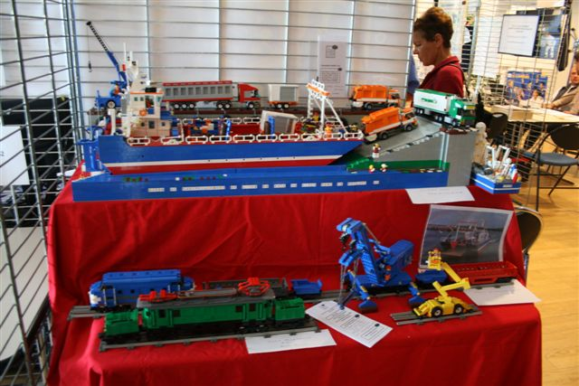

Membre à la fois de plusieurs clubs LEGO, d’un forum (legopirate) et partenaire du club de la maquette de Saint-Martin-des-Champs près de Morlaix (29), la petite brique a participé pour la première fois à la 11e édition du forum des associations, le 5 septembre dernier.

A cette occasion, une place m’a été réservée à la demande de Mr le Maire de la ville, premier fan de LEGO. Il souhaite que... j’organise dans le futur un salon 100% LEGO, il a même écrit un article.

Le but de cette participation est la création d’un club LEGO. Déjà, deux élèves suivent mes cours. Un nouvel article de presse sortira bientôt pour finaliser mon projet.

[Galerie photos](http://photos.freelug.org/main.php/v/barr__/expositions/2009/saintmartin2009/)

La participation à la journée du patrimoine du 19 septembre à Roscoff a été annulée, salle non conforme...

Mes prochains salons :  
**–** [Kidexpo (du 16 au 18octobre)](/articles/kidexpo-16-17-et-18-octobre-2009/)  
**–** [salon de Cholet (24 et 25 octobre)](/articles/festival-du-modelisme-cholet-24-et-25-octobre-2009/)

A bientôt

jean marc de Morlaix , finistère, bretagne, france, terre ...
