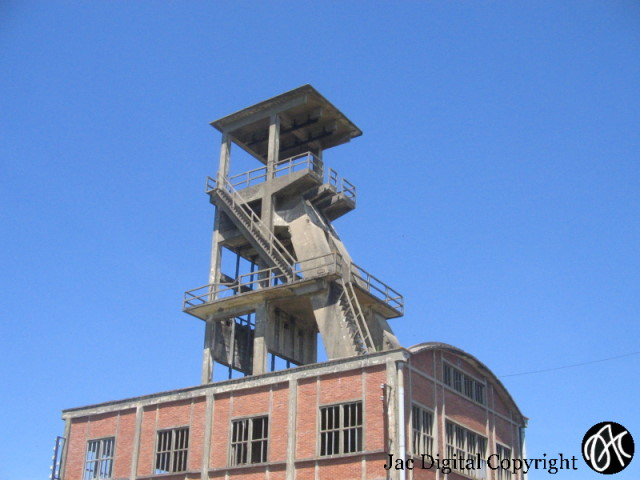
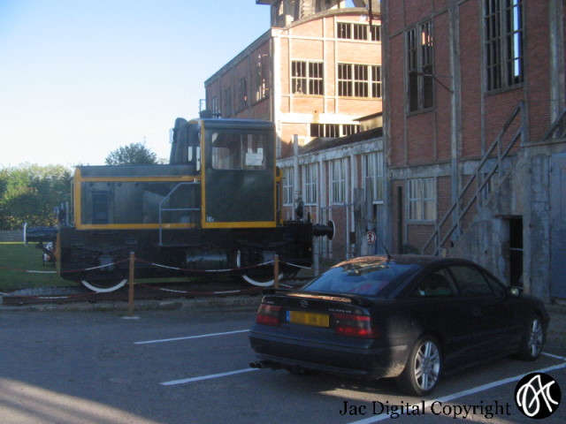
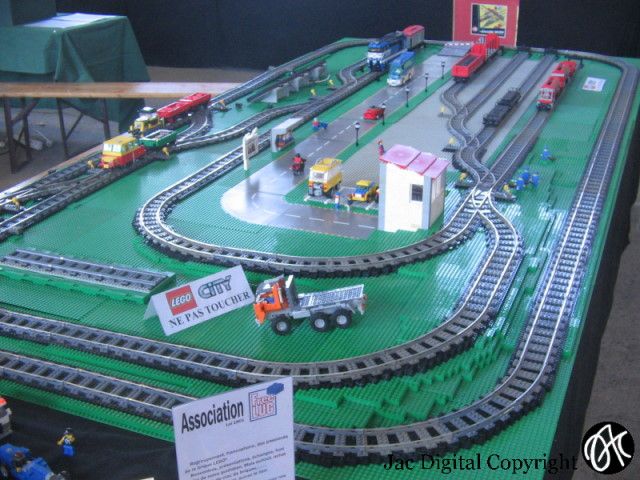
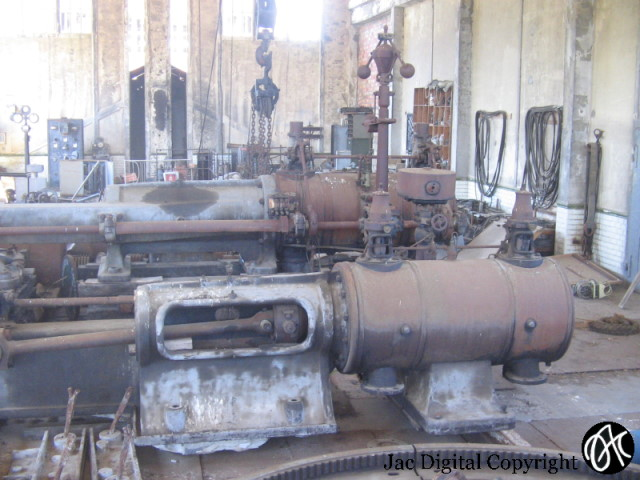

Exposer dans des salles des fêtes, des salles omnisport ou de grands halls d’exposition, nous avons l’habitude, mais dans les locaux d’une ancienne mine à charbon, ce n’est vraiment pas courant. Ca ne sera pas facile de transcrire l’ambiance ressentie sur place.

Ca y est, mon nouveau réseau est chargé dans la voiture, je suis prêt à prendre la route pour rejoindre Noyant-d’Allier, dans l’Allier (03) et participer à cette exposition particulière, dans les locaux d’une ancienne mine à charbon.

Les bâtiments sont construits en béton armé. C’est un des premier construit de cette manière, si ce n’est le premier. Même le chevalement a laissé la ferraille de côté pour son élévation. D’ailleurs quelle élévation ! Noyant-d’Allier est construit sur une butte. De là haut, on doit avoir une superbe vue. Mais cela restera dans mon imagination, car l’état du béton ne permet pas une ascension en toute sécurité. Nous serons installés dans la salle des "pendues", qui était en fait les vestiaires des mineurs. Les pendues, ce sont les vêtements, seulement...

**Chevalement en béton armé**

Après une heure de parcours, quelle ne fut pas ma surprise de tomber nez à nez avec le locotracteur que j’ai reproduit pour le concours de l’Assemblée Générale. J’en ai profité pour faire quelques photos.

**Bonne surprise du matin !!**

Après un accueil sympathique par les personnes déjà présentes et un bon petit jus d’orange, je commence le déballage et le montage des tables BAB. Tout seul, ce n’est pas une mince affaire, mais j’ai le temps, le salon ouvre ses portes à 14h00. Le plus dur est d’installer le réseau. C’est un vrai casse-tête. Heureusement que j’ai eu la bonne idée de faire un plan aux plaques près. Ca aide beaucoup.

Mon réseau est tout nouveau. Je voulais présenter le fonctionnement du triage des wagons marchandises. Le plus dur étant de faire une butte et de faire en sorte que les wagons ne déraillent pas en redescendant sur les aiguillages. Le fonctionnement n’est pas idéal, je peux me servir seulement de 2 voies sur les 4. Mais c’est amusant tout de même. Je vous présenterais le principe dans un prochain article.

**Le triage en LEGO**

L’exposition s’est très bien déroulée, au rythme du loco-tracteur jaune monocylindre qui faisait le tour des bâtiments, avec son "chargement" de visiteurs. Cette exposition a été en plus très ludique. Daniel Fournier, un des membres organisateurs (membre de l’association _[Les Amis de la Mine de Noyant-d’Allier](http://www.mine-noyant.fr/)_), que je rencontre souvent en salon, nous a organisé une visite dans des salles normalement fermées au public. Nous avons pu découvrir de très vieux moteur ou dynamo, appareils électriques et machines à vapeur. Tous cela chapeauté par de petites explications. Un vrai guide de musée !

**Machine à vapeur.**

Une très bonne ambiance a régné durant ces deux jours. La vie avec de tels passionnés est très instructive. J’ai appris beaucoup de choses, en plus du ressenti dans ces lieux chargés d’histoire.

Un seul regret, comme d’habitude, je n’ai vraiment pas pris assez de photos !

[Galerie photo](http://photos.freelug.org/main.php/v/JAC/Exposition/Expositions2010/Noyant/)
