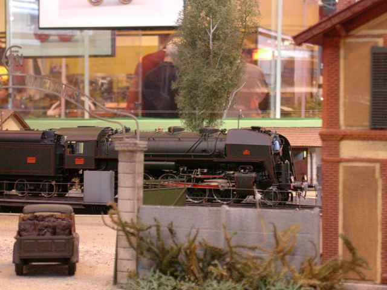
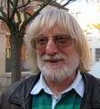
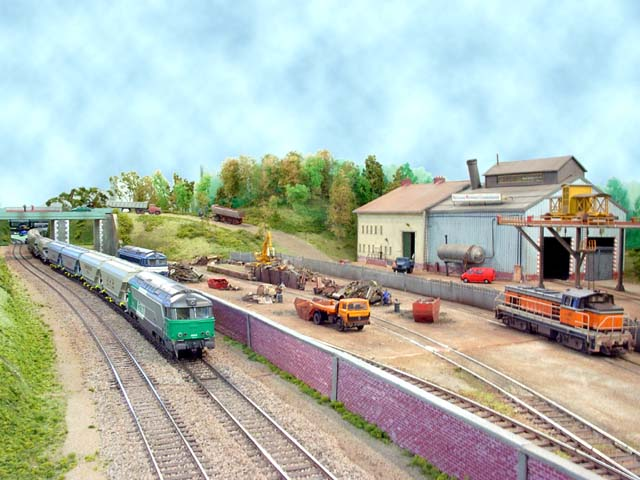
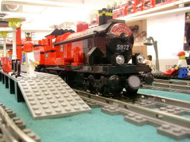
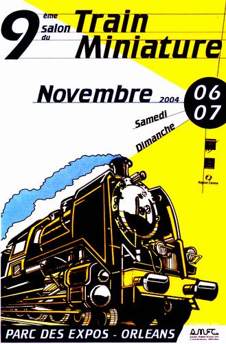

Tous ceux qui ont déjà participé ou organisé une exposition sont maintenant conscients des secrets qui font la réussite d’une belle présentation. Parmis ces secrets l’aspect dynamique contribue immanquablement à attirer l’oeil des visiteurs et à les faire s’attarder sur les décors en essayant de relever tel ou tel détail.

Dans le domaine des compositions dynamiques se tient au premier rang le train, que bon nombre de nos amis FreeLUGiens considèrent comme leur principal centre d’intérêt.

Dans cette optique il nous a paru évident, au sein du CA de FreeLUG, de développer des relations avec ceux qui ont la plus grande expérience de cet univers, à savoir les représentants de la Fédération Française de Modélisme Ferroviaire.

C’est au cours du dernier Mondial de la Maquette et du Modèle Réduit de la porte de Versailles à Paris, que les premiers contacts ont été pris avec la FFMF. D’abord pour présenter notre association et puis ensuite aussi pour partager notre retour d’expérience sur les expositions auxquelles nous avons participé de concert avec d’autres activités de modélistes.

**Les joyaux du modélisme ferroviaire**

J’ai a cette occasion pu discuter avec Christian TOURSEL, qui est le président de la FFMF et nous avons débattu du rôle que pouvait tenir le train LEGO® pour développer, notamment auprès des plus jeunes, l’intérêt pour le modélisme ferroviaire.

La FFMF est une puissante fédération qui intègre plus de 100 associations et clubs régionaux et qui organise de nombreuses manifestations sur l’ensemble du territoire.

L’idée de départ d’une affiliation de FreeLUG auprès de la FFMF a été de pouvoir faciliter le dialogue entre les adhérents FreeLUG et ceux des autres associations affiliées et d’être considéré comme des partenaires à part entière dès que des opportunités d’expositions communes peuvent se présenter.

Je laisse donc la parole à Christian TOURSEL pour vous présenter ce qu’est la FFMF.

**Christian TOURSEL - Président FFMF**

**–** Créer...  
**–** Imaginer...  
**–** Reproduire...  
**–** Mettre en scène...  
**–** Raconter...  
**–** Partager...

Le modélisme ferroviaire, le monde en mouvement

Le modéliste ferroviaire crée un monde, imaginaire ou réel, moderne ou ancien. Il le restitue dans sa totalité. Le mouvement des trains s’inscrit dans un décor, recréant en trois dimensions ces moments que la photographie ne permet de revoir qu’en deux dimensions. Le modéliste ferroviaire est un metteur en scène. Il reproduit le monde, en l’animant, en lui donnant vie, cette vie qui raconte les hommes, leur histoire.

Le modéliste ferroviaire est aussi le gardien de la culture ferroviaire, et son vulgarisateur. Avec le public, au travers des expositions, mais aussi dans les clubs, il partage ses connaissances de l’aventure du chemin de fer qui a façonné nos villes, nos paysages, notre histoire. C’est tout cela, le modélisme ferroviaire.

Ce monde miniature, recréé sous vos yeux, pour vos yeux, s’anime, vit, se déplace, retrouve les rythmes de la vraie vie. La place de la gare s’emplit des étals du marché du jeudi matin. Le vieil autorail brinquebalant amène son lot de ménagères et de petits producteurs locaux, les bras chargés de sacs et de paquets.

**Vue du réseau du GMC**

Ou alors, un tramway brillant vient prendre les passagers de l’étincelant TGV stationné sous la verrière qui semble défier les nuages. Tout est possible, reconstruire le passé, inventer les futurs progrès technologiques, recréer la vie des hommes autour de leurs machines fumantes. Ou mimer le présent, et ses trains oblongs lancés comme des fusées. Et pourquoi pas la navette amenant les mineurs de la cité lunaire au travail ?

Tout est possible, et tout prend vie devant vos yeux : les trains s’animent, la lumière du jour décline, les cloches de l’église sonnent. Les personnages figés racontent mille histoires.  
Tout cela, ce sont les modélistes ferroviaires qui l’ont créé, pour leur plaisir, mais aussi pour le plaisir de tous. De leurs doigts sort la magie de ce monde recomposé, aux couleurs si vraies, aux mouvements si réalistes, si bien que, spectateur, l’on cherche à retrouver un petit bout de son histoire, de ses souvenirs. Cette magie, ce sont les modélistes ferroviaires qui l’ont créée.

**L’univers des trains LEGO®**

Leur maison, c’est la Fédération Française de Modélisme Ferroviaire. Elle est leur dénominateur commun, celle qui les relie tous, jeunes et vieux, hommes et femmes, autour d’une même passion. Les thèmes représentés par les modélistes sont multiples. Les échelles de réduction utilisées sont nombreuses. Cette complexité, c’est la vie même. Le modélisme ferroviaire n’est pas un loisir uniforme. Il est artistique, technique, historique. La fédération est leur maison, aux artistes, aux techniciens, aux historiens.

Mais aussi celle des jeunes et des plus âgés. Certains modélistes ont connu les temps héroïques de la vapeur, d’autres sont les enfants des voitures Corail ou de l’Eurostar. On est modéliste ferroviaire à 6 ans ou à 90 ans. C’est la même fascination qui règne dans les yeux des petits et des grands quand le jeu prend vie. C’est aussi dans ce brassage générationnel que se réalise la transmission de la culture ferroviaire.

Parce qu’au delà des différences propres à chacun, la Fédération Française de Modélisme Ferroviaire est porteuse de la culture ferroviaire qui est présente dans chaque réalisation modéliste. Amateurs de TGV ou amoureux de vieilles bouillottes, collectionneurs ou constructeurs, tous partagent la même passion pour le train.

La Fédération Française de Modélisme Ferroviaire, ce sont plus de 100 clubs de passionnés dans toute la France, ainsi que les grandes associations spécialisées, soit plus de 3000 pratiquants fédérés.  
Ce sont des dizaines d’expositions locales et régionales montées par les clubs, dont plusieurs organisent les sessions de jeu des Juniors Du Rail ou d’autres animations en direction des jeunes.

La fédération, c’est aussi la promotion du modélisme ferroviaire au travers des grandes manifestations telles Le Train Capitale en mai et juin 2003, le Mondial de la Maquette chaque année, ou en d’autres occasions dans la presse écrite et audio-visuelle. Depuis maintenant deux ans, par l’organisation de la Semaine du Train Miniature (du 13 au 21 novembre 2004), tous les amateurs de France sont appelés, aux côtés des associations, à interpeller le plus large public.

La fédération communique auprès de ses adhérents et des néophytes à l’aide de son site web national, du site de Juniors Du Rail, et de 10 sites régionaux au plus près des amateurs.  
Elle propose, par des brochures ou des stages, des formations à l’animation et à la gestion des associations, ainsi qu’aux techniques utilisées en modélisme. Elle aide les clubs à organiser leurs calendriers par l’information à l’aide de l’agenda national et par la concertation.  
Elle suscite l’élaboration de « guides » qui permettent à chacun de réaliser une œuvre qui sera compatible avec celles d’autres modélistes, et participe à la rédaction des normes unificatrices au niveau européen.

Il y a forcément une place pour chacun à la fédération : farouchement individuel ou à la recherche d’une association locale, spécialiste d’une échelle de réduction ou d’un écartement de voies, il existe un moyen de s’intégrer au mouvement modéliste, de s’associer à d’autres, de s’entraider, de partager, d’apprendre, de jouer.

Vous rechercher un renseignement, une aide, une association, vous souhaitez en créer une, les animateurs fédéraux sont là pour vous y aider. Avec la fédération et ses 3000 membres, le plaisir du train miniature a une particularité : plus on le partage, plus il y en a !

Retrouvez-nous sur Internet [http://www.ffmftrain.org/](http://www.ffmftrain.org/) ou à FFMF - BP 15 - 91291 ARPAJON Cedex. Venez dans les clubs, échanger, construire, créer. Devenez magicien à votre tour.

* * *

Concrètement notre affiliation se traduit par une adhésion d’un minimum de 6 membres, pour lesquels FreeLUG a pris en charge les droits d’entrée (8 euro).

Ces membres sont :

**–** Pascal Brugier  
**–** Erik Amzallag  
**–** Philippe Label  
**–** Pacal Bréard  
**–** Gilles Micheletti  
**–** et moi-même, Didier Malon.

Si vous souhaitez, vous aussi adhérer, contactez moi, je vous expliquerai la marche à suivre. La part individuelle de la cotisation est cette année de 6 euro, en échange de quoi vous recevrez une petite carte supplémentaire à ranger en compagnie de votre carte d’adhérent FreeLUG.

N’hésitez pas à aller consulter le site de la [FFMF](http://www.ffmftrain.org/) notamment les pages concernant le calendrier des prochaines expositions et contactez nous si vous souhaitez prendre contact avec les organisateurs pour que nous puissions intervenir en votre faveur.

**Expo d’Orléans**

Et puis pour ceux qui se rendront à notre exposition d’0rléans les 6 et 7 Novembre prochains, je vous précise que cette manifestation est organisée à la base par une association affiliée FFMF.
