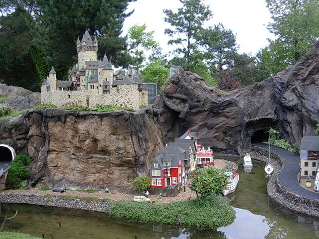
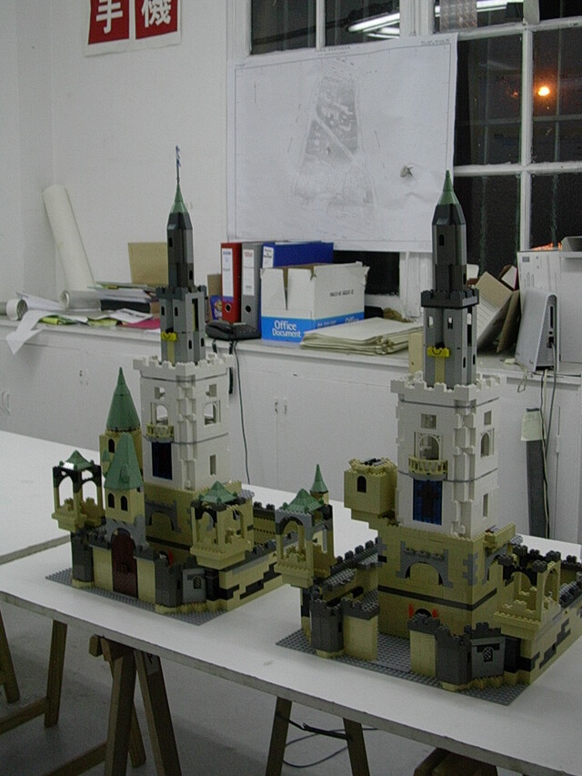

Depuis le mercredi 28 Mars, est sorti sur les écrans français le dernier film de James Huth, intitulé Hell Phone. Quel rapport avec FreeLUG ?

Et bien c’est ce que je vais vous raconter aujourd’hui.

Il ne s’agit pas d’une nouvelle rubrique "cinéma" qui vient bouleverser nos chroniques FreeLUGiennes, mais du compte-rendu d’une aventure pas banale, que j’ai partagée avec l’ami Gilles (celui dont le père n’est pas maladroit !).

Pour planter le décor, un petit flashback de quelques mois dans le passé...

L’action se déroule dans un centre d’affaire parisien où je réalise quotidiennement les différentes tâches qui me permettent de gagner chaque mois de quoi acheter, entre autres, quelques petites briques pour augmenter ma collection.

Nous sommes le mercredi 30 Août, il est 11h00 du matin, je suis au milieu de mes collègues et mon "cell phone" sonne...

"Allo ?

**–** Bonjour, je suis le régisseur du nouveau film de James Huth (passage en mode FreeLUGien cinéphile : James Huth = Serial lover avec la délicieuse Michèle Laroque, film déjà qualifié de déjanté et que j’ai bien aimé et également de Brice de Nice avec Jean Dujardin, que je n’ai toujours pas vu... enfin le film, parce que Jean Dujardin on le voit pratiquement dans tous les films en ce moment)  
**–** Oui ?  
**–** Et en fait j’ai un petit service à vous demander ?  
**–** Oui (excitation grandissante...) ?  
**–** C’est la boutique LEGO du boulevard des Italiens (merci Ingrid) qui nous a donné vos coordonnées. Notre problème est le suivant : Nous avons besoin de réaliser un château en LEGO pour tourner quelques scènes du film et nous ne savons pas comment faire. On nous a dit que vous pourriez peut être nous aider ?  
**–** Oui, qu’est-ce que vous voulez faire exactement ?  
**–** Et bien on voudrait faire un château du style "Princesse au Bois dormant", d’environ 80 cm de haut.  
**–** Et qu’est-ce que vous avez comme briques ?  
**–** Et bien on a commencé par acheter un château en Duplo, mais ça ne convenait pas au réalisateur, alors nous sommes retournés à la boutique et nous avons acheté quelques boîtes de vrac, mais ça ne va pas. Nous n’arrivons pas à obtenir ce que nous recherchons.  
**–** Ok, je vois (encore un challenge où il faut monter un projet en quelques semaines en partant de pratiquement rien...) et vous voudriez que l’on vous aide en vous donnant des idées, éventuellement que l’on vous fasse une notice et vous dise ce que vous pouvez acheter comme briques ?  
**–** Euh, non, on aimerait que vous veniez construire le château.  
**–** Bon d’accord, et le tournage il est prévu quand ?  
**–** Demain matin !  
_Passage en mode panique..._  
**–** Oui alors, ça va être un peu difficile, là, parce que accessoirement je bosse et qu’il va falloir quand même y passer un peu de temps, bon je vais voir ce que je peux faire et je vous rappelle."

Bon, j’ai un poil romancé notre entretien, pour les besoins du film, mais ça c’est grosso modo passé comme ça.

La suite a consisté à passer dans la foulée un mail sur la liste adhérents pour faire appel à des volontaires, à appeler Erik (Meuh) (Tonquédec) et Gilles (habitué des caméras et grosse réserve de briques) pour savoir si ils pouvaient venir me donner un coup de mains. Erik est malheureusement occupé et Gilles est d’astreinte le soir, mais doit pouvoir se libérer. Une petite explication à mes collègues qui connaissent mon implication dans la vie de l’association et qui gentiment, comprennent qu’une proposition comme ça, on peut rarement la refuser.

La décision est prise, je prends mon après-midi, retourne à la maison piller mon stock de "Tan" et de "Gris" et me voilà parti, direction une vieille usine désaffectée à Pantin, au nord de Paris, où l’équipe du film a implanté les principaux éléments du décors.

Effectivement après une rapide présentation, je découvre le château multicolore que les assistants du film ont essayé de réaliser à partir des boîtes de vrac et je comprends la détresse de la production.

On m’explique brièvement la scène : "Alors Sid, le héros du film, interprété par Jean-Baptiste Maunier (Les choristes), s’occupe d’un petit garçon et il l’aide à réaliser un beau château en LEGO. Il faut que l’on voit que le château a été difficile à construire, parce qu’en final, pour remercier Sid de son aide, le petit garçon se jette sur le château et détruit tout !

Ah, d’accord il va falloir construire un truc difficile à construire et qui se casse facilement, si j’avais su, j’aurai suggéré d’utiliser l’AT-AT de Star Wars, qui correspond mieux à ce type de contrainte. En plus ce n’est pas un château qu’il faut construire, mais au moins 2, voir 3... Pour un casse-tête pareil, j’aurai bien eu besoin de l’aide de Banban, tiens !

Bon étape numéro un, on range les briques multicolores (désolé les assistants, mais votre château ne répond pas vraiment aux exigences esthétiques du film, par contre on va récupérer ce qu’il y a de blanc et de gris pour qu’avec ce que j’ai apporté on puisse faire quelque chose).

Gilles me rejoint à ce moment là, il est aux environs de 17h et tout reste à faire.

Après plusieurs heures de travail (pizza et boissons gracieusement offertes par la production), nous arrivons à un résultat, qui compte tenu des moyens disponibles, nous paraît globalement satisfaisant.

C’est sûr qu’avec plus de temps et plus de briques, nous aurions pu faire ça :

Mais nous sommes quand même heureux d’avoir pu arriver à ce résultat :

En plus il a fallu étudier le truc pour que le château puisse quand même arriver entier sur le plateau de tournage, fragiliser certaines zones pour qu’il soit facile à casser et laisser certains modules assez compacts pour qu’il puisse être remonté aisément par l’équipe dans le cas où plusieurs prises seraient nécessaires. Nous avons réussi quand même à faire 2 châteaux de bonne taille.

Il est 23 heures. Quasiment toute l’équipe a déserté le plateau, à part le sculpteur qui réalise en résine une cinquantaine de faux téléphones pour tourner la scène de l’usine.

Bernard le régisseur du film, nous fait quand même visiter le plateau avant que nous ne quittions les lieux et nous passons tour à tour de l’usine de fabrication des téléphones, à la chambre de Sid (aux perspectives volontairement déformées pour ajouter à l’effet d’exigüité voulu), au fast-food de Chicken-Fritz en passant par les catacombes.

Quelques jours après, je reviens sur les lieux du tournage récupérer mes briques et je suis invité à partager un petit barbecue avec l’équipe du film.

Je rencontre brièvement James Huth le réalisateur du film et je lui demande s’il a pu tourner la scène comme il le souhaitait. Il me remercie gentiment pour l’aide que nous avons apporté au film et m’explique que pour la scène, finalement les deux châteaux ont été utilisés, afin d’avoir un volume consistant. Il y a eu deux prises. Lors de la première le petit garçon n’y est pas allé franchement et il n’a pas réussi à casser les châteaux (aïe). Dans la deuxième, il s’est laché et a tout explosé (ouf !).

Effectivement en rangeant mes briques, j’en ai trouvé une qui témoigne de son investissement. J’espère qu’il ne s’est pas fait mal.

Toute cette belle aventure s’est terminée hier soir, où nous sommes allés, Gilles et moi, voir ce film...

Nous avons sursauté sur nos sièges, lorsque vers la fin du film, le héros part pour un rendez-vous avec la femme de sa vie et se fait interpeler par le petit garçon, qui lui dit : "Mais tu avais promis que tu allais m’aider pour faire mon château en LEGO !"

En revanche, "notre scène" n’a pas été conservée au montage, cependant le générique du film rend compte de nos efforts, puisqu’il mentionne "**merci à Didier et à ses camarades de FreeLUG !**". Eh, eh, c’est comme si nous avions reçu un César.

A mon tour de remercier l’équipe du film pour son accueil.

Voici [le site officiel du film](http://www.hellphone-lefilm.com/), film que je vous invite à découvrir, si vous avez envie de rigoler un moment. Il regorge d’humour noir et de situations un peu salaces (Gilles n’a pas regretté d’y aller sans ses filles), mais ça reste correct et c’est effectivement truffé de références cinématographiques.

Quant à notre scène coupée ? Peut-être figurera-t-elle sur le DVD ?

Nous rendrons aussi un petit hommage au film durant notre exposition au salon de la maquette. Saurez-vous la découvrir ?
