LEGO lance en fanfare une nouvelle gamme destinée aux filles à partir de 5 ans, Friends, avec pas moins de 23 sets pour 2012. Avant même le début de l’année, quelques sets ont déjà fait leur apparition sur les tablettes des magasins. Voyons ce que nous réserve cette gamme.

## Un peu d’histoire

Mais commençons par un peu d’historique. LEGO a développé par le passé plusieurs gammes destinées aux filles.

**Homemaker**

La plus ancienne, les [Homemaker](http://www.brickset.com/browse/themes/?theme=Homemaker) a été diffusée entre 1971 et 1974. Il s’agit de pièces de maison et de mobilier, avec des figurines de briques à bras articulés et grande tête.

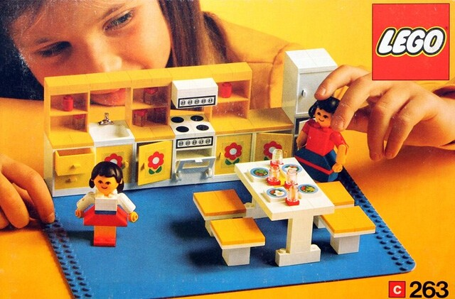

**Scala**

Puis une gamme dénommée [Scala](http://www.brickset.com/browse/themes/?theme=Scala&subtheme=Jewellery) apparait brièvement en 1979/1980. C’était en réalité des accessoires, type bijoux, à construire : bagues, bracelets, colliers... J’ai encore quelques reliquats de ces pièces qui avaient appartenu à ma sœur alors âgée de 5 ans.

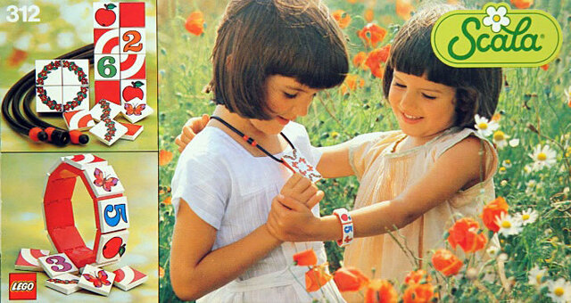

**Paradisa**

En 1992, LEGO lance une gamme System dédiée aux filles, [Paradisa](http://www.brickset.com/browse/themes/?theme=Town&subtheme=Paradisa), avec l’introduction d’une nouvelle couleur, le rose (qui avait été lancé en réalité une année plus tôt dans le Duplo) et le vert pastel. J’avais alors 10 ans. Face à cette hérésie, je n’avais pas hésité à coller les pages du catalogue pour ne pas voir ces horreurs. De 1992 à 97, LEGO sortira 18 sets. Aujourd’hui, il m’en manque encore 5 pour compléter la collection...

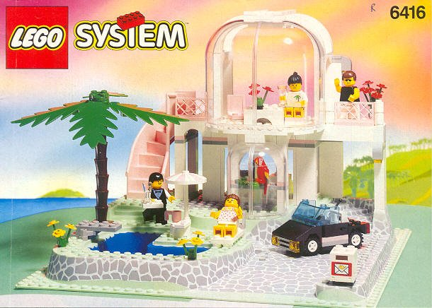

**Belville**

Peu de temps après le lancement de Paradisa, en 1994 LEGO lance [Belville](http://www.brickset.com/browse/themes/?theme=Belville), une gamme à base de figurines articulées, plus grandes que les minifigs. Les décors, simples et dotés de très grandes pièces, mais équipés en accessoires, sont clairement davantage destinés à être un lieu de jeu plus qu’un jeu de construction. Jusqu’en 2008, LEGO sort chaque année plusieurs sets, très inspirés de l’univers féminin comme la maison, l’hôpital, les loisirs extérieurs puis de l’univers féérique avec entre autres un passage sur les contes d’Andersen en 2005 lors de la célébration du 200ieme anniversaire de la naissance du conteur danois.

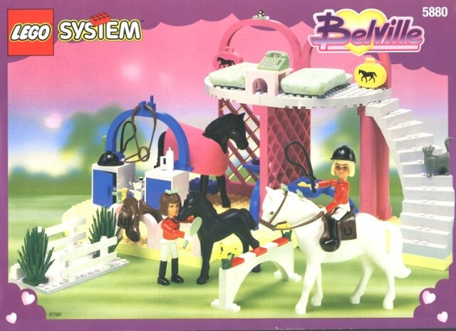

**Scala**

En 1997, LEGO, lors de ses errements des années fin 90, sort en parallèle une nouvelle hérésie série, [Scala](http://www.brickset.com/browse/themes/?theme=Scala) (reprenant alors la même appellation que la gamme de 79/80). Cette gamme est à rapprocher du monde de la poupée Barbie. Des grandes figurines articulées à habiller, de grandes maisons à équiper. La gamme durera jusqu’en 2001.

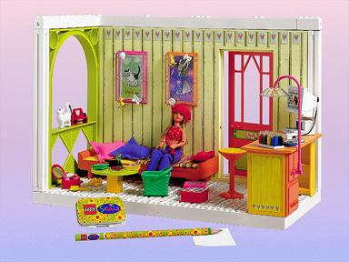

**Clikits**

Enfin, entre 2003 et 2006, LEGO lance la gamme [Clikits](http://www.brickset.com/browse/themes/?theme=Clikits), une série de petites pièces pour confectionner ses bijoux et boîtes à bijoux.

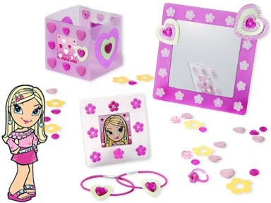

A noter également qu’il existe aussi des boîtes pour filles dans la gamme DUPLO.

Si LEGO a longuement occupé le créneau du marché des filles avec la gamme Belville, on pouvait lui reprocher de ne pas avoir tenu une gamme plus proches de ses classiques. C’est une question qui a souvent été posé à LEGO lors de rencontres avec les AFOLs.

Voici la réponse apportée par Jan Beyer lors d’une session questions/réponses de [notre assemblée générale 2006](/articles/compte-rendu-de-l-assemblee-generale-du-18-fevrier-2006/) où le manager des relations avec la communauté des AFOLs avait participé :

>   
> **–** Il a existé une série Paradisa pour les filles. Aujourd’hui, est il prévu une telle série pour les filles ?
> 
> _Jan Beyer :_ A partir d’un certain âge, les filles arrêtent de jouer aux LEGO. La gamme fille représente une part très minime des ventes. Par conséquent LEGO ne prévoit pas de faire des investissements pour développer une gamme spécifique pour les filles.

* * *

Six ans plus tard, il semblerait que la donne ait changé. La gamme Friends fait son apparition, et il semblerait que le succès soit au rendez-vous.

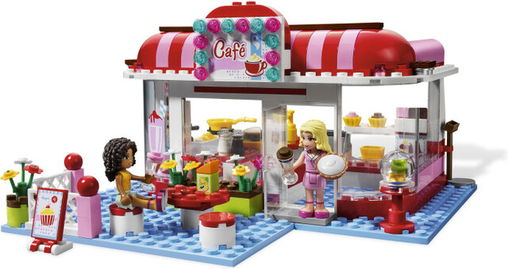

## Présentation

L’objectif ici n’est pas de décrire un set en particulier, mais de présenter de façon générale la gamme.

**Les boîtes**

Commençons par l’emballage. Les boîtes arborent des couleurs très chatoyantes, avec une dominante pour le mauve. Le logo contient cœur et papillon. Pas de doute, le côté bucolique nous indique clairement que la gamme est destinée aux filles. Parlons filles d’ailleurs, la gamme propose à son lancement 5 personnages dénommés Mia, Emma, Andrea, Stephanie et Olivia, représentant le panel classique : la rousse, la brune, la métisse, la blonde et la châtain.

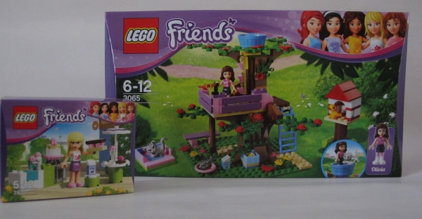

Les boîtes de taille moyenne (pour les grandes, je ne sais pas, il n’y en avait pas en rayon) ont leurs arrêtes latérales de face courbées, probablement pour donner une forme féminine supplémentaire à la boîte. Original pour une boîte LEGO.

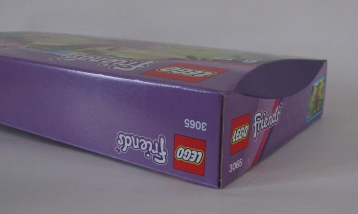

**Les figurines**

Attardons-nous sur les figurines, grande nouveauté de cette gamme.  
Le buste et les jambes viennent en sachets séparés. Un coup d’œil sur les mentions de la boîte et on imagine que ces pièces sont fabriquées en Chine.

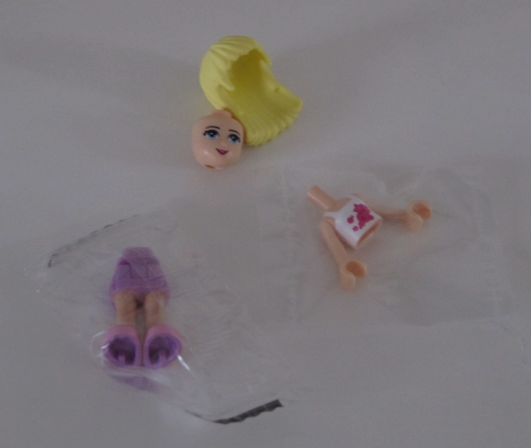

Donc comme les minifigs classiques, nous pouvons mélanger jambes, buste, tête et cheveux.

La finesse des bras surprend. Les cheveux sont dans un plastique mou, bien que l’épaisseur les rend rigides. Deux trous y sont présents pour y fixer des petits accessoires comme couronne ou nœud. La figurine se fixe évidemment sur des tenons classiques et peut tenir en ses mains les accessoires LEGO. Mais les mains sont fixes et ne tournent pas, façon Playmobil...

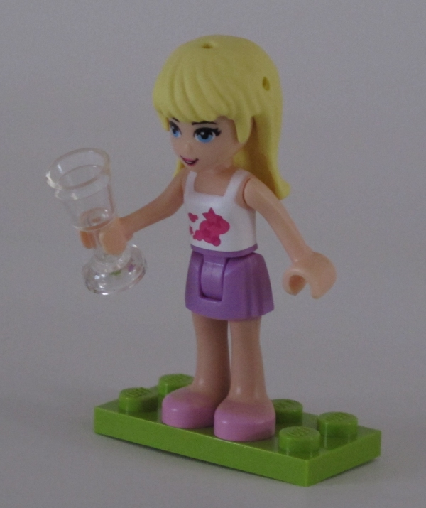

Pour comparaison, voici Stéphanie à côté de PZ (toute ressemblance avec des personnages existants est pure coïncidence).

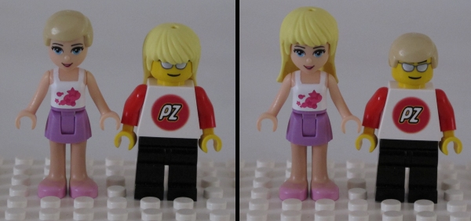

La bonne nouvelle, ce sont les cheveux qui sont compatibles avec ceux des minifigs traditionnels. La gamme Friends sera donc une source d’enrichissement de coiffures pour nos minifigs.

**Les couleurs**

Autre nouveauté de cette gamme, c’est l’introduction de nouvelles couleurs, ce qui surprend toujours quand on sait que LEGO a cherché à réduire sa palette de couleurs pour réduire les coûts de production.

Nous avons droit à un nouveau bleu, dénommé Medium Azure chez Bricklink.

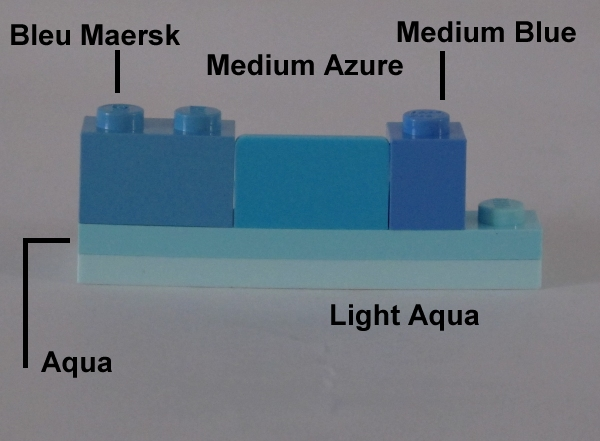

Ainsi qu’un nouveau violet, dénommé Medium Lavender

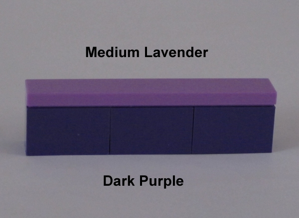

Ce n’est pas forcément les couleurs que les AFOLs souhaitaient le plus avoir, mais on en trouvera bien un usage ! :)

**Les accessoires**

Pour accompagner le succès de la gamme auprès des filles, il faut des accessoires. Beaucoup d’accessoires. C’est ce qui fait que Playmobil marche mieux auprès des filles.

LEGO a donc imaginé de nombreux accessoires, que vous découvrez en vous plongeant dans l’[inventaire des sets Friends](http://www.bricklink.com/catalogList.asp?catType=S&catString=771).

## Conclusion

Alors, que faut-il en penser ?

Pour les accessoires, la gamme Friends sera une excellente source qui permettra d’ajouter de nombreux détails, notamment dans les vignettes. Les couleurs trouveront surement quelques usages. Mais surtout, oserons-nous mélanger les figurines ? C’est finalement peut être le seul reproche qui sera fait à LEGO : mais pourquoi avoir encore choisir autre chose que la minifig classique ?

[La gamme Friends sur le site LEGO](http://friends.lego.com/fr-fr/Default.aspx)
