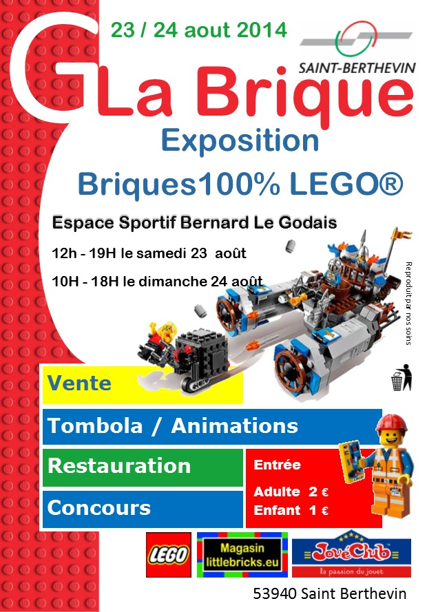
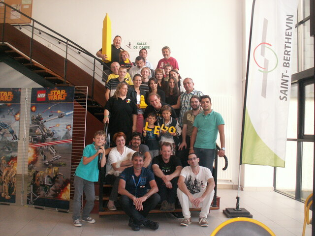

Le premier salon mayennais (53) 100 pour 100 LEGO a eu lieu les 23 et 24 août 2014 à Saint Berthevin sous la bannière d’une petite association locale G la brique.

Pendant 3 ans elle a organisé un salon du jouet qui devenait moribond. G la brique s’est donc recentré sur son activité principale et a proposé en 2014 son premier salon LEGO. 650m2 et la participation d’un bon nombre d’exposants venant de partout en France pour soutenir Gilles BORDIER et son asso. Nous avons eu 1421 visites payantes et un super retour des élus et du public et la banane des exposants.  
Gilles BORDIER souhaite remercier tous les soutiens AFOL’s pour la réussite de son projet.  
Face au succès, l’édition 2015 se profile pour les 22 et 23 août 2015. Merci à tous, merci d’apporter tant de bonheur aux locaux.

**merci les amis merci de me permettre d’exister**

Certains commentaires sont visibles sur la page Facebook de G la brique, c’est [ici](https://www.facebook.com/groups/glabrique).
