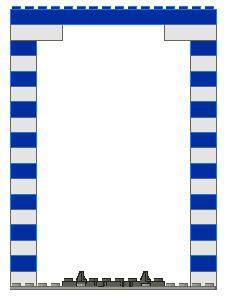
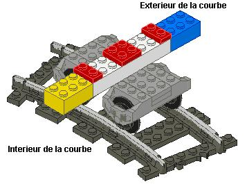
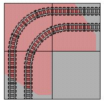
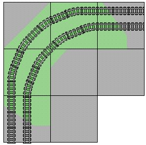

Gabarit des trains utilisé en exposition.

## Principe

Les tailles variées des trains LEGO, particulièrement les MOCs, nécessitent de faire bien attention à la façon dont va être construit le décor à proximité immédiate des voies.

Ceci est particulièrement vrai quand il s’agit de trains en largeur de 8 tenons lors du passage des courbes.

C’est pourquoi un gabarit, qui pourra être évolutif, est fixé afin de s’assurer que les décors que nous allons construire ne vont pas provoquer de gêne à la circulation des trains les plus encombrants. Parmi les décors critiques se trouvent particulièrement les tunnels.

Ce gabarit sert à la fois de support pour la construction des décors, mais également devrait être une contrainte à respecter lors de la construction d’un nouvel élément de train (locomotive, wagon...).

**Algorithme de calcul**

_Du coté constructeur de décor :_  
Employez la technique du chariot décrite plus bas pour vous assurer que vos décors ne gêneront pas la circulation des trains.

_Du coté du constructeur de matériel roulant :_  
Pour être sur que votre matériel roulera sans problème dans les décors existants, il est préférable de tenir compte des valeurs des tableaux : en fonction de l’empattement, de la largeur et du porte-à-faux aux extrémités de votre matériel, vous pouvez vérifier si il correspond au gabarit existant.

## Largeur en ligne droite

La largeur des trains ne doit absolument pas excéder les 10 tenons de large, éléments décoratifs compris. En effet, l’écartement des rails en ligne droite est de 8 tenons. En laissant un tenon de marge pour chaque voie, la partie centrale pouvant être occupée par le décor est alors réduite à 4 tenons. Un décor doit donc pouvoir être placé sans difficulté à 2 tenons des rails en ligne droite.

## Hauteur

La hauteur actuelle est définie par la BB17000 de Erik, posée sur rails et pantographe levé.

La hauteur minimale à laisser libre est de 17 briques. Si le circuit est équipé de caténaires, la caténaire doit se trouver à 17 briques au dessus du sol. Un tunnel devrait donc être un peu plus haut.

## Encombrement en courbe

L’encombrement en courbe est représenté par 2 valeurs : le débordement intérieur (qui se mesure au milieu de l’empattement) et le débordement extérieur (qui se mesure au coin extérieur).

Deux configurations de courbes existent, chacune influe sur ces valeurs.

Pour vérifier simplement le gabarit, faire circuler un petit chariot de 8 tenons de long, équipé de 2 essieux de train 9V. Le chariot est équipé en sa largeur et en son milieu d’une brique 2x8 (pour représenter la largeur des rails).  
La valeur donnée dans le tableau est à ajouter en prolongation de cette brique. Le gabarit est respecté si rien ne vient gêner la circulation du chariot. Sur le schéma, la brique jaune représente le débordement intérieur, la brique bleue le débordement extérieur.  
_Les dimensions ci-dessous sont exprimées en tenons_

**Définition des termes employés**

-   "Empattement :" distance séparant les axes de rotation des boggies (leur point de fixation avec le châssis)
-   "Porte-à-faux :" distance entre l’axe de rotation du boggie et l’extrémité du matériel (la plus longue des distances avant ou arrière)
-   "Largeur :" largeur totale (éléments décoratifs compris)

## En courbe étroite

Les courbes étroites sont les courbes classiques, en configuration C-C-C-C (C pour rail courbe)  
L’encombrement en courbe est important, dû au déport des wagons en 8 de large.

La zone colorée représente la zone concernée par le gabarit en courbe.

L’encombrement actuel en courbe étroite est fixé par rapport à la [BB 64000 de Pascal Bréard.](http://www.brickshelf.com/cgi-bin/gallery.cgi?f=43244)

**Débordement intérieur**

La valeur actuelle est fixée à 3 tenons de libre.

La mention « (rouge) » conserve le signalement en rouge du tableau d’origine.

| Empattement | Largeur 6 | Largeur 8 | Largeur 10 |
| --- | --- | --- | --- |
| 18 | 1 | 2 | 3 |
| 19 | 1 | 2 | 3 |
| 20 | 1 | 2 | 3 |
| 21 | 1 | 2 | 3 |
| 22 | 1 | 2 | 3 |
| 23 | 1 | 2 | 3 |
| 24 | 1 | 2 | 3 |
| 25 | 2 | 3 | **4** |
| 26 | 2 | 3 | **4** |
| 27 | 2 | 3 | **4** |
| 28 | 2 | 3 | **4** |
| 29 | 2 | 3 | **4** |
| 30 | 2 | 3 | **4** |
| 31 | 3 | **4** | 5 (rouge) |
| 32 | 3 | **4** | 5 (rouge) |
| 33 | 3 | **4** | 5 (rouge) |
| 34 | 3 | **4** | 5 (rouge) |
| 35 | **4** | 5 (rouge) | 6 (rouge) |
| 36 | **4** | 5 (rouge) | 6 (rouge) |
| 37 | **4** | 5 (rouge) | 6 (rouge) |
| 38 | **4** | 5 (rouge) | 6 (rouge) |
| 39 | 5 (rouge) | 6 (rouge) | 7 (rouge) |
| 40 | 5 (rouge) | 6 (rouge) | 7 (rouge) |
| 41 | 5 (rouge) | 6 (rouge) | 7 (rouge) |
| 42 | 5 (rouge) | 6 (rouge) | 7 (rouge) |
| 43 | 6 (rouge) | 7 (rouge) | 8 (rouge) |
| 44 | 6 (rouge) | 7 (rouge) | 8 (rouge) |
| 45 | 6 (rouge) | 7 (rouge) | 8 (rouge) |
| 46 | 7 (rouge) | 8 (rouge) | 9 (rouge) |
| 47 | 7 (rouge) | 8 (rouge) | 9 (rouge) |
| 48 | 7 (rouge) | 8 (rouge) | 9 (rouge) |

**Débordement extérieur**

La valeur actuelle est fixée à 4 tenons de libre.

La mention « (rouge) » conserve le signalement en rouge du tableau d’origine.

Une cellule finale est absente dans la source et porte la mention « Cellule absente dans l’original ». Les valeurs existantes sont conservées sans correction.

**Largeur : 6**

| Empattement | Porte-à-faux 4 | Porte-à-faux 5 | Porte-à-faux 6 | Porte-à-faux 7 | Porte-à-faux 8 | Porte-à-faux 9 | Porte-à-faux 10 |
| --- | --- | --- | --- | --- | --- | --- | --- |
| 18 | 0 | 1 | 1 | 1 | 2 | 2 | 3 |
| 19 | 1 | 1 | 1 | 2 | 2 | 3 | 3 |
| 20 | 1 | 1 | 1 | 2 | 2 | 3 | 3 |
| 21 | 1 | 1 | 2 | 2 | 3 | 3 | 3 |
| 22 | 1 | 1 | 2 | 2 | 3 | 3 | 3 |
| 23 | 1 | 1 | 2 | 2 | 3 | 3 | **4** |
| 24 | 1 | 1 | 2 | 2 | 3 | 3 | **4** |
| 25 | 1 | 1 | 2 | 2 | 3 | 3 | **4** |
| 26 | 1 | 1 | 2 | 2 | 3 | 3 | **4** |
| 27 | 1 | 2 | 2 | 3 | 3 | **4** | **4** |
| 28 | 1 | 2 | 2 | 3 | 3 | **4** | **4** |
| 29 | 1 | 2 | 2 | 3 | 3 | **4** | **4** |
| 30 | 1 | 2 | 2 | 3 | 3 | **4** | **4** |
| 31 | 1 | 2 | 2 | 3 | 3 | **4** | **4** |
| 32 | 1 | 2 | 2 | 3 | 3 | **4** | **4** |
| 33 | 1 | 2 | 2 | 3 | 3 | **4** | 5 (rouge) |
| 34 | 1 | 2 | 2 | 3 | 3 | **4** | 5 (rouge) |
| 35 | 1 | 2 | 2 | 3 | 3 | **4** | 5 (rouge) |
| 36 | 1 | 2 | 2 | 3 | 3 | **4** | 5 (rouge) |
| 37 | 1 | 2 | 3 | 3 | **4** | **4** | 5 (rouge) |
| 38 | 1 | 2 | 3 | 3 | **4** | **4** | 5 (rouge) |
| 39 | 1 | 2 | 3 | 3 | **4** | **4** | 5 (rouge) |
| 40 | 1 | 2 | 3 | 3 | **4** | **4** | 5 (rouge) |
| 41 | 1 | 2 | 3 | 3 | **4** | 5 (rouge) | 5 (rouge) |
| 42 | 1 | 2 | 3 | 3 | **4** | 5 (rouge) | 5 (rouge) |
| 43 | 1 | 2 | 3 | 3 | **4** | 5 (rouge) | 5 (rouge) |
| 44 | 1 | 2 | 3 | 3 | **4** | 5 (rouge) | 5 (rouge) |
| 45 | 1 | 2 | 3 | 3 | **4** | 5 (rouge) | 5 (rouge) |
| 46 | 1 | 2 | 3 | 3 | **4** | 5 (rouge) | 5 (rouge) |
| 47 | 1 | 2 | 3 | 3 | **4** | 5 (rouge) | 5 (rouge) |
| 48 | 1 | 2 | 3 | 3 | **4** | 5 (rouge) | 5 (rouge) |

**Largeur : 8**

| Empattement | Porte-à-faux 4 | Porte-à-faux 5 | Porte-à-faux 6 | Porte-à-faux 7 | Porte-à-faux 8 | Porte-à-faux 9 | Porte-à-faux 10 |
| --- | --- | --- | --- | --- | --- | --- | --- |
| 18 | 1 | 2 | 2 | 2 | 3 | 3 | **4** |
| 19 | 2 | 2 | 2 | 3 | 3 | **4** | **4** |
| 20 | 2 | 2 | 2 | 3 | 3 | **4** | **4** |
| 21 | 2 | 2 | 3 | 3 | 3 | **4** | **4** |
| 22 | 2 | 2 | 3 | 3 | 3 | **4** | **4** |
| 23 | 2 | 2 | 3 | 3 | 3 | **4** | **4** |
| 24 | 2 | 2 | 3 | 3 | 3 | **4** | **4** |
| 25 | 2 | 2 | 3 | 3 | 3 | **4** | **4** |
| 26 | 2 | 2 | 3 | 3 | 3 | **4** | **4** |
| 27 | 2 | 3 | 3 | 3 | **4** | **4** | 5 (rouge) |
| 28 | 2 | 3 | 3 | 3 | **4** | **4** | 5 (rouge) |
| 29 | 2 | 3 | 3 | **4** | **4** | 5 (rouge) | 5 (rouge) |
| 30 | 2 | 3 | 3 | **4** | **4** | 5 (rouge) | 5 (rouge) |
| 31 | 2 | 3 | 3 | **4** | **4** | 5 (rouge) | 5 (rouge) |
| 32 | 2 | 3 | 3 | **4** | **4** | 5 (rouge) | 5 (rouge) |
| 33 | 2 | 3 | 3 | **4** | **4** | 5 (rouge) | 5 (rouge) |
| 34 | 2 | 3 | 3 | **4** | **4** | 5 (rouge) | 5 (rouge) |
| 35 | 2 | 3 | 3 | **4** | **4** | 5 (rouge) | 5 (rouge) |
| 36 | 2 | 3 | 3 | **4** | **4** | 5 (rouge) | 5 (rouge) |
| 37 | 2 | 3 | 3 | **4** | 5 (rouge) | 5 (rouge) | 6 (rouge) |
| 38 | 2 | 3 | 3 | **4** | 5 (rouge) | 5 (rouge) | 6 (rouge) |
| 39 | 2 | 3 | 3 | **4** | 5 (rouge) | 5 (rouge) | 6 (rouge) |
| 40 | 2 | 3 | 3 | **4** | 5 (rouge) | 5 (rouge) | 6 (rouge) |
| 41 | 2 | 3 | 3 | **4** | 5 (rouge) | 5 (rouge) | 6 (rouge) |
| 42 | 2 | 3 | 3 | **4** | 5 (rouge) | 5 (rouge) | 6 (rouge) |
| 43 | 2 | 3 | 3 | **4** | 5 (rouge) | 5 (rouge) | 6 (rouge) |
| 44 | 2 | 3 | 3 | **4** | 5 (rouge) | 5 (rouge) | 6 (rouge) |
| 45 | 2 | 3 | 3 | **4** | 5 (rouge) | 5 (rouge) | 6 (rouge) |
| 46 | 2 | 3 | 3 | **4** | 5 (rouge) | 5 (rouge) | 6 (rouge) |
| 47 | 2 | 3 | 3 | **4** | 5 (rouge) | 5 (rouge) | 6 (rouge) |
| 48 | 2 | 3 | 3 | **4** | 5 (rouge) | 5 (rouge) | 6 (rouge) |

**Largeur : 10**

| Empattement | Porte-à-faux 4 | Porte-à-faux 5 | Porte-à-faux 6 | Porte-à-faux 7 | Porte-à-faux 8 | Porte-à-faux 9 | Porte-à-faux 10 |
| --- | --- | --- | --- | --- | --- | --- | --- |
| 18 | 2 | 3 | 3 | 3 | **4** | **4** | **4** |
| 19 | 3 | 3 | 3 | **4** | **4** | **4** | 5 (rouge) |
| 20 | 3 | 3 | 3 | **4** | **4** | **4** | 5 (rouge) |
| 21 | 3 | 3 | **4** | **4** | **4** | 5 (rouge) | 5 (rouge) |
| 22 | 3 | 3 | **4** | **4** | **4** | 5 (rouge) | 5 (rouge) |
| 23 | 3 | 3 | **4** | **4** | **4** | 5 (rouge) | 5 (rouge) |
| 24 | 3 | 3 | **4** | **4** | **4** | 5 (rouge) | 5 (rouge) |
| 25 | 3 | 3 | **4** | **4** | **4** | 5 (rouge) | 5 (rouge) |
| 26 | 3 | 3 | **4** | **4** | **4** | 5 (rouge) | 5 (rouge) |
| 27 | 3 | 3 | **4** | **4** | 5 (rouge) | 5 (rouge) | 6 (rouge) |
| 28 | 3 | 3 | **4** | **4** | 5 (rouge) | 5 (rouge) | 6 (rouge) |
| 29 | 3 | 3 | **4** | **4** | 5 (rouge) | 5 (rouge) | 6 (rouge) |
| 30 | 3 | 3 | **4** | **4** | 5 (rouge) | 5 (rouge) | 6 (rouge) |
| 31 | 3 | 3 | **4** | **4** | 5 (rouge) | 5 (rouge) | 6 (rouge) |
| 32 | 3 | 3 | **4** | **4** | 5 (rouge) | 5 (rouge) | 6 (rouge) |
| 33 | 3 | **4** | **4** | 5 (rouge) | 5 (rouge) | 6 (rouge) | 6 (rouge) |
| 34 | 3 | **4** | **4** | 5 (rouge) | 5 (rouge) | 6 (rouge) | 6 (rouge) |
| 35 | 3 | **4** | **4** | 5 (rouge) | 5 (rouge) | 6 (rouge) | 6 (rouge) |
| 36 | 3 | **4** | **4** | 5 (rouge) | 5 (rouge) | 6 (rouge) | 6 (rouge) |
| 37 | 3 | **4** | **4** | 5 (rouge) | 5 (rouge) | 6 (rouge) | 6 (rouge) |
| 38 | 3 | **4** | **4** | 5 (rouge) | 5 (rouge) | 6 (rouge) | 6 (rouge) |
| 39 | 3 | **4** | **4** | 5 (rouge) | 5 (rouge) | 6 (rouge) | 6 (rouge) |
| 40 | 3 | **4** | **4** | 5 (rouge) | 5 (rouge) | 6 (rouge) | 6 (rouge) |
| 41 | 3 | **4** | **4** | 5 (rouge) | 5 (rouge) | 6 (rouge) | 7 (rouge) |
| 42 | 3 | **4** | **4** | 5 (rouge) | 5 (rouge) | 6 (rouge) | 7 (rouge) |
| 43 | 3 | **4** | **4** | 5 (rouge) | 5 (rouge) | 6 (rouge) | 7 (rouge) |
| 44 | 3 | **4** | **4** | 5 (rouge) | 5 (rouge) | 6 (rouge) | 7 (rouge) |
| 45 | 3 | **4** | **4** | 5 (rouge) | 5 (rouge) | 6 (rouge) | 7 (rouge) |
| 46 | 3 | **4** | **4** | 55 (rouge) | 6 (rouge) | 7 (rouge) | Cellule absente dans l’original |
| 47 | 3 | **4** | **4** | 5 (rouge) | 5 (rouge) | 6 (rouge) | 7 (rouge) |
| 48 | 3 | **4** | **4** | 5 (rouge) | 5 (rouge) | 6 (rouge) | 7 (rouge) |

## En courbe large

Les courbes larges, plus adaptées aux trains en 8 sont en configuration C-D-C-D-C-D-C (C pour rail courbe, D pour rail droit)

La zone colorée représente la zone concernée par le gabarit en courbe.

L’encombrement actuel en courbe étroite est fixé par rapport à la [Z6300 d’Erik.](https://photos.freelug.org/main.php/v/brickerik/Moc/trains/Z6300/)

**Débordement intérieur**

La valeur actuelle est fixée à 4 tenons de libre.

La mention « (rouge) » conserve le signalement en rouge du tableau d’origine.

| Empattement | Largeur 6 | Largeur 8 | Largeur 10 |
| --- | --- | --- | --- |
| 18 | 0 | 1 | 2 |
| 19 | 0 | 1 | 2 |
| 20 | 0 | 1 | 2 |
| 21 | 0 | 1 | 2 |
| 22 | 0 | 1 | 2 |
| 23 | 1 | 2 | 3 |
| 24 | 1 | 2 | 3 |
| 25 | 1 | 2 | 3 |
| 26 | 1 | 2 | 3 |
| 27 | 1 | 2 | 3 |
| 28 | 1 | 2 | 3 |
| 29 | 1 | 2 | 3 |
| 30 | 1 | 2 | 3 |
| 31 | 2 | 3 | **4** |
| 32 | 2 | 3 | **4** |
| 33 | 2 | 3 | **4** |
| 34 | 2 | 3 | **4** |
| 35 | 2 | 3 | **4** |
| 36 | 2 | 3 | **4** |
| 37 | 2 | 3 | **4** |
| 38 | 3 | **4** | 5 (rouge) |
| 39 | 3 | **4** | 5 (rouge) |
| 40 | 3 | **4** | 5 (rouge) |
| 41 | 3 | **4** | 5 (rouge) |
| 42 | 3 | **4** | 5 (rouge) |
| 43 | 3 | **4** | 5 (rouge) |
| 44 | **4** | 5 (rouge) | 6 (rouge) |
| 45 | **4** | 5 (rouge) | 6 (rouge) |
| 46 | **4** | 5 (rouge) | 6 (rouge) |
| 47 | **4** | 5 (rouge) | 6 (rouge) |
| 48 | **4** | 5 (rouge) | 6 (rouge) |

**Débordement extérieur**

La valeur actuelle est fixée à 4 tenons de libre.

La mention « (rouge) » conserve le signalement en rouge du tableau d’origine.

**Largeur : 6**

| Empattement | Porte-à-faux 4 | Porte-à-faux 5 | Porte-à-faux 6 | Porte-à-faux 7 | Porte-à-faux 8 | Porte-à-faux 9 | Porte-à-faux 10 |
| --- | --- | --- | --- | --- | --- | --- | --- |
| 18 | 0 | 0 | 1 | 1 | 1 | 2 | 2 |
| 19 | 0 | 0 | 1 | 1 | 1 | 2 | 2 |
| 20 | 0 | 0 | 1 | 1 | 1 | 2 | 2 |
| 21 | 0 | 0 | 1 | 1 | 1 | 2 | 2 |
| 22 | 0 | 0 | 1 | 1 | 1 | 2 | 2 |
| 23 | 0 | 1 | 1 | 1 | 2 | 2 | 2 |
| 24 | 0 | 1 | 1 | 1 | 2 | 2 | 2 |
| 25 | 1 | 1 | 1 | 2 | 2 | 2 | 3 |
| 26 | 1 | 1 | 1 | 2 | 2 | 2 | 3 |
| 27 | 1 | 1 | 1 | 2 | 2 | 2 | 3 |
| 28 | 1 | 1 | 1 | 2 | 2 | 2 | 3 |
| 29 | 1 | 1 | 1 | 2 | 2 | 2 | 3 |
| 30 | 1 | 1 | 1 | 2 | 2 | 2 | 3 |
| 31 | 1 | 1 | 1 | 2 | 2 | 2 | 3 |
| 32 | 1 | 1 | 1 | 2 | 2 | 2 | 3 |
| 33 | 1 | 1 | 1 | 2 | 2 | 3 | 3 |
| 34 | 1 | 1 | 1 | 2 | 2 | 3 | 3 |
| 35 | 1 | 1 | 1 | 2 | 2 | 3 | 3 |
| 36 | 1 | 1 | 1 | 2 | 2 | 3 | 3 |
| 37 | 1 | 1 | 1 | 2 | 2 | 3 | 3 |
| 38 | 1 | 1 | 1 | 2 | 2 | 3 | 3 |
| 39 | 1 | 1 | 2 | 2 | 3 | 3 | 3 |
| 40 | 1 | 1 | 2 | 2 | 3 | 3 | 3 |
| 41 | 1 | 1 | 2 | 2 | 3 | 3 | 3 |
| 42 | 1 | 1 | 2 | 2 | 3 | 3 | 3 |
| 43 | 1 | 1 | 2 | 2 | 3 | 3 | 3 |
| 44 | 1 | 1 | 2 | 2 | 3 | 3 | 3 |
| 45 | 1 | 2 | 2 | 3 | 3 | 3 | **4** |
| 46 | 1 | 2 | 2 | 3 | 3 | 3 | **4** |
| 47 | 2 | 2 | 3 | 3 | 3 | **4** | **4** |
| 48 | 2 | 2 | 3 | 3 | 3 | **4** | **4** |

**Largeur : 8**

| Empattement | Porte-à-faux 4 | Porte-à-faux 5 | Porte-à-faux 6 | Porte-à-faux 7 | Porte-à-faux 8 | Porte-à-faux 9 | Porte-à-faux 10 |
| --- | --- | --- | --- | --- | --- | --- | --- |
| 18 | 1 | 1 | 2 | 2 | 2 | 3 | 3 |
| 19 | 1 | 1 | 2 | 2 | 2 | 3 | 3 |
| 20 | 1 | 1 | 2 | 2 | 2 | 3 | 3 |
| 21 | 1 | 1 | 2 | 2 | 2 | 3 | 3 |
| 22 | 1 | 1 | 2 | 2 | 2 | 3 | 3 |
| 23 | 1 | 2 | 2 | 2 | 3 | 3 | 3 |
| 24 | 1 | 2 | 2 | 2 | 3 | 3 | 3 |
| 25 | 2 | 2 | 2 | 3 | 3 | 3 | **4** |
| 26 | 2 | 2 | 2 | 3 | 3 | 3 | **4** |
| 27 | 2 | 2 | 2 | 3 | 3 | 3 | **4** |
| 28 | 2 | 2 | 2 | 3 | 3 | 3 | **4** |
| 29 | 2 | 2 | 2 | 3 | 3 | 3 | **4** |
| 30 | 2 | 2 | 2 | 3 | 3 | 3 | **4** |
| 31 | 2 | 2 | 2 | 3 | 3 | 3 | **4** |
| 32 | 2 | 2 | 2 | 3 | 3 | 3 | **4** |
| 33 | 2 | 2 | 2 | 3 | 3 | **4** | **4** |
| 34 | 2 | 2 | 2 | 3 | 3 | **4** | **4** |
| 35 | 2 | 2 | 2 | 3 | 3 | **4** | **4** |
| 36 | 2 | 2 | 2 | 3 | 3 | **4** | **4** |
| 37 | 2 | 2 | 2 | 3 | 3 | **4** | **4** |
| 38 | 2 | 2 | 2 | 3 | 3 | **4** | **4** |
| 39 | 2 | 2 | 3 | 3 | 3 | **4** | **4** |
| 40 | 2 | 2 | 3 | 3 | 3 | **4** | **4** |
| 41 | 2 | 2 | 3 | 3 | 3 | **4** | **4** |
| 42 | 2 | 2 | 3 | 3 | 3 | **4** | **4** |
| 43 | 2 | 2 | 3 | 3 | 3 | **4** | **4** |
| 44 | 2 | 2 | 3 | 3 | 3 | **4** | **4** |
| 45 | 2 | 3 | 3 | 3 | **4** | **4** | 5 (rouge) |
| 46 | 2 | 3 | 3 | 3 | **4** | **4** | 5 (rouge) |
| 47 | 3 | 3 | 3 | **4** | **4** | 5 (rouge) | 5 (rouge) |
| 48 | 3 | 3 | 3 | **4** | **4** | 5 (rouge) | 5 (rouge) |

**Largeur : 10**

| Empattement | Porte-à-faux 4 | Porte-à-faux 5 | Porte-à-faux 6 | Porte-à-faux 7 | Porte-à-faux 8 | Porte-à-faux 9 | Porte-à-faux 10 |
| --- | --- | --- | --- | --- | --- | --- | --- |
| 18 | 2 | 2 | 3 | 3 | 3 | **4** | **4** |
| 19 | 2 | 2 | 3 | 3 | 3 | **4** | **4** |
| 20 | 2 | 2 | 3 | 3 | 3 | **4** | **4** |
| 21 | 2 | 2 | 3 | 3 | 3 | **4** | **4** |
| 22 | 2 | 2 | 3 | 3 | 3 | **4** | **4** |
| 23 | 2 | 3 | 3 | 3 | **4** | **4** | **4** |
| 24 | 2 | 3 | 3 | 3 | **4** | **4** | **4** |
| 25 | 3 | 3 | 3 | **4** | **4** | **4** | **4** |
| 26 | 3 | 3 | 3 | **4** | **4** | **4** | **4** |
| 27 | 3 | 3 | 3 | **4** | **4** | **4** | 5 (rouge) |
| 28 | 3 | 3 | 3 | **4** | **4** | **4** | 5 (rouge) |
| 29 | 3 | 3 | 3 | **4** | **4** | **4** | 5 (rouge) |
| 30 | 3 | 3 | 3 | **4** | **4** | **4** | 5 (rouge) |
| 31 | 3 | 3 | 3 | **4** | **4** | **4** | 5 (rouge) |
| 32 | 3 | 3 | 3 | **4** | **4** | **4** | 5 (rouge) |
| 33 | 3 | 3 | 3 | **4** | **4** | **4** | 5 (rouge) |
| 34 | 3 | 3 | 3 | **4** | **4** | **4** | 5 (rouge) |
| 35 | 3 | 3 | 3 | **4** | **4** | **4** | 5 (rouge) |
| 36 | 3 | 3 | 3 | **4** | **4** | **4** | 5 (rouge) |
| 37 | 3 | 3 | 3 | **4** | **4** | **4** | 5 (rouge) |
| 38 | 3 | 3 | 3 | **4** | **4** | **4** | 5 (rouge) |
| 39 | 3 | 3 | **4** | **4** | **4** | 5 (rouge) | 5 (rouge) |
| 40 | 3 | 3 | **4** | **4** | **4** | 5 (rouge) | 5 (rouge) |
| 41 | 3 | 3 | **4** | **4** | **4** | 5 (rouge) | 5 (rouge) |
| 42 | 3 | 3 | **4** | **4** | **4** | 5 (rouge) | 5 (rouge) |
| 43 | 3 | 3 | **4** | **4** | **4** | 5 (rouge) | 5 (rouge) |
| 44 | 3 | 3 | **4** | **4** | **4** | 5 (rouge) | 5 (rouge) |
| 45 | 3 | **4** | **4** | **4** | 5 (rouge) | 5 (rouge) | 6 (rouge) |
| 46 | 3 | **4** | **4** | **4** | 5 (rouge) | 5 (rouge) | 6 (rouge) |
| 47 | **4** | **4** | **4** | 5 (rouge) | 5 (rouge) | 6 (rouge) | 6 (rouge) |
| 48 | **4** | **4** | **4** | 5 (rouge) | 5 (rouge) | 6 (rouge) | 6 (rouge) |
