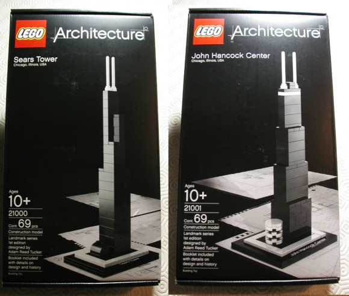
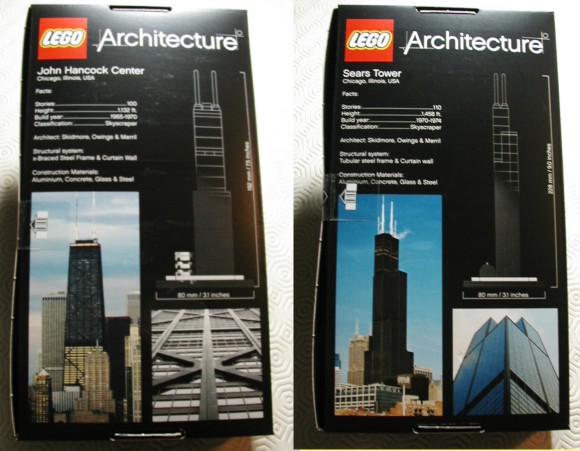
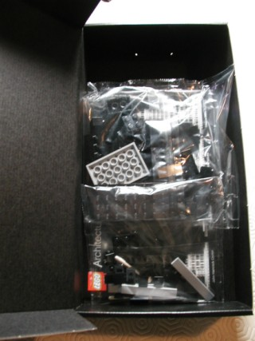
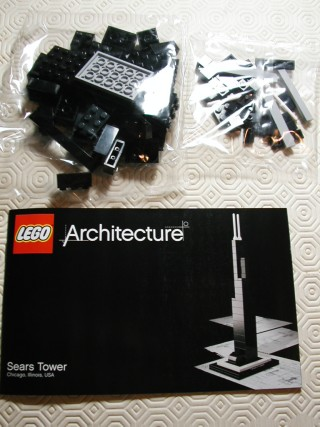
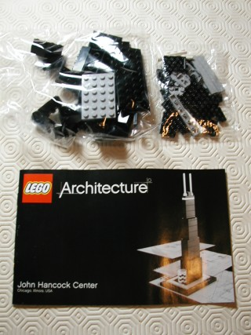
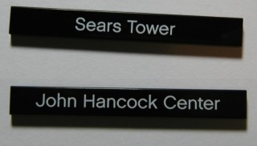
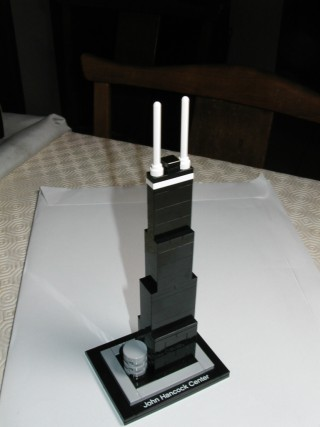
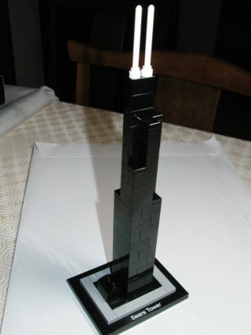

Les deux modèles 21000 - Sears Tower & 21001 - John Hancock Center ont été créés par Adam Reed Tucker, de [Brickstructures](http://www.brickstructures.com/).

Reproductions miniatures très épurées des immeubles [Sears Tower](http://fr.wikipedia.org/wiki/Sears_Tower) et [John Hancock Center](http://fr.wikipedia.org/wiki/John_Hancock_Center), ces deux boîtes sont commercialisées exclusivement aux Etats-Unis.

Vendues au prix unitaire de 22$, c’est grâce à un contact sur place que j’ai pu en commander un exemplaire de chaque. Cumulant les doubles frais d’envois, les deux boîtes me sont revenues à un total de 60$.

Alors, pour 60$, qu’avons-nous ?

## Les boîtes

Les deux boîtes sont parées d’un superbe habit noir, on voit que l’attention a été apportée à l’emballage.

Sur la face, image du modèle et nom du bâtiment. Sur le verso, descriptif du bâtiment réel.

Les boîtes s’ouvrent par le dessus qui est un couvercle à battant. Là encore, on découvre que même le carton est noir.

## Le contenu

Deux sachets pour chaque modèle, ainsi que la notice. La notice, à l’image de la boîte et finalement de la couleur des briques, est elle aussi noire. Le papier est de bonne facture type qualité photo, ce n’est pas le même que les notices traditionnelles.

Les deux premières pages présentent le bâtiment réel. Les suivantes la construction. On y trouve même l’inventaire des pièces. Les deux dernières pages présentent l’auteur des boîtes et le concept du LEGO en architecture.

Si le contenu en briques de ces boîtes est très classique, la présence de plaques lisses 1x8 sérigraphiées avec le nom du bâtiment donne tout le cachet de ces exclusivités.

La construction est on ne peut plus simple : 69 pièces de base à empiler dans chaque cas. La notice réduit certaines étapes répétitives.

Enfin, sur la dernière couverture, les dessins laissent deviner la forme des deux futurs modèles de la gamme, l’[Empire State Building](http://www.brickset.com/detail.aspx?Set=21002-1) et le [Seattle Space Needle](http://www.brickset.com/detail.aspx?Set=21003-1).

## Conclusion

Ce n’est évidemment pas pour le modèle en lui même que nous achèterons ces boîtes, mais bien la pièce de collection. L’attention portée à la qualité du produit et de son emballage ainsi que l’âge minimum indiqué (10 ans) et bien évidemment le prix élevé pour le faible nombre de pièces indiquent bien que ces modèles sont destinés à un public averti, collectionneur de LEGO ou amoureux d’architecture.
