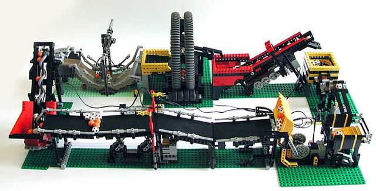

Goûter "Grand Bidule à Balles" chez Philo le Dimanche 5 Juin 2005.

Vous êtes tous cordialement invités à vous joindre à un goûter qui aura lieu le Dimanche 5 Juin 2005 chez Philo (Louvres, Val d’Oise).

Tous, oui, mais... **_ne sont invités que ceux et celles amenant un module_** (au moins !) à ajouter au "Grand Bidule à Balles" qui sera assemblé lors de cette rencontre.

## Modalités pratiques

**–** Rendez-vous chez moi vers 15h.  
**–** **[Merci de me prévenir](mailto:philohome2@free.fr)** de votre venue, je vous enverrai en retour coordonnées exactes, plan, etc...  
**–** Vous manquez de balles pour tester ? **[Contactez-moi](mailto:philohome2@free.fr)** également, il est possible de vous en prêter.

## Grand Bidule à Balles

Les spécifications du GBB se trouvent **[ici](http://www.freelug.org/article.php3?id_article=362)**.  
Pour mémoire, les points les plus importants à respecter sont (dans l’ordre) :  
**–** La taille du godet d’entrée (10 briques x 10 briques x 10 briques)  
**–** La sortie, qui doit pouvoir verser dans le panier d’entrée du module suivant  
**–** Le débit, de l’ordre de 1 balle par seconde. Si le débit de votre module n’est pas suffisant, la sanction n’est pas immédiate mais votre entrée va se remplir à ne plus savoir qu’en faire !

Il ne s’agit pas de faire quelque-chose de parfait, c’est plutôt une répétition pour le GBB officiel qui aura lieu cet été lors des "AFOL’s DAYS 2005"...

A bientôt,

Philo
