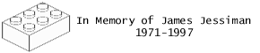

James Jessiman est l’auteur de LDraw, l’origine de tous les systèmes de CAO LEGO, de MLCad à LeoCAD... Il est décédé voici 10 ans, le 25 juillet 1997. A cette occasion, le comité de direction de LDraw organise un hommage à James. Voici la traduction de l’annonce.

Le 25 Juillet 1997, James Jessiman est décédé de suite à des complications de la grippe. Le LDraw Steering Committee souhaite commémorer le 10ème anniversaire de ce triste évènement par un hommage à James et à sa grande fondation. Nous vous invitons à envoyer l’image d’une :

"1 4 0 0 0 1 0 0 0 1 0 0 0 1 3002.dat"

(une Brique rouge 2x3 pour ceux qui ne sont pas des fans de CAO). Vos contributions seront réunies dans une galerie du site LDraw.

Si vous n’êtes pas à l’aise avec la radiosité ou les rendus haute résolution et que vos images sont directement issues de MLCad ce n’est pas un problème - nous acceptons toutes sortes de formats, croquis, dessins et même photos mais évidemment nous préférons des "LDraws". Par ailleurs, merci de ne pas dépasser une taille de 640x480 pixels. Le reste ne dépend que de vous, pas de suggestion ni de délai (ce serait toutefois préférable d’avoir vos contributions pour le 25 juillet). Vous pouvez aussi ajouter une brève dédicace à votre rendu du logo de LDraw.org.

Vos propositions doivent être envoyées aux webmestres en utilisant le sujet “LDraw - 10th anniversary”, à l’adresse suivante :

webmaster@#stop-au-spam#ldraw.org (ne pas oublier de supprimer l’anti-spam).

Les hommages des membres du SteerCo ont déjà été placés dans la galerie à cette adresse :  
[http://www.ldraw.org/Article472.html](http://www.ldraw.org/Article472.html)

Pour le LDraw Steering Committee,

Willy Tschager
