Cela fait déjà quelques années qu’un petit groupe d’AFOLs essaye de faire rouler le plus vite possible un train en LEGO. Cet article se propose de présenter tous les trains officiels ou proto qui ont roulé et sont classés sur la LGV.

## Les trains de la LGV

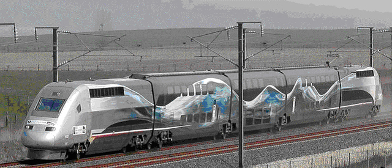

Cet article se propose de présenter tous les trains officiels ou proto qui ont roulé et sont classés sur la LGV.

Chaque train est présenté une seule fois avec son meilleur temps supérieur à 10 Km/h.

Vous pouvez consulter les derniers classements ici : [Le record du monde de vitesse d’un train LEGO : : 29,99 Km/h à Briqu’Expo Diemoz 2015](http://www.freelug.org/spip.php?article2119)

## Les officiels

* * *

**27,47 Km/h - AGV Italo** - _DanSto_

Fana’briques 2015

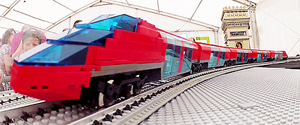

AGV Italo : inspiré de l’AGV rouge Italo de NTV ce train entièrement articulé et entièrement motorisé avec 6 moteurs . C’est un train léger à centre de gravité bas qui détient actuellement (en 2015) le record de vitesse dans sa catégorie.

Première sortie à Festibriques 2011 (meilleur temps de l’évènement dans sa catégorie).

* * *

**27,03 Km/h -LEGO 10233** - _Arnaud_

Briqu’Expo Diemoz 2015

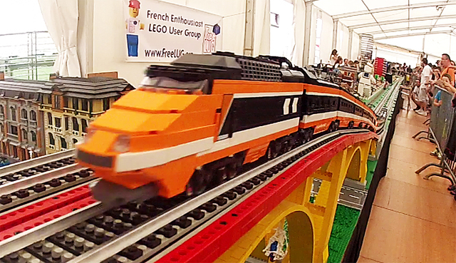

Train set Lego N° 10233 ’’Horizon Express’’ : sortie en 2013 et constitué d’une motrice et de 2 voitures. Set vendu non motorisé.  
Pour le record sur la LGV ce train est constitué de deux motrices et 3 voitures. le tout motorisé avec 4 moteurs 9 V.

* * *

**25,59 Km/h - LEGO 7897** -

Saint Rambert 2009

Train set Lego N° 7897 ’’passager train’’ : sortie en 2006 et constitué de 2 motrices et d’une voiture.

* * *

**25,07 Km/h - LEGO 4511** - _cdhd_

Briqu’Expo Diemoz 2013

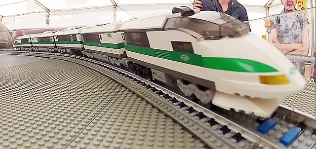

Train set Lego N° 4511 ’’High Speed Train’’ : sortie en 2003 et constitué d’une motrice avec 1 moteur 9V et d’une voiture.

La rame est constitué avec 3 boites officielles pour pouvoir faire un train de 5 éléments.  
La motorisation est faite par un moteur 9V à l’arrière de chaque motrice plus 2 moteurs 9V sur la voiture centrale soit 4 moteurs 9V en tout.

* * *

**22,90 Km/h - Lego 7898 - IEC1** - _Pierrolego_

Rail’Expo 2014

* * *

**22,60 Km/h - TGV Atlantique** - _Brikolego_

Briqu’Expo Diemoz 2015

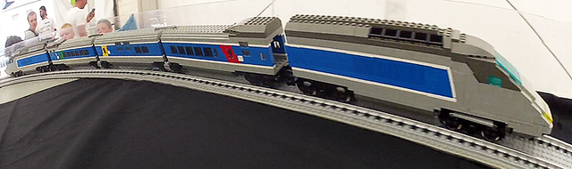

Train MOC.  
Motorisation avec 4 moteurs 9 V : deux sur chaque motrice.  
Particulatité : la liaison entre les voitures est faite par un élastique...

* * *

**21,13 Km/h - Shinkansen** - _DanSto_

Saint Rambert 2009

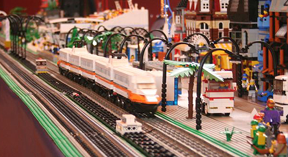

Shinkansen T700 ( [http://pic20.picturetrail.com/VOL1464/9580528/17445208/289467538.jpg](http://pic20.picturetrail.com/VOL1464/9580528/17445208/289467538.jpg) ) : Train conventionnel à 5 véhicules et 10 boggies inspiré de la série T700 avec sa jolie bande orange sur toute la longueur et ses ailerons de protection du pantographe.

Première sortie à Fana’briques 2008 avec 4 vieux moteurs. Dernière sortie à Saint-Rambert avec une motorisation de 4 à 10 moteurs neufs.

* * *

**20,42 Km/h - Thalys** - _DanSto_

Fana’briques 2010

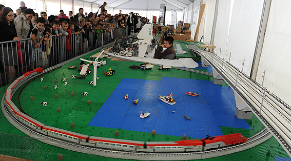

Thalys PBA : Train avec deux locos et de 3 à 8 véhicules articulés inspiré du Thalys première génération de couleur rouge et gris. Il a la particularité de bien respecter les proportions du train réel par habillage des boggies et l’utilisation de stickers pour les fenêtres.

Il est entièrement motorisé : 8 moteurs en version compétition et 13 moteurs en version commerciale.

Première sortie à Fana’briques 2010 (meilleur temps de l’évènement dans sa catégorie).

* * *

**19,87 Km/h - Thalys** - _Gerard S_

Fana’briques 2012

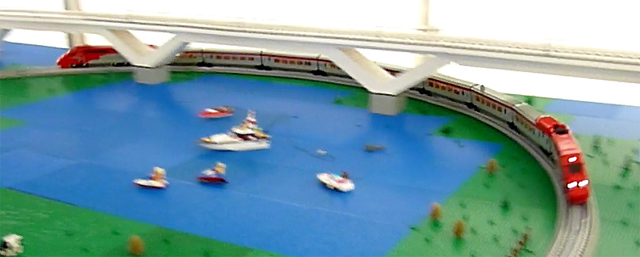

* * *

**19,31 Km/h - TGV 001** - _NICO_

Fana’briques 2008

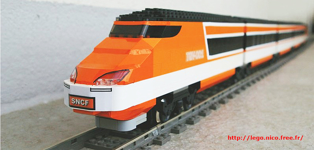

Train MOC. C’est le premier TGV prototype réel qui a roulé.

Tous les détails sont ici : [http://lego.nico.free.fr/lego-tgv-001.htm](http://lego.nico.free.fr/lego-tgv-001.htm)

* * *

**19,19 Km/h - TGV La poste** - _Thierry_

Fana’briques 2008

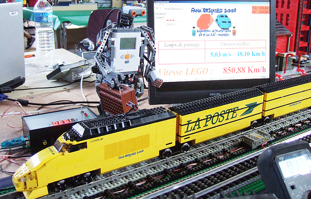

Train MOC

* * *

**18,81 Km/h - TGV Atlantique** - _Nicolas S_

Fana’briques 2008

* * *

**17,93 Km/h - TGV V150** - _NICO_

Fana’briques 2008

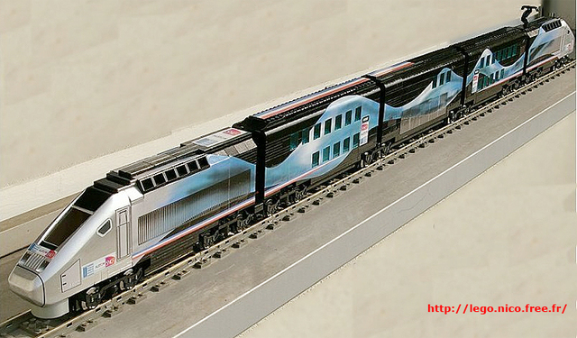

Train MOC.

Tous les détails sont ici : [http://lego.nico.free.fr/lego-4402.htm](http://lego.nico.free.fr/lego-4402.htm)

* * *

**17,45 Km/h - TGV HSBC** - _NICO_

Fana’briques 2008

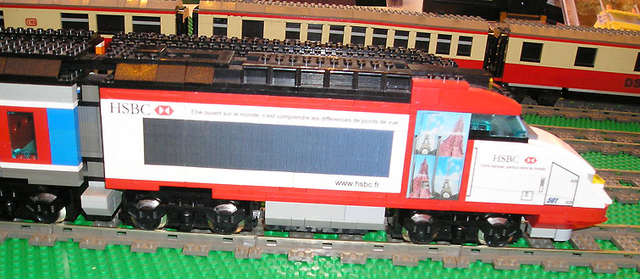

Train MOC.

Tous les détails sont ici : [http://lego.nico.free.fr/lego-tgv-hsbc.htm](http://lego.nico.free.fr/lego-tgv-hsbc.htm)

* * *

**15,76 Km/h - LEGO 60051**\-

Fana’briques 2015

* * *

## Les prototypes

* * *

**29,97 Km/h - TDM** - _DaunyLUG_

BrickExpo Diemoz 2015

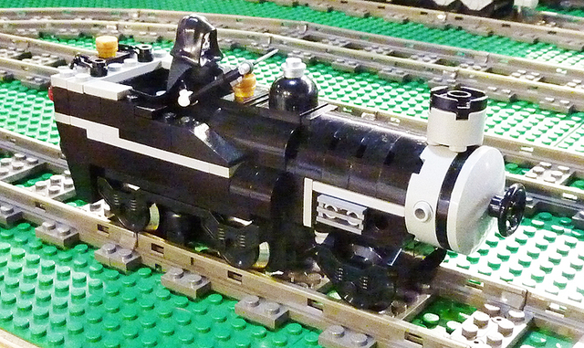

Suite au essais à Fanabrique 2015 avec le ProtoTono il est apparu plusieurs choses :

-   Avec seulement 1 moteur (2 essieux) le train saute trop et ne tient pas, même en ligne droite.
-   Si on rajoute un troisième essieux c’est mieux mais la rigidité du train pose des problèmes en virage (tenue de route) et transmet trop de vibration au moteur en ligne droite.
-   Les éléments extérieur (principalement en porte a faux) on tendance à amplifier les vibrations et à se détacher en route.
-   Le poids du train le pénalise en virage et diminue la vitesse de passage en virage.  
    J’ai donc choisi de faire un train minimaliste autour d’un moteur et d’un essieux avant amorti.  
    Ce train prend la forme d’une 030 de compétition d’une longueur de 20 tenons et 6 tenons de largueur.

La naissance du TDM ou Train De la Mort (qui tue) ce base sur 2 axiomes :  
**–** Les vrais fans de train le savent, il n’y a qu’un seul type de train qui compte et qui devrais exister : "Les trains à vapeur".  
**–** Qu’est ce qui fini par rattraper tous le monde même les plus rapide : "La mort"  
Donc battre un record inaccessible ne peut être fait que par la mort à bord d’un train à vapeur.

Reste à savoir qui pourra le battre ...

* * *

**29,81 Km/h - Space train V1** - _Jac_

Saint Rambert 2009

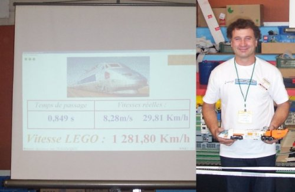

* * *

**29,68 Km/h - Proto Tono** - _DaunyLUG_

Fana’briques 2015

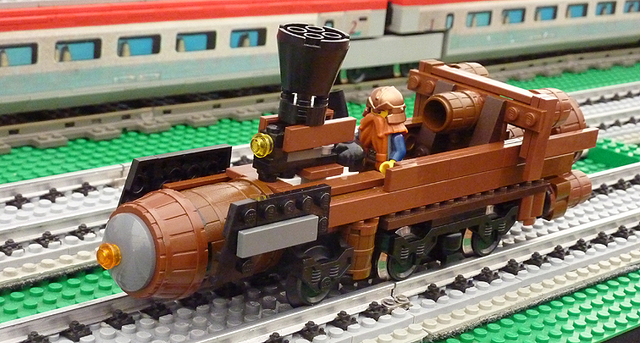

1 moteur 9V

* * *

**29,35 Km/h - Proto noir ailé** - _DanSto_

Fana’briques 2012

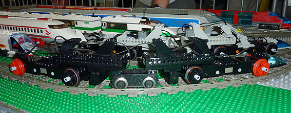

Proto noir articulé : Train prototype articulé à deux véhicules constitué de 2 locos motorisées RC à grandes roues et boggies double-moteur et un boggie central de prise de contact électrique dont il a permis de valider ce mode de motorisation.  
Première sortie à Fana’briques 2012.

Proto gris articulé : Train prototype articulé à deux véhicules constitué de 2 locos motorisées PFS à grandes roues et boggies double-moteur et un boggie central de prise de contact électrique dont il a permis de valider ce mode de motorisation.  
Première sortie à Fana’briques 2012 (meilleur temps de l’évènement dans sa catégorie).

* * *

**29,19 Km/h - Plasmazator II** - _CDHD_

Rail-Expo 2014

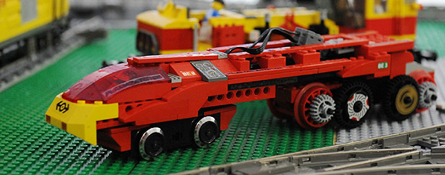

1 châssis de moteur 9V pour capter le courant et 1 moteur 9V PFS qui entraîne les roues via un train d’engrenages.

L’idée est de pouvoir augmenter la vitesse de rotation des roues pour aller plus vite.  
Mais cela augmente le couple moteur nécessaire et donne une mauvaise capacité de frein moteur.

Ce train est très léger et si l’on accélère trop fort ==> gros patinage des roues ...

* * *

**28,85 Km/h - La flèche double** - _Jac_

Brick Expo Diemoz 2013

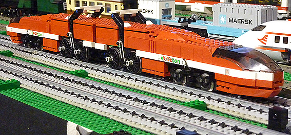

En fait, je voulais carément créé un train, mais pour le record, je ne faisait rouler que les motrices.

Longueur : 43 tenons, largeur 8 tenons à cause des blocages Technic et hauteur 10 briques, sur l’aileron.

Chaque motrice a son moteur PFS qui prends le courant sur des boggies 9V vidés. Tout est relié électriquement, c’est à dire que chaque moteurs prends le courant sur 2 boggies. Les boggies sont reliés à la caisse seulement par une plate trouée. Des élastiques servent de ressort pour maintenir les éléments en place. Les roues motrices sont les roues Lego de machine à vapeur, diamètre 3cm et poids d’une motrice : 400gr.

J’ai voulu faire une rame complète sur le principe des TGV, mais c’est un peu lourd pour faire des runs. Du coup, je n’ai fait rouler que les motrices. Les buts atteint étaient :

-   la forme avant profiler avec un montage solide, c’était le cas tout de même malgré les sorties de voies ;
-   Une forme globale assez basse, même avec des grandes roues ;
-   Une bonne tenue de voie malgré tout ;
-   Un châssis solide et une caisse en SNOT ;
-   Un look sympa malgré tout les branchements intérieurs.  
    Ce que j’ai raté avec ce train, le porte à fau avant qui a tendance à lancer le train hors des rails, merci Pierrick, je suis presque sur que c’est ça. Le système PFS est pas mal mais il faut maitriser le pilotage, le freinage est pratiquement inexistant.  
    Je ferais d’autres prototypes, j’ai des idées en tête. Je vais de toutes façons construire sur le même principe, chassis Technic et élastiques amortisseurs. Je pense que le système par 2 boggies est le mieux.

* * *

**28,51 Km/h - BBR** - _DanSto_

Fana’briques 2010

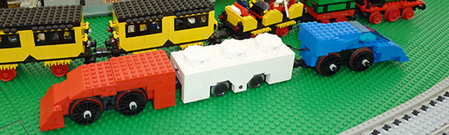

BBR (Bleu Blanc Rouge) : Train prototype à 3 véhicules constitué de 2 locos motorisées RC à grandes roues et une voiture centrale de prise de contact électrique dont il a permis de valider ce mode de motorisation.

Première (et unique) sortie à Fana’briques 2010 (meilleur temps de l’évènement dans sa catégorie).

* * *

**27,91 Km/h - La flèche** -

Fanabriques 2010

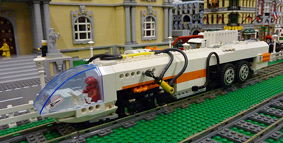

La Ligne Grande Longueur de Daniel me permet de tester un système anti roulis de caisse sur le boggie avant. Je n’atteindrai pas des vitesses mémorable, mais grâce à cette innovation, le train a beaucoup plus de fluidité dans le fonctionnement. Il passe en souplesse tous les raccords de rails, même à bonne vitesse en 18V.

Il n’y a plus qu’à attendre une prochaine installation de la LGV pour tester le passage sur les grandes courbes à dévers.

Mon prototype profilé blanc et orange en est à sa quatrième version. J’ai mis en route ce que j’avais de plus grand, en sachant qu’il fallait que ça passe avec l’empattement du boggie. J’ai trouvé des roues Technic à pneu. Il a fallu que je modifie tout le boggie pour qu’il ait un système de guidage sur les rails. Ce qui fait qu’il est un peu énorme, long et encombrant. Du coup le moteur est long à se lancer. Il est long aussi à freiner. La conduite est d’autant plus difficile et les gamelles étaient là, malgré les amortisseurs. De plus les pneus salissent prématurément les voies, ce qui va gêner énormément les autres trains.

[http://photos.freelug.org/main.php/v/JAC/MOC/Train/Proto-LGV/Version3/](http://photos.freelug.org/main.php/v/JAC/MOC/Train/Proto-LGV/Version3/)

[http://photos.freelug.org/main.php/v/JAC/MOC/Train/Proto-LGV/Version4/](http://photos.freelug.org/main.php/v/JAC/MOC/Train/Proto-LGV/Version4/)

* * *

**27,17 Km/h - Bat Train** - _MilkBrick_

Rail-Expo 2014

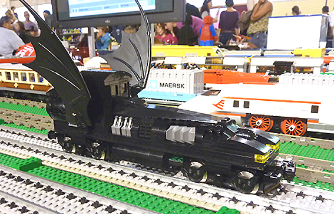

A la base un MOC pour délirer sur le thème : Batman a plein de Batappareils mais il n’a pas de bat-train, il faut réparer cette injustice.  
Il n’a jamais été conçu pour faire de la vitesse, mais sur la LGV il s’en est sorti avec les honneurs en obtenant un temps tout a fait honorable car le modèle a un centre de gravité assez bas ce qui fait qu’il tenait bien dans les courbes.  
Les 2 moteurs 9V sont également nécessaires.

Aucun run n’a pu être fait avec les ailes car elles sont hors gabarit LGV la plupart du temps.

Le lien vers le topic de presentation sur BrickPirate.  
[http://www.brickpirate.net/forum/phpBB3/viewtopic.php?f=69&t=11466](http://www.brickpirate.net/forum/phpBB3/viewtopic.php?f=69&t=11466)

* * *

**26,99 Km/h - Supo3000** - _Pierrolego_

Fana’briques 2015

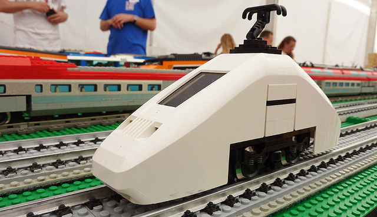

Un moteur 9 V.

1 moteur 9V Lego.

* * *

**26,94 Km/h - AGV-Proto1** - _DanSto_

Fana’briques 2015

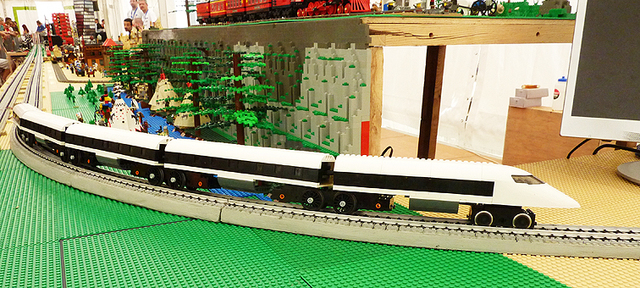

Proto AGV2 : Train entièrement articulé, motorisé avec 8 moteurs PFS associés par pair et dérivé de l’AGV. C’est un train léger à centre de gravité bas, avec deux prises de contact électrique, des pivots amortis et une puissante motorisation PFS.

Première (et unique) sortie à Fana’briques 2015.

* * *

**26,42 Km/h - Fusée** - _PierroLego_

Rail-Expo 2014

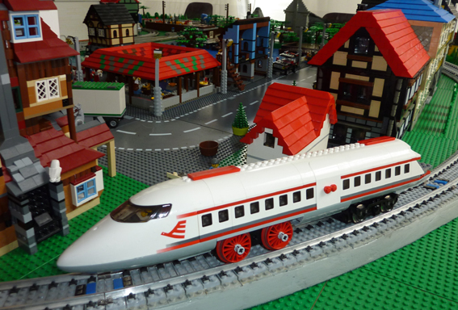

Un chassis de moteur 9V pour capter le courant et un moteur de traction PSF avec de grandes roues.

* * *

**25,76 Km/h - BuzzTrain** - _Yannick_

Rail-Expo 2014

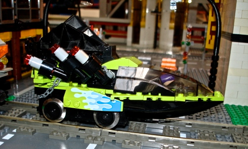

1 moteur 9V Lego.

* * *

**24,30 Km/h - EagleRed** - _mcrbe_

Briqu’Expo Diemoz 2015

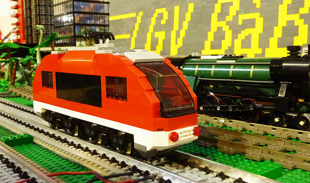

2 moteurs 9V Lego.

* * *

**22,05 Km/h - Gaston** - _MilkBrick_

Rail-Expo 2014

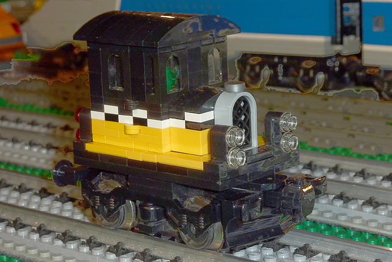

1 moteur 9V.

* * *

**19,74 Km/h - 1903 - Schnelltriebwagen** -

Fana’briques 2010

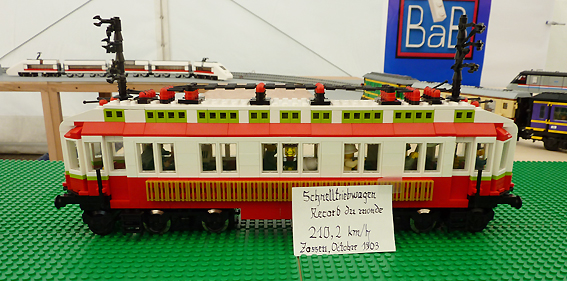

Train historique. Le 28 octobre 1903, elle roule à 210,200 km/h

2 moteurs 9V Lego

* * *

**17,55 Km/h - TER Auvergne** - _Zed\_43_

Briqu’Expo Diemoz 2015

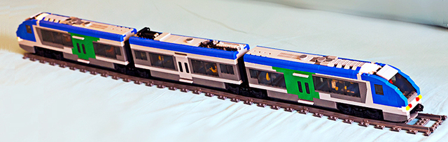

Rame TER : X 76500 encore nommée AGC (Autorail Grande Capacité) ou XCG.  
Il s’agit d’un train composé de 3 ou 4 caisses. Les versions auvergnates sont à motorisation diesel et transmission électrique et roulent sur les lignes Clermont-Ferrand - Roanne - Lyon ; Clermont-Ferrand - Aurillac ; Clermont-Ferrand - Gannat ; Clermont-Ferrand - Moulins - Dijon ; Clermont-Ferrand - Nîmes ; Clermont-Ferrand - Moulins - Nevers.

* * *

**17,24 Km/h - TramTaco** - _Nano_

Briqu’Expo Diemoz 2015

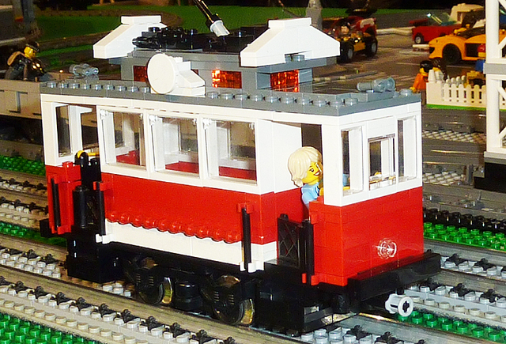

* * *

**16,70 Km/h - TurboJac** - _Jac_

Fana’briques 2010

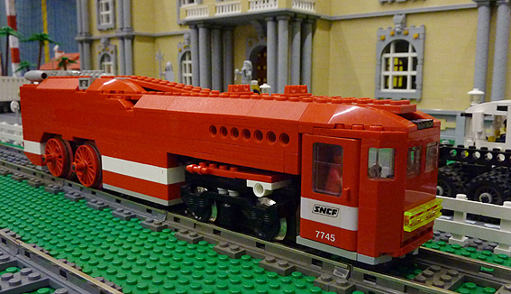

"A cette vitesse, faire profilé ne sert à rien". Ok je prends la chose au pied de la lettre et du coup voilà le deuxième prototype : "La flèche Auvergnate", rouge et blanc et tout plat devant. J’aurais pu faire encore plus plat, mais bon, je voulais qu’il soit esthétique, quand même. Malgré un aspect bien différent, la conception reste identique à la version 3 de mon premier prototype. En revanche, il est équipé d’un moteur de train PFS.

La fleche d’Auvergne

Très important, le freinage. On a beaucoup de mal à passer la courbe à vitesse "normale", car il est très difficile de ralentir le train une fois lancé. J’ai donc essayé de faire une sorte d’aéro-frein sur un côté du prototype. Le système était commandé par infrarouge grâce au capteur LEGO situé à l’arrière du train. Mais il s’est avéré que d’envoyer une impulsion au bon moment n’a pas été facile, de plus la pièce qui freinait le train n’était pas efficace. Heureusement, Xavier (Technicien d’alimentation de la LGV) avait rajouté un bouton permettant un freinage électrique.

[http://photos.freelug.org/main.php/v/JAC/MOC/Train/Proto-LGV/FlechDauvergne/](http://photos.freelug.org/main.php/v/JAC/MOC/Train/Proto-LGV/FlechDauvergne/)

* * *

**16,21 Km/h - Zeppelin Berlin-Hambourg** -

Fana’briques 2010

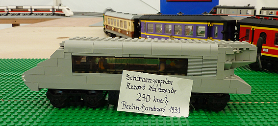

Train historique. Le Schienenzeppelin, c’est-à-dire Zeppelin sur rails, est un véhicule ferroviaire automoteur propulsé par hélice conçu par l’ingénieur Franz Kruckenberg en 1929.  
Ce Schienenzeppelin, que Kruckenberg qualifiait d’« aérotrain » (Flugbahn-Wagen), demeura un prototype. Avec 230,2 km/h, Le 21 juin 1931 il battit le record de vitesse sur rail, et le conserva 24 ans.

* * *

**13,77 Km/h - Plasmazator 1** - _cdhd_

Brick-Expo Diemoz 2013

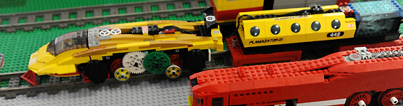

Un fourgon avec 2 châssis de moteur 9V pour capter le courant et sur la locomotive 4 moteurs buggy qui entraînent les roues via un train d’engrenages.  
L’idée est de pouvoir augmenter la vitesse de rotation des roues pour aller plus vite.  
Mais cela augmente le couple moteur nécessaire et donne une mauvaise capacité de frein moteur ...  
Ce train est relativement léger et si l’on accélère trop fort ==> gros patinage des roues ...  
En fait ce train est beaucoup trop motorisé et pas assez lourd.

* * *

**— Km/h - truc ?** - _DanSto_

Fana’briques 2010

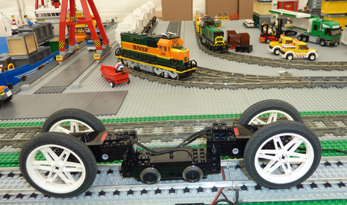

* * *

... et le vôtre prochainement ?

* * *

Articles connexes :  
[JAC - Trains prototypes pour la LGV](http://www.freelug.org/spip.php?article1232)

[Règlement V4 : record du monde de vitesse d’un train LEGO](http://www.freelug.org/spip.php?article2091)
